# Proyecto intermodular — Grupo Sevilla


<div align="center">
  
</div>

<div align="center">

**Grupo Sevilla SL**

</div>

**Curso:** 2026–2027  
**Ciclo:** 2.º ASIX  
**Fecha del documento:** 25 de septiembre de 2026  
**Repositorio:** [Grupo-Sevilla](https://github.com/AliChan-ai/Grupo-Sevilla)

---

## Índice

1. [Fase 1 · Práctica 1: Organización del grupo de trabajo](#fase-1--práctica-1-organización-del-grupo-de-trabajo)
   1. [Roles del grupo](#1-roles-del-grupo)
   2. [Herramientas y técnicas](#2-herramientas-y-técnicas)
   3. [Repositorio de documentación](#3-repositorio-de-documentación)
   4. [Bitácora](#4-bitácora)
2. [Fase 1 · Práctica 2: Instalación y configuración de Proxmox y VLANs](#fase-1--práctica-2-instalación-y-configuración-de-proxmox-y-vlans)
   1. [Instalar y poner en funcionamiento Proxmox](#1-instalar-y-poner-en-funcionamiento-proxmox)
   2. [Direcciones IP y redes VLAN](#2-direcciones-ip-y-redes-vlan)
   3. [Conexión al Cisco 3560 mediante consola](#3-conexión-al-cisco-3560-mediante-consola)
   4. [Configuración de VLANs en el Cisco 3560](#4-configuración-de-vlans-en-el-cisco-3560)
   5. [Interfaces VLAN (SVI)](#5-interfaces-vlan-svi)
   6. [Configuración de los puertos del switch](#6-configuración-de-los-puertos-del-switch)
3. [Práctica 3: Despliegue de los equipos del laboratorio](#práctica-3-despliegue-de-los-equipos-del-laboratorio)
   1. [Esquema de conexión en la VLAN 310](#1-esquema-de-conexión-en-la-vlan-310)
   2. [Requisitos de los equipos](#2-requisitos-de-los-equipos)
   3. [Tarea 1: Diseño del particionado](#3-tarea-1-diseño-del-particionado)
   4. [Tarea 2: Instalación del servidor](#4-tarea-2-instalación-del-servidor)
   5. [Tarea 3: Verificación después de la instalación](#5-tarea-3-verificación-después-de-la-instalación)
   6. [Instalación de los clientes Linux Mint](#6-instalación-de-los-clientes-linux-mint)
4. [Práctica 4: Despliegue de servicios con Windows Server](#práctica-4-despliegue-de-servicios-con-windows-server)
   1. [Tarea 1: Planificación de la infraestructura](#1-tarea-1-planificación-de-la-infraestructura)
   2. [Tarea 2: Instalación de Windows Server 2025](#2-tarea-2-instalación-de-windows-server-2025)
   3. [Tarea 3: Configuración del almacenamiento](#3-tarea-3-configuración-del-almacenamiento)
   4. [Tarea 4: Configuración TCP/IP del servidor](#4-tarea-4-configuración-tcpip-del-servidor)
   5. [Tarea 5: Servicio DHCP en Windows Server](#5-tarea-5-servicio-dhcp-en-windows-server)
   6. [Tarea 6: DHCP no autorizado y DHCP Snooping](#6-tarea-6-dhcp-no-autorizado-y-dhcp-snooping)
5. [Incidencias y soluciones](#incidencias-y-soluciones)
6. [Tareas pendientes](#tareas-pendientes)

---

# Fase 1 · Práctica 1: Organización del grupo de trabajo

Antes de empezar el proyecto, organizamos el grupo de trabajo: repartimos los roles, elegimos las herramientas, creamos el repositorio de documentación con su bitácora y publicamos el enlace de acceso.

## 1. Roles del grupo

El grupo tiene seis integrantes repartidos en tres roles. Cada rol lo ocupan **dos personas**: así, como pide el enunciado, siempre hay un suplente si el titular no está en clase, y además nos apoyamos entre nosotros. El reparto lo acordamos entre todos en la primera sesión.

| Rol | Integrantes | Funciones |
|---|---|---|
| **Jefe de proyecto** | Yeray Mico · Sharaf El Mahfoudi | Coordinar el grupo y la sede, coordinar las exposiciones y justificar las decisiones del grupo |
| **Secretario** | Hamza Souiad · Ali Slatna | Redactar las actas, coordinar la documentación de cada integrante, mantener la bitácora semanal y hacer las entregas |
| **Responsable técnico** | Jhoel Fuentes · Raul Llorca | Gestionar las herramientas de trabajo y llevar el inventario del hardware y el software cedido por el centro |

## 2. Herramientas y técnicas

| Necesidad | Herramienta |
|---|---|
| Repositorio de documentación | GitHub |
| Documentación y bitácora | Markdown |
| Gestión del proyecto y reparto de tareas | [Trello](https://trello.com/b/ZamItCqc/grupo-sevilla) |
| Diagramas | *Pendiente de completar* |
| Comunicación del grupo | *Pendiente de completar* |

## 3. Repositorio de documentación

Enlace de acceso: **https://github.com/AliChan-ai/Grupo-Sevilla**

| Elemento | Ubicación |
|---|---|
| Documento del proyecto | `Documentacion/` |
| Recursos a entregar (imágenes, configuraciones, scripts) | `Recursos/` |
| Panel de gestión del proyecto | [Tablero de Trello](https://trello.com/b/ZamItCqc/grupo-sevilla) |
| Bitácora | `Bitacora/` |

En cada entrega, el secretario hace un commit con el nombre de la práctica (por ejemplo, `Fase 1 Práctica 2`) y sube a Aules el enlace a ese commit.

## 4. Bitácora

Llevamos dos registros en Markdown, en **orden cronológico inverso** (primero la entrada más reciente):

- **Registro diario** (`Bitacora/Diario/`): un fichero por integrante. Cada uno añade una entrada al terminar cada sesión, con el objetivo del día, lo que ha hecho, lo que ha conseguido y lo que no ha conseguido y por qué.
- **Registro semanal** (`Bitacora/Semanal.md`): el secretario resume al final de cada semana el objetivo del grupo, lo conseguido y lo que no se ha conseguido y por qué.

---

# Fase 1 · Práctica 2: Instalación y configuración de Proxmox y VLANs

Tenemos que preparar el servidor de la sede para poder virtualizar varios servidores y clientes. Para ello, utilizaremos Proxmox.

## 1. Instalar y poner en funcionamiento Proxmox

Primero, vamos a instalar Proxmox VE en nuestro servidor para poder crear y gestionar máquinas virtuales.

### Pasos para arrancar desde un USB

1. Conectamos el USB que contiene el instalador de Proxmox al servidor.
2. Encendemos o reiniciamos el servidor y entramos en la BIOS/UEFI pulsando la tecla correspondiente (normalmente F2, F12, DEL o ESC).
3. Entramos en el menú **Boot** y seleccionamos el USB como dispositivo de arranque. Elegimos la entrada que empieza por **UEFI:** para que la instalación se haga en modo UEFI.
4. Guardamos los cambios y reiniciamos el servidor si es necesario.
5. Cuando arranque desde el USB, aparecerá el menú de instalación de Proxmox.
6. Seleccionamos **Install Proxmox VE** para comenzar con la instalación.

<p align="center">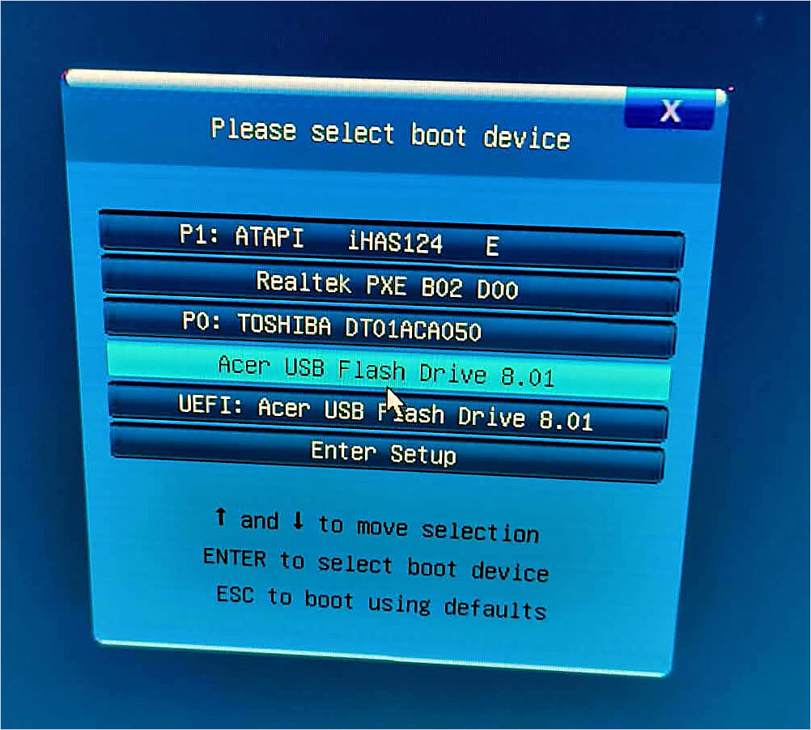</p>

Una vez iniciado el instalador de Proxmox, aparecerá el acuerdo de licencia (EULA). Lo leeremos y aceptaremos para poder continuar con la instalación.

<p align="center"></p>

A continuación, el instalador nos pedirá configurar la cuenta de administrador. Tendremos que introducir un correo electrónico y crear una contraseña segura que utilizaremos para acceder a Proxmox. Es importante guardar estos datos para poder iniciar sesión más adelante.

<p align="center">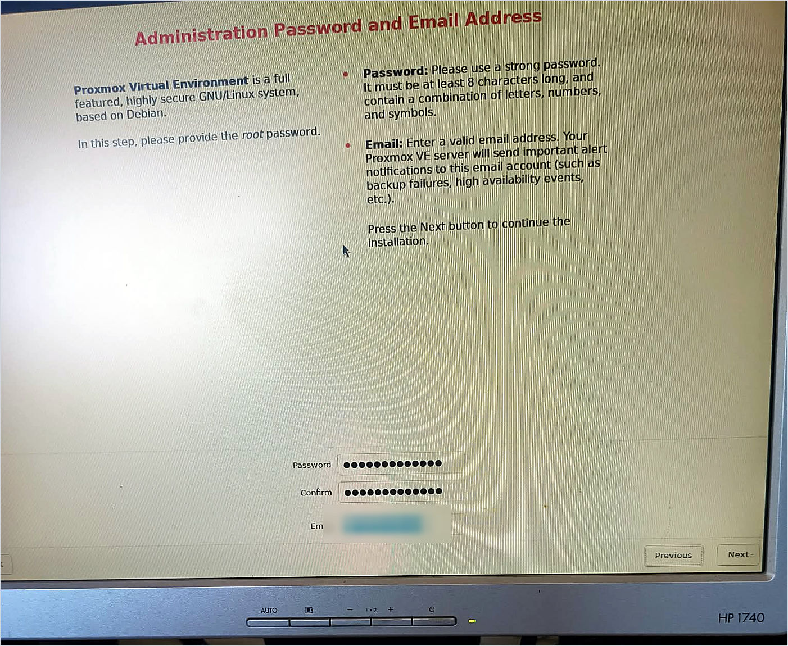</p>

Después, configuraremos la dirección IP del servidor para que tenga conectividad con los otros ordenadores de la red. También indicaremos la máscara de red, la puerta de enlace y el servidor DNS para asegurarnos de que la conexión funcione correctamente.

<p align="center">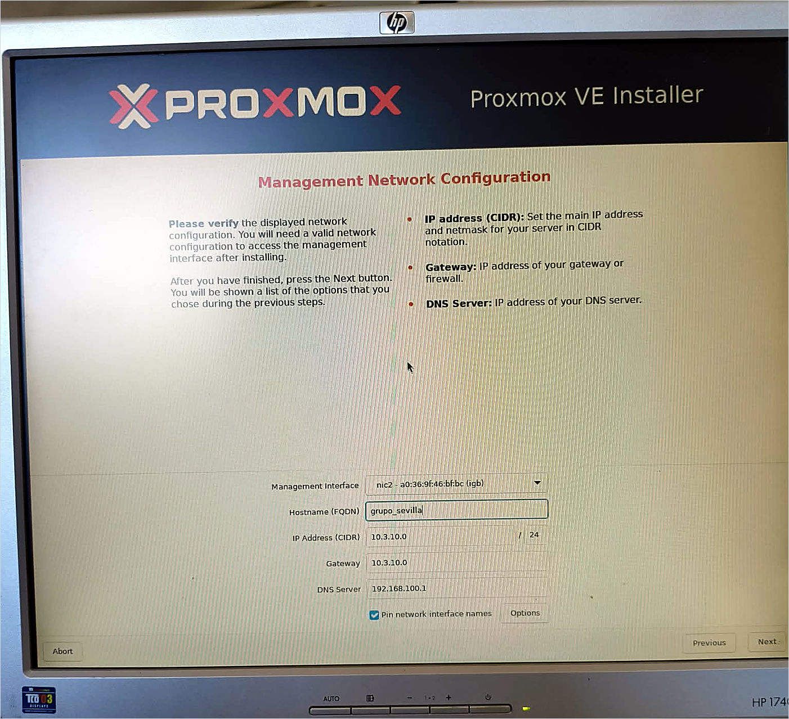</p>

Por último, revisaremos el resumen de la configuración para comprobar que todos los datos sean correctos. Si todo está bien, pulsaremos **Install** para comenzar la instalación de Proxmox. Esperaremos a que termine y, una vez finalizada, reiniciaremos el servidor para empezar a utilizarlo.

<p align="center">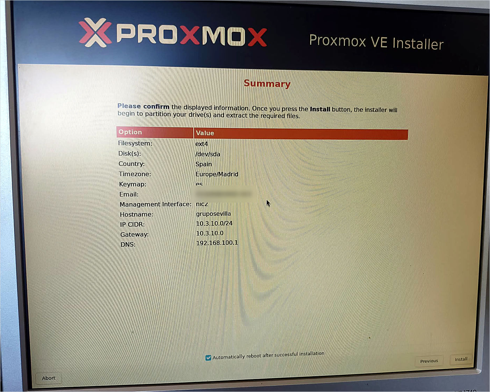</p>

> **Nota:** en el resumen del instalador aparecen como IP `10.3.10.0/24` y como puerta de enlace `10.3.10.0`, que es la dirección de red y no una dirección válida para un equipo. Después lo corregimos en `/etc/network/interfaces`: el puente `vmbr0` quedó con la IP `10.3.10.2/24` y la puerta de enlace `10.3.10.1` (ver Práctica 4, Tarea 4).

## 2. Direcciones IP y redes VLAN

Según el diagrama, nuestra sede utiliza la red `10.3.0.0/16` y tiene las siguientes VLAN:

| VLAN | Departamento | Red | Puerta de enlace (switch) |
|---:|---|---|---|
| 310 | Servidores | `10.3.10.0/24` | `10.3.10.1` |
| 320 | RRHH | `10.3.20.0/24` | `10.3.20.1` |
| 330 | Dirección | `10.3.30.0/24` | `10.3.30.1` |
| 399 | Gestión | `10.3.99.0/24` | `10.3.99.1` |

## 3. Conexión al Cisco 3560 mediante consola

Primero, tendremos que instalar PuTTY en nuestro ordenador cliente. Este programa nos permitirá conectarnos al switch Cisco 3560 mediante una conexión por consola y ejecutar los comandos necesarios para configurarlo.

```bash
sudo apt install putty
```

<p align="center">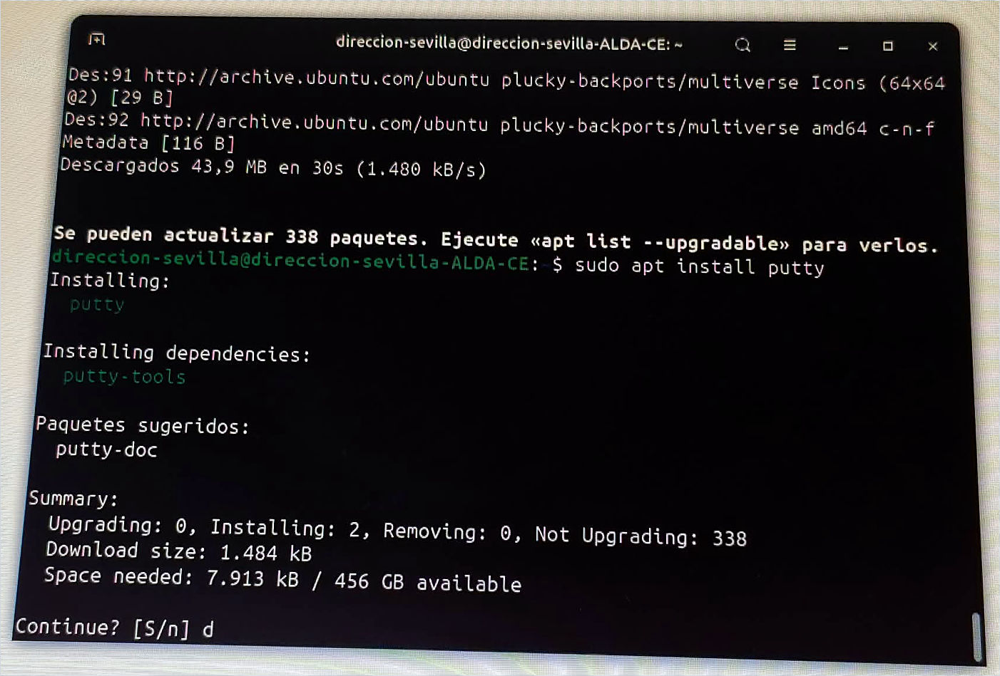</p>

Una vez instalado PuTTY, conectaremos el cable de consola entre el ordenador y el switch. Después, abriremos el programa, seleccionaremos el tipo de conexión **Serial** e indicaremos el puerto correspondiente. En el primer intento usamos el puerto serie integrado `/dev/ttyS0`.

<p align="center">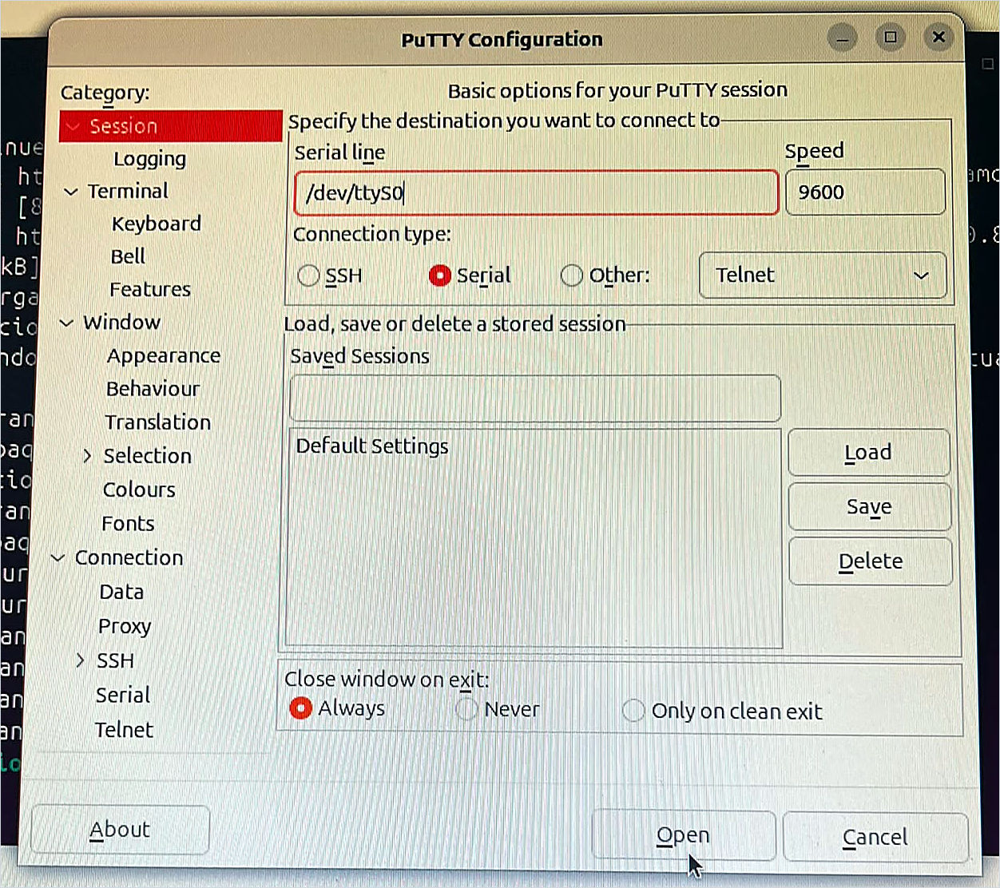</p>

Antes de conectar el switch Cisco 3560 al ordenador, identificaremos dónde se encuentra el puerto serial o de consola. El cable de consola se conecta mediante un adaptador **USB–serie**, así que buscamos en los mensajes del sistema qué nombre le ha dado:

```bash
sudo dmesg | grep tty
```

La salida muestra que el adaptador **FTDI USB Serial Device** se ha conectado como **`ttyUSB0`**, así que ese es el puerto que tenemos que usar en PuTTY, y no `ttyS0`.

<p align="center">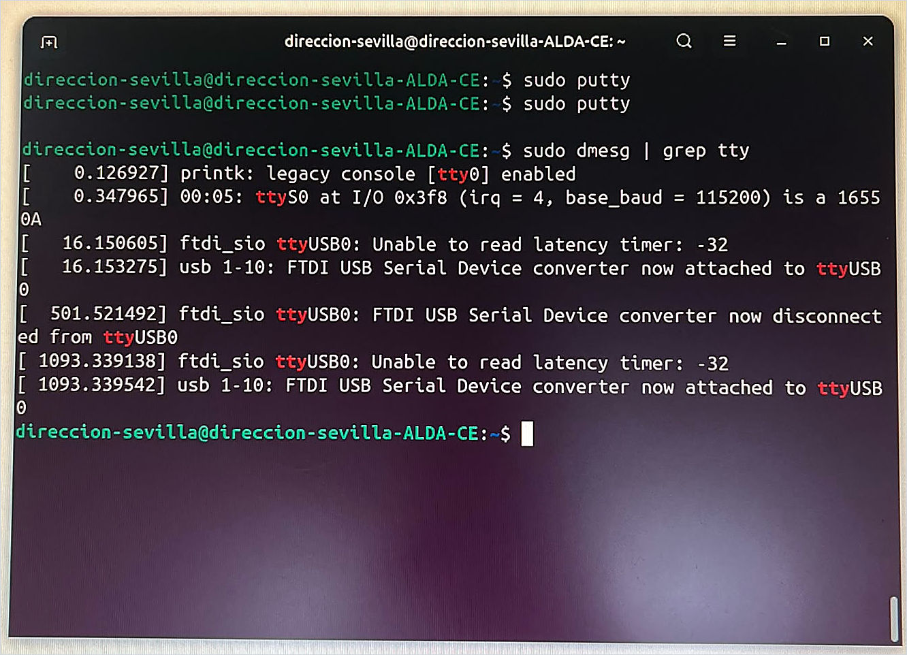</p>

## 4. Configuración de VLANs en el Cisco 3560

Primero, entraremos en el modo de configuración del switch utilizando el comando:

```text
conf t
```

Luego, crearemos las VLAN necesarias y asignaremos un nombre a cada una para identificar los diferentes departamentos de la sede de Sevilla.

```text
vlan 310
 name SERVIDOR-Sevilla
exit
vlan 320
 name RRHH-Sevilla
exit
vlan 330
 name DIRECCION-Sevilla
exit
vlan 399
 name GESTION-Sevilla
```

<p align="center">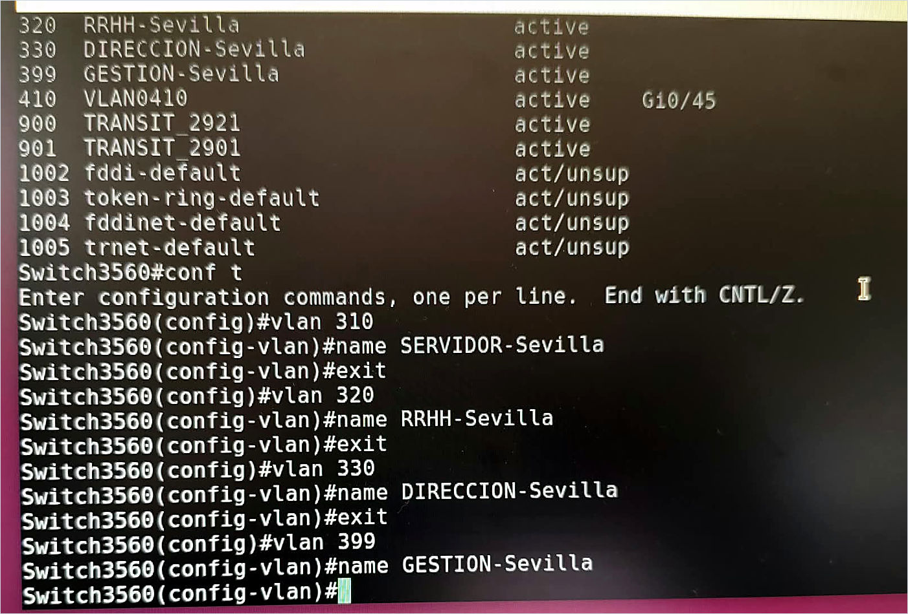</p>

A continuación, veremos las VLAN y las interfaces del switch Cisco 3560 con `show vlan brief`. Esta información nos permitirá identificar los puertos que utilizaremos para conectar el servidor Proxmox y los futuros equipos, y así poder asignar cada puerto a la VLAN correspondiente. Las cuatro VLAN aparecen en estado **active**; como el switch es compartido en el laboratorio, también salen las VLAN de otros grupos.

<p align="center">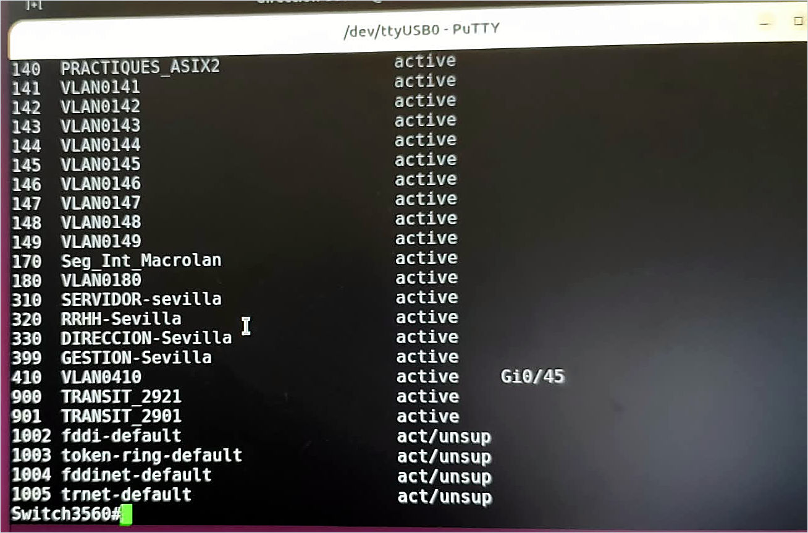</p>

En esta imagen podemos ver la configuración de PuTTY que utilizamos para conectarnos al switch Cisco 3560 mediante el puerto serial. Seleccionamos el tipo de conexión **Serial**, indicamos el puerto `/dev/ttyUSB0` y establecemos una velocidad de **9600 baudios**. Guardamos la configuración como la sesión **SEVILLA** para no tener que escribirla cada vez.

<p align="center">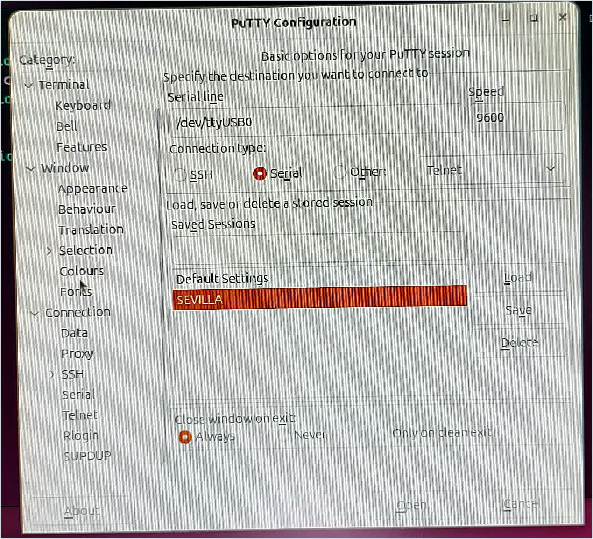</p>

Una vez configurados estos parámetros, pulsamos **Open** para acceder a la consola del switch. Desde allí, continuamos con la configuración de las VLAN que habíamos creado anteriormente y añadimos las que todavía faltaban.

Una vez conectados al switch Cisco 3560 mediante PuTTY, configuramos las VLAN necesarias para la sede de Sevilla. Para ello, entramos en el modo de configuración global con el comando `conf t` y creamos cada VLAN con su número, nombre y red IP correspondiente:

- **VLAN 310 — Servidores:** `10.3.10.0/24`
- **VLAN 320 — RRHH:** `10.3.20.0/24`
- **VLAN 330 — Dirección:** `10.3.30.0/24`
- **VLAN 399 — Gestión:** `10.3.99.0/24`

> **Nota:** las redes indicadas documentan el esquema IP de cada VLAN. La creación de una VLAN en el switch no configura por sí sola una dirección IP ni el enrutamiento de esa red. Por eso, en el siguiente apartado configuramos una interfaz VLAN para cada una.

## 5. Interfaces VLAN (SVI)

Para que el switch tenga una dirección IP en cada red y actúe como puerta de enlace de cada departamento, creamos una **interfaz VLAN (SVI)** por VLAN, le asignamos su IP y la activamos con `no shutdown`:

```text
interface vlan 310
 ip address 10.3.10.1 255.255.255.0
 no shutdown
exit
interface vlan 320
 ip address 10.3.20.1 255.255.255.0
 no shutdown
exit
interface vlan 330
 ip address 10.3.30.1 255.255.255.0
 no shutdown
exit
interface vlan 399
 ip address 10.3.99.1 255.255.255.0
 no shutdown
```

<p align="center">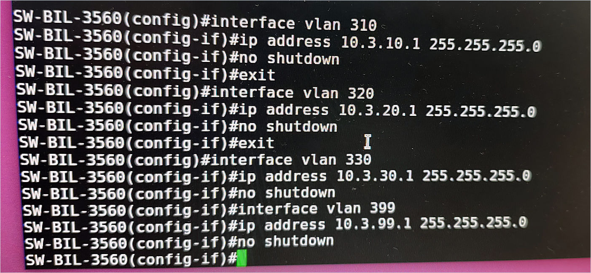</p>

> **Nota:** en una primera sesión pusimos `10.3.99.2` en la VLAN 399. Después la cambiamos a `10.3.99.1` para que todas las VLAN sigan el mismo criterio (la `.1` es la puerta de enlace).

## 6. Configuración de los puertos del switch

**Puerto Gi0/22 (servidor Proxmox) en modo trunk.** El puerto del servidor Proxmox lo configuramos como **trunk 802.1Q**, con la VLAN 310 como nativa y las cuatro VLAN permitidas. Así Proxmox sigue estando en la VLAN 310, y además las máquinas virtuales pueden conectarse a cualquiera de las otras VLAN.

```text
interface gi0/22
 switchport trunk encapsulation dot1q
 switchport mode trunk
 switchport trunk native vlan 310
 switchport trunk allowed vlan 310,320,330,399
```

<p align="center">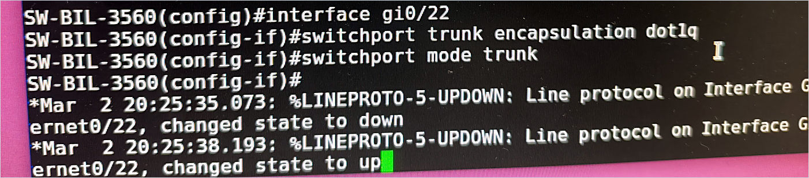</p>
<p align="center">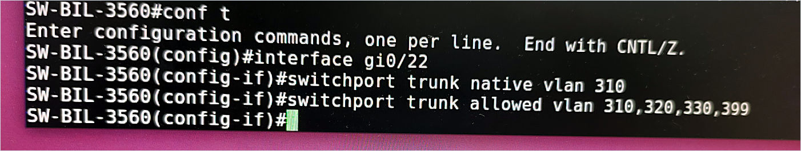</p>

**Puertos Gi0/23 (VLAN 310) y Gi0/25 (VLAN 320) en modo access.** El ordenador cliente se conecta a Gi0/23, en la VLAN 310. Gi0/25 queda en la VLAN 320 (RRHH). En los dos activamos **PortFast** para que el puerto pase a funcionar en cuanto se conecta el equipo, sin esperar a Spanning Tree.

```text
interface gi0/23
 switchport mode access
 switchport access vlan 310
 spanning-tree portfast
exit
interface gi0/25
 switchport mode access
 switchport access vlan 320
 spanning-tree portfast
```

<p align="center">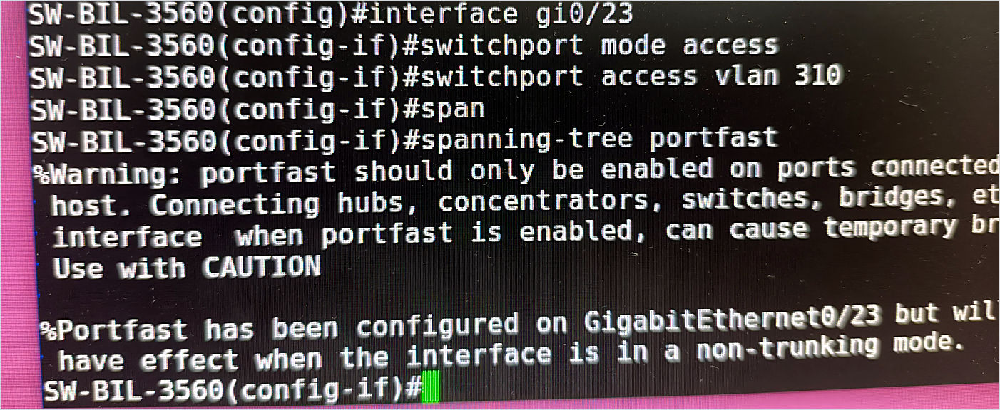</p>
<p align="center">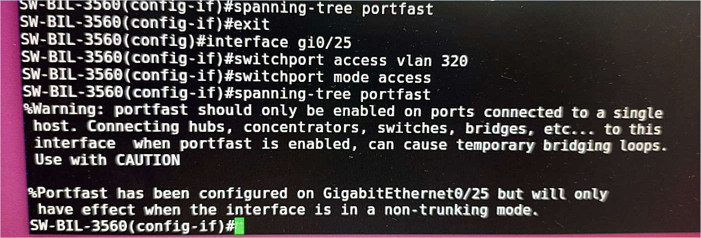</p>

---

# Práctica 3: Despliegue de los equipos del laboratorio

Esta fase corresponde a la **Práctica 3: Despliegue de equipos del laboratorio**. Con Proxmox instalado y las VLAN configuradas en el switch, desplegamos los equipos del laboratorio del grupo:

1. Un **servidor virtualizado** con Ubuntu Server LTS, instalado en modo UEFI y con el sistema, el arranque, los datos de los usuarios y la swap en discos separados.
2. Un **cliente Linux virtualizado** con Linux Mint.
3. Un **cliente Linux físico** con Linux Mint, instalado en el equipo asignado al grupo.

### ¿Por qué separamos el sistema en varios discos?

Siguiendo las recomendaciones de LPIC-1 (objetivo 102.1), instalar Linux en un único disco o en una única partición raíz (`/`) es una mala práctica en un servidor de producción. Separar el árbol de directorios en discos y particiones independientes aporta:

- **Aislamiento de fallos:** si `/home` o `/var` se llenan, la raíz (`/`) sigue funcionando y el sistema no se bloquea por falta de espacio.
- **Rendimiento y tolerancia a fallos:** cada directorio puede estar en un disco de tecnología distinta o en RAID (por ejemplo, el sistema en SSD y los datos de usuarios en discos de mayor capacidad).
- **Seguridad:** cada partición se puede montar en `/etc/fstab` con opciones restrictivas como `noexec`, `nosuid` o `nodev`.
- **Actualizaciones independientes:** se puede reinstalar o migrar el sistema en `/` sin tocar los datos de los usuarios en `/home`.

## 1. Esquema de conexión en la VLAN 310

Antes de entrar en Proxmox, planificamos en la pizarra cómo se conectan los equipos dentro de la VLAN 310 (Servidores, red `10.3.10.0/24`):

| Equipo | Puerto del 3560 | Modo | Dirección IP |
|---|---|---|---|
| Switch Cisco 3560 (interfaz de la VLAN 310) | — | — | `10.3.10.1` |
| Servidor Proxmox | `0/22` | Trunk 802.1Q, VLAN nativa 310 | `10.3.10.2/24` |
| Ordenador cliente (host PC) | `0/23` | Access, VLAN 310 | `10.3.10.3/24` |

En la pizarra planificamos los dos puertos en modo **access** dentro de la VLAN 310. Al final, el puerto de Proxmox (`0/22`) lo configuramos como **trunk** con VLAN nativa 310 (ver Práctica 2, apartado 6): el servidor Proxmox y el ordenador cliente siguen en la misma red y pueden comunicarse. Dentro de Proxmox se alojarán las máquinas virtuales de los servidores (S1, S2…).

<p align="center">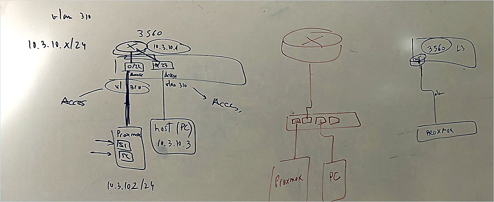</p>

## 2. Requisitos de los equipos

| Equipo | Sistema operativo | Firmware | Almacenamiento |
|---|---|---|---|
| Servidor (virtual, en Proxmox) | Ubuntu Server LTS (24.04.1) | UEFI obligatorio | 4 discos independientes |
| Cliente virtual (en Proxmox) | Linux Mint | UEFI o BIOS | 1 disco, particionado estándar |
| Cliente físico (equipo del grupo) | Linux Mint | UEFI o BIOS | 1 disco, particionado estándar |

## 3. Tarea 1: Diseño del particionado

Antes de iniciar el instalador, diseñamos el particionado del servidor. En Proxmox los discos de la máquina se conectan al controlador VirtIO SCSI, así que dentro de Ubuntu aparecen como `/dev/sda`, `/dev/sdb`, `/dev/sdc` y `/dev/sdd`.

| Disco | Disco en Proxmox | Dispositivo en Ubuntu | Tamaño del disco | Partición | Tamaño | Sistema de ficheros | Punto de montaje | Uso |
|---|---|---|---|---|---|---|---|---|
| Disco 1 | `scsi0` | `/dev/sda` | 1,5 GB | `/dev/sda1` | 538 MB | vfat (FAT32) | `/boot/efi` | Partición de sistema EFI, al principio del disco |
| Disco 1 | `scsi0` | `/dev/sda` | 1,5 GB | `/dev/sda2` | Resto (986 MB) | ext4 | `/boot` | Núcleo Linux e initramfs |
| Disco 2 | `scsi1` | `/dev/sdb` | 10 GB | `/dev/sdb1` | 10 GB (todo el disco) | swap | — | Memoria de intercambio |
| Disco 3 | `scsi2` | `/dev/sdc` | 20 GB | `/dev/sdc1` | 20 GB (todo el disco) | ext4 | `/` | Sistema base |
| Disco 4 | `scsi3` | `/dev/sdd` | 30 GB | `/dev/sdd1` | 30 GB (todo el disco) | ext4 | `/home` | Datos de los usuarios |

> Los nombres `/dev/sdX` siguen el orden de los discos en Proxmox; se confirman con `lsblk` en la Tarea 3.

**Justificación del diseño:**

- **`/boot/efi` en vfat:** el firmware UEFI solo sabe leer particiones FAT, por eso la partición EFI tiene que ser FAT32 y estar al principio del disco 1.
- **`/boot` en ext4:** solo guarda el núcleo y el initramfs, que son ficheros estáticos. Tenerlo aparte asegura que el sistema pueda arrancar aunque haya problemas en `/`.
- **`/` y `/home` en ext4:** ext4 es el sistema de ficheros por defecto de Ubuntu, es estable y tiene journaling. Cada uno ocupa su disco entero, así que los datos de los usuarios quedan aislados del sistema.
- **swap en un disco propio:** la memoria de intercambio no compite por espacio ni por accesos con el sistema ni con los datos.

> **Nota sobre el disco 1:** la práctica pide un disco de 1 GB con la partición EFI (mínimo recomendado de 512 MB) y `/boot` (1 GB). Las dos juntas no caben en 1 GB, así que creamos el disco 1 con **1,5 GB**: 538 MB para la partición EFI y el resto (986 MB, prácticamente 1 GB) para `/boot`.

Los clientes Linux Mint se instalan con el **particionado estándar** que propone el instalador, en un único disco.

## 4. Tarea 2: Instalación del servidor

### 4.1. Acceso a la interfaz web de Proxmox

Desde el ordenador cliente abrimos el navegador y accedemos a la interfaz web de Proxmox escribiendo la IP del servidor y el puerto `8006`:

```text
https://10.3.10.2:8006
```

El navegador mostrará un aviso de certificado, porque Proxmox utiliza un certificado autofirmado. Lo aceptamos para continuar. En la pantalla de inicio de sesión introducimos el usuario `root`, la contraseña que definimos durante la instalación y el dominio **Linux PAM standard authentication**, y pulsamos **Login**.

<p align="center">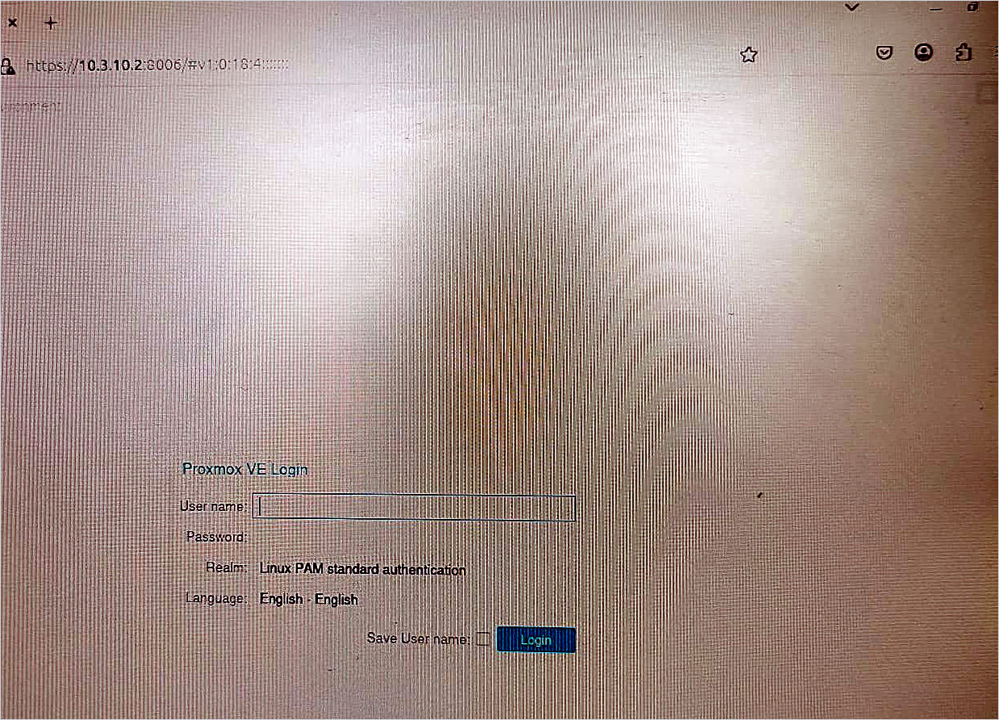</p>

Una vez dentro, vemos el panel **Datacenter** con nuestro nodo `gruposevilla` y sus almacenamientos: `local` (ISO, plantillas y copias de seguridad) y `local-lvm` (discos de las máquinas virtuales).

<p align="center">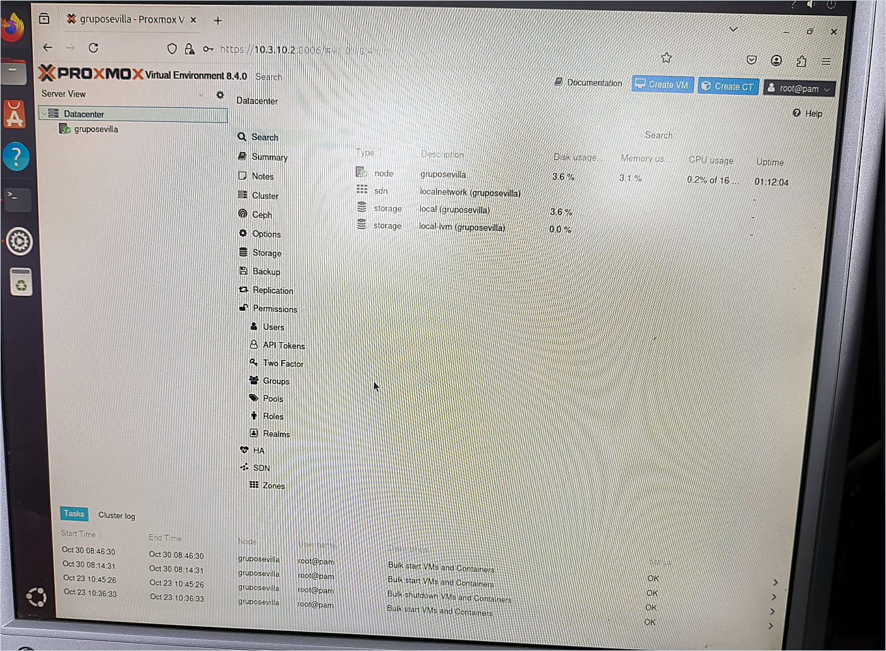</p>

### 4.2. Subir la imagen ISO de Ubuntu Server

Para instalar un sistema operativo en una máquina virtual necesitamos su imagen ISO dentro de Proxmox. Para ello, seleccionamos el almacenamiento **local (gruposevilla)**, entramos en **ISO Images** y pulsamos **Upload**. Elegimos el archivo `ubuntu-24.04.1-live-server-amd64.iso` desde el ordenador y pulsamos **Upload**.

<p align="center">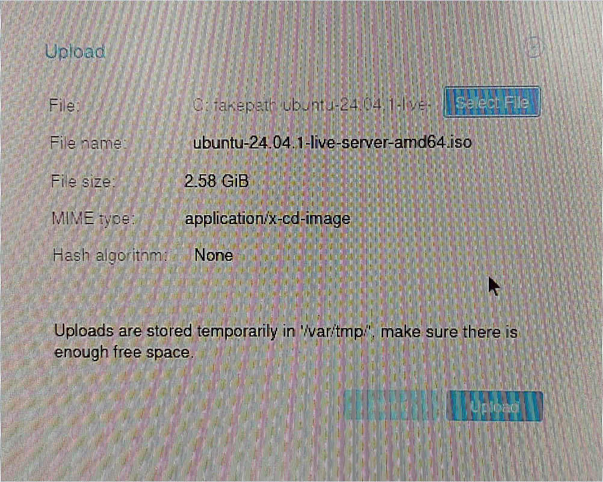</p>

Cuando termina la subida, la ISO aparece en la lista de **ISO Images** del almacenamiento `local`, con un tamaño de 2,77 GB.

<p align="center">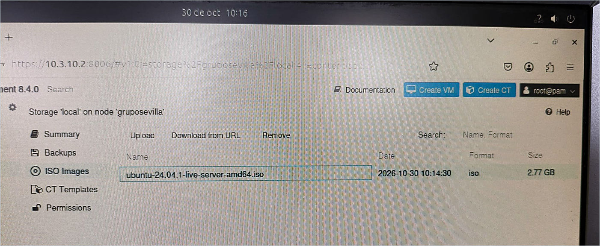</p>

### 4.3. Crear la máquina virtual

Pulsamos el botón **Create VM**, en la parte superior derecha, para abrir el asistente de creación de máquinas virtuales. Lo recorremos pestaña a pestaña.

**General.** Indicamos el nodo `gruposevilla`, el identificador de la máquina (**VM ID** `100`) y su nombre, `Ubuntuserver`.

<p align="center">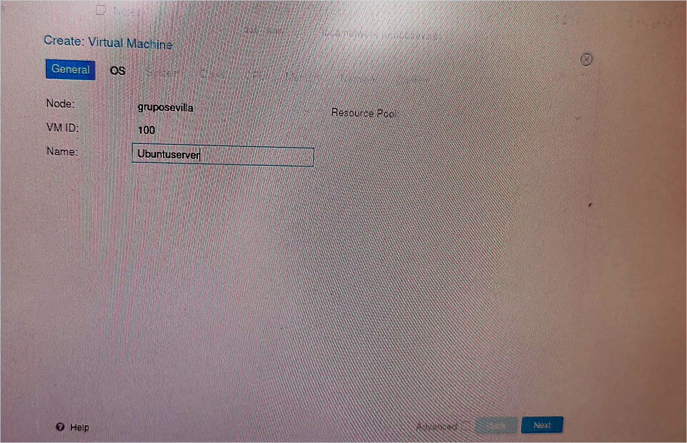</p>

**OS.** Marcamos **Use CD/DVD disc image file (iso)**, seleccionamos el almacenamiento `local` y la ISO `ubuntu-24.04.1-live-server-amd64.iso`. Como sistema invitado dejamos **Linux** con la versión **6.x – 2.6 Kernel**.

<p align="center">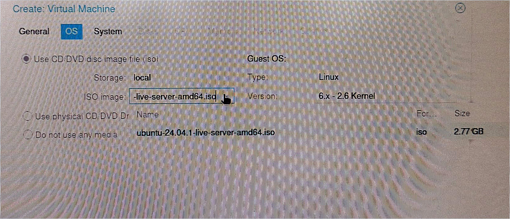</p>

**System.** Dejamos la tarjeta gráfica y el tipo de máquina por defecto y el controlador SCSI **VirtIO SCSI single**. Como BIOS elegimos **OVMF (UEFI)**, marcamos **Add EFI Disk** y guardamos el disco EFI en `local-lvm`. Con esto la máquina arranca en **modo UEFI**, como exige la práctica. El disco EFI de Proxmox solo guarda las variables del firmware y no es uno de los cuatro discos del diseño.

<p align="center">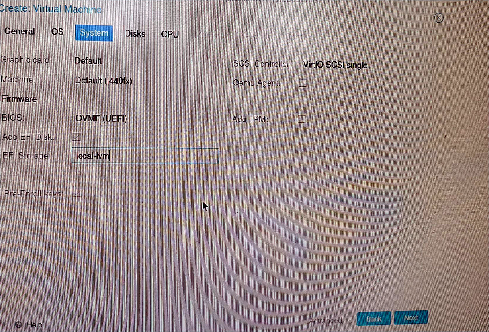</p>

**Disks.** En el asistente se creó un primer disco, `scsi0`, en el almacenamiento `local-lvm` con un tamaño de **32 GB** y sin caché. Este disco no cumple el diseño de la Tarea 1, así que después lo sustituimos por los cuatro discos de la práctica (apartado 4.5).

<p align="center">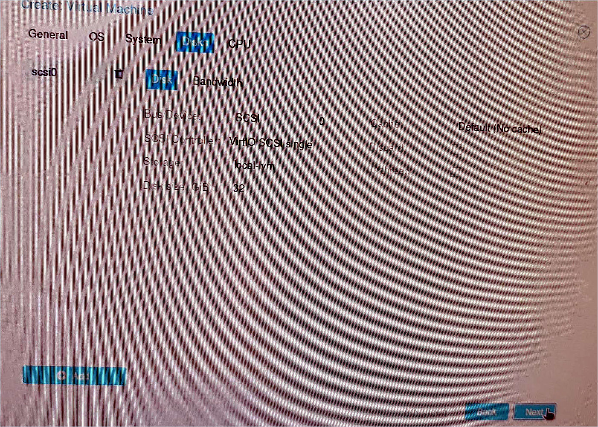</p>

**CPU y Memory.** Asignamos 1 socket con 1 núcleo (tipo de CPU `x86-64-v2-AES`) y **2048 MB** de memoria RAM. Estos valores se pueden ver en el resumen final.

**Network.** Conectamos la tarjeta de red al puente `vmbr0`, que es la interfaz de red del servidor Proxmox, con el modelo **VirtIO (paravirtualized)** y el cortafuegos activado. Así, la máquina virtual sale a la red por el mismo puerto que el servidor.

<p align="center">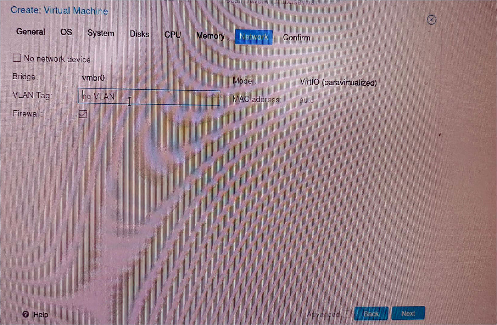</p>

**Confirm.** Revisamos el resumen de la configuración y pulsamos **Finish** para crear la máquina:

| Parámetro | Valor |
|---|---|
| `vmid` / `name` | `100` / `Ubuntuserver` |
| `nodename` | `gruposevilla` |
| `sockets` / `cores` / `cpu` | `1` / `1` / `x86-64-v2-AES` |
| `memory` | `2048` MB |
| `ostype` | `l26` (Linux) |
| `ide2` | `local:iso/ubuntu-24.04.1-live-server-amd64.iso,media=cdrom` |
| `scsi0` | `local-lvm:32,iothread=on` |
| `scsihw` | `virtio-scsi-single` |
| `efidisk0` | `local-lvm:1,efitype=4m,pre-enrolled-keys=1` |
| `net0` | `virtio,bridge=vmbr0,firewall=1` |

<p align="center">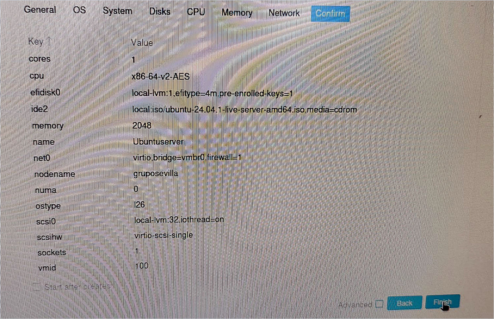</p>

### 4.4. Comprobación de la máquina virtual

Al volver al panel **Datacenter**, la nueva máquina virtual aparece en la lista de recursos como **100 (Ubuntuserver)**, dentro del nodo `gruposevilla`.

<p align="center">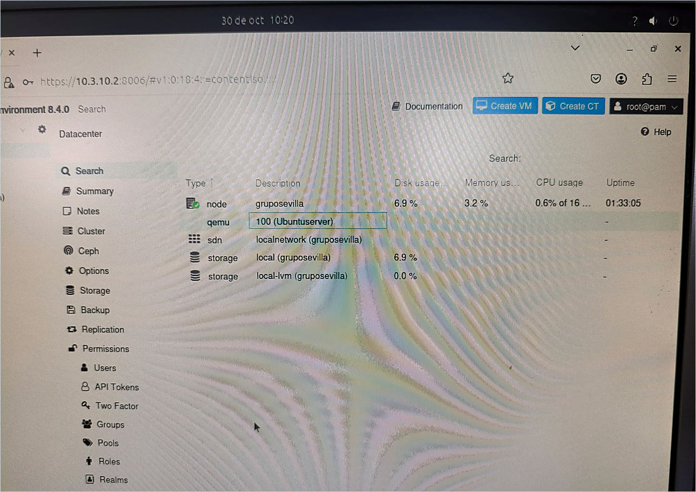</p>

### 4.5. Añadir los cuatro discos del diseño

Con la máquina apagada, seleccionamos **100 (Ubuntuserver) → Hardware** y ajustamos los discos al diseño de la Tarea 1:

1. Seleccionamos el disco de 32 GB (`scsi0`), pulsamos **Detach** y después **Remove** para eliminarlo.
2. Pulsamos **Add → Hard Disk** y creamos los cuatro discos en `local-lvm`, con el bus **SCSI**:

| Disco | Bus/Device | Tamaño |
|---|---|---|
| Disco 1 — arranque y EFI | `scsi0` | 1,5 GB |
| Disco 2 — swap | `scsi1` | 10 GB |
| Disco 3 — sistema base | `scsi2` | 20 GB |
| Disco 4 — datos de usuarios | `scsi3` | 30 GB |

3. En **Options → Boot Order** comprobamos que la máquina arranca primero desde el CD (`ide2`) para iniciar el instalador.

Todos los discos usan el controlador **VirtIO SCSI single**, el almacenamiento `local-lvm` y la caché por defecto (**No cache**).

<p align="center">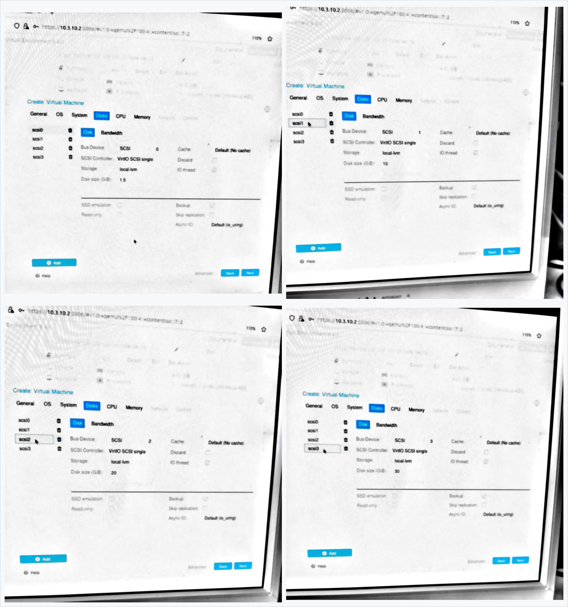</p>

### 4.6. Instalación de Ubuntu Server con particionado manual

1. Iniciamos la máquina (**Start**) y abrimos la **Console**. La máquina arranca en modo UEFI desde la ISO de Ubuntu Server.
2. Seguimos el instalador (idioma, teclado, red) hasta llegar a **Guided storage configuration**.
3. Elegimos **Custom storage layout**, que es el particionado manual. No usamos el particionado automático.

<p align="center">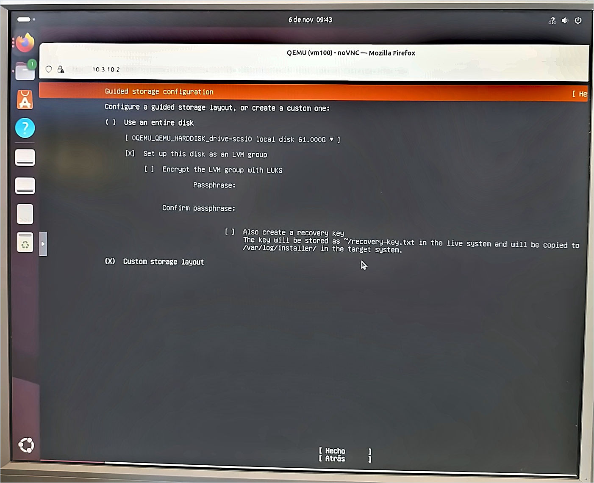</p>

4. Creamos las particiones en cada disco tal como las diseñamos en la Tarea 1:
   - En `scsi0` (1,5 GB): marcamos el disco como **Use as Boot Device**, lo que crea la partición EFI (`/boot/efi`, fat32), y en el espacio libre que queda añadimos una partición ext4 montada en `/boot`.

<p align="center">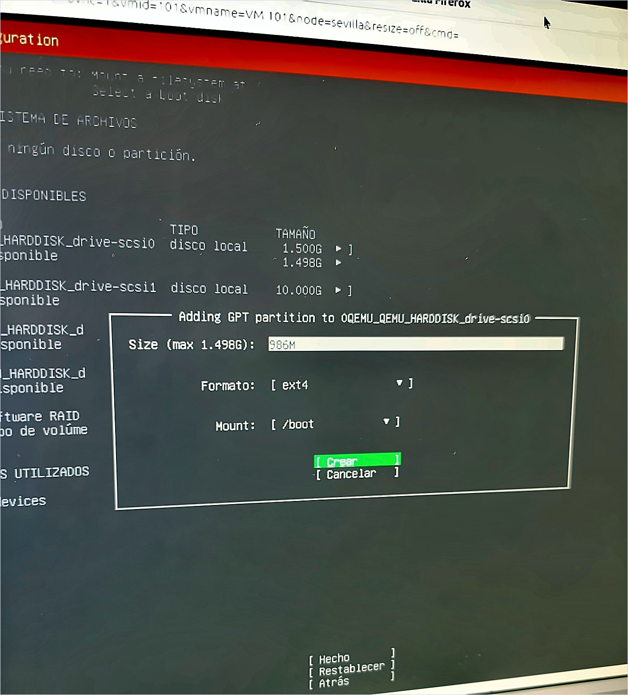</p>

   - En `scsi1` (10 GB): una partición que ocupa todo el disco, con formato **swap**.

<p align="center">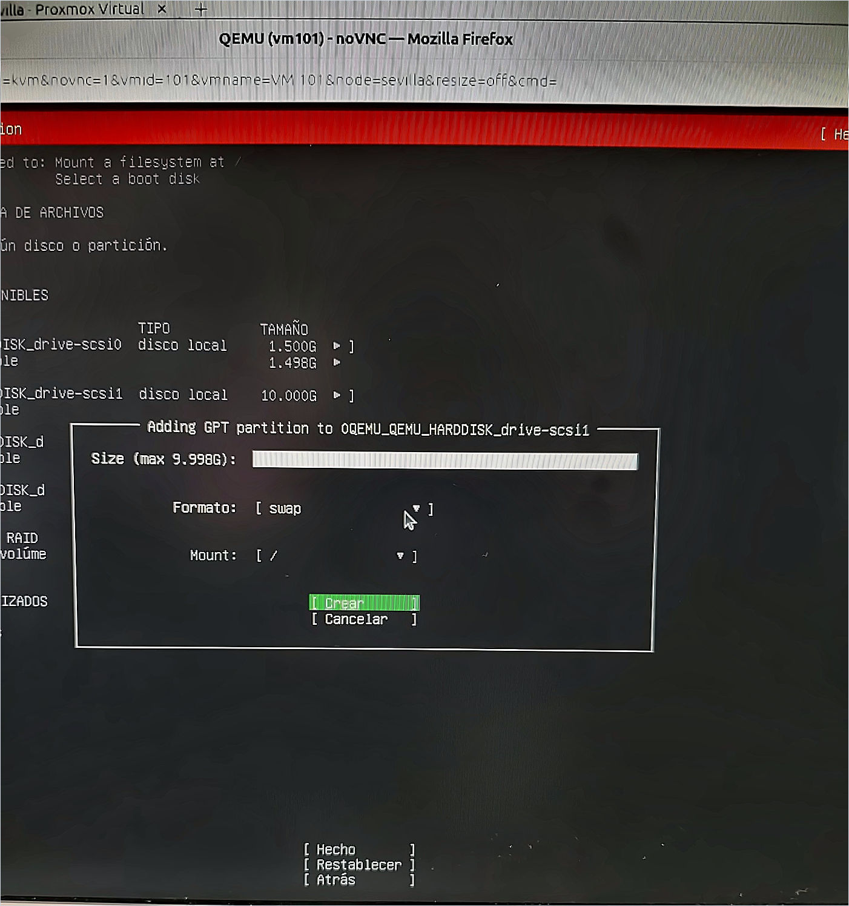</p>

   - En `scsi2` (20 GB): una partición ext4 que ocupa todo el disco, montada en `/`.
   - En `scsi3` (30 GB): una partición ext4 que ocupa todo el disco, montada en `/home`.

5. Revisamos el resumen. En **Dispositivos utilizados** se ve que cada punto de montaje está en su propio disco: `/boot/efi` (fat32) y `/boot` (ext4) en `scsi0`, la swap en `scsi1`, `/` en `scsi2` y `/home` en `scsi3`.

<p align="center">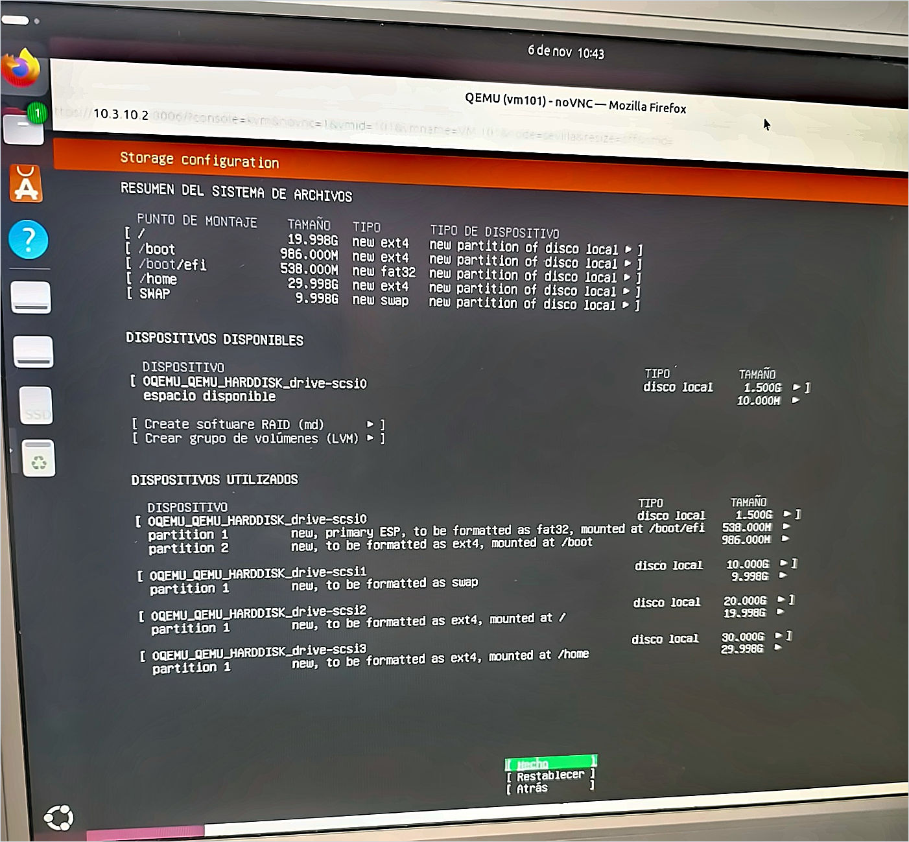</p>

6. Confirmamos y completamos la instalación. En **Profile configuration** indicamos el nombre `Sevilla`, el nombre del servidor `sevilla` y el usuario `grupo-s`.

<p align="center">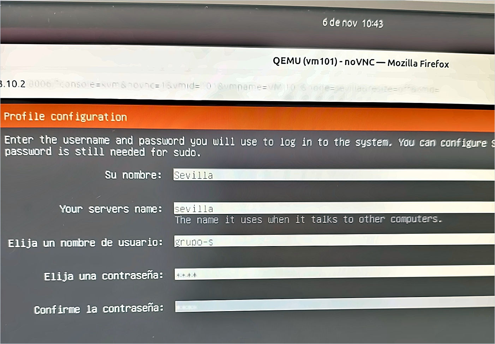</p>

7. Al terminar, quitamos la ISO de la máquina (**Hardware → CD/DVD Drive → Do not use any media**) y reiniciamos. El sistema arranca solo desde el disco y podemos iniciar sesión con `grupo-s`. En el mensaje de bienvenida ya se ve que `/home` tiene su propio espacio (29,36 GB).

<p align="center">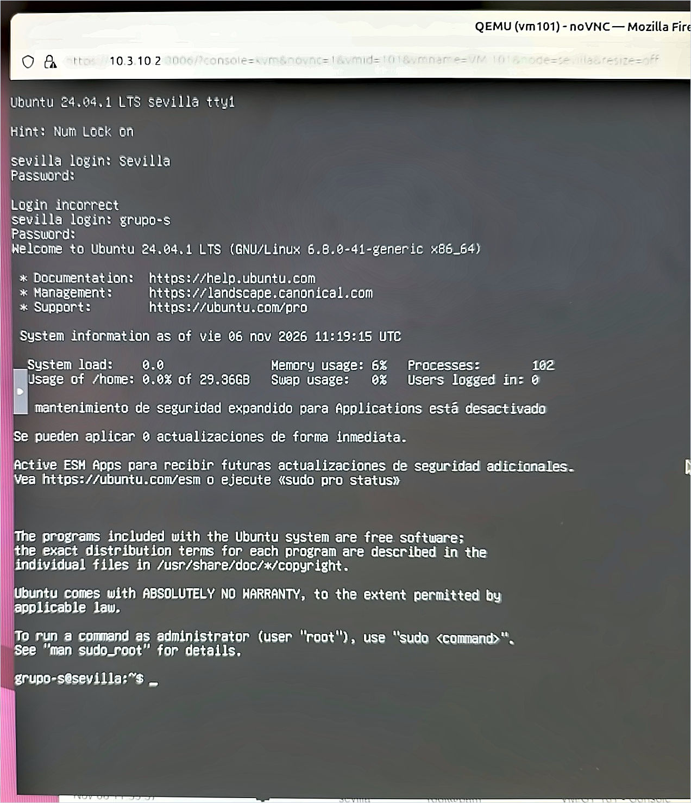</p>

## 5. Tarea 3: Verificación después de la instalación

Una vez que el sistema arranca, entramos en la terminal y ejecutamos las siguientes comprobaciones.

**1. El sistema ha arrancado en modo UEFI.** Si existe el directorio `/sys/firmware/efi`, el sistema se ha iniciado en modo UEFI:

```bash
ls /sys/firmware/efi
[ -d /sys/firmware/efi ] && echo "Arranque en modo UEFI" || echo "Arranque en modo BIOS"
```

En la salida de `df -h` (punto 2) ya aparece montado el sistema de ficheros `efivarfs` en `/sys/firmware/efi/efivars`. Este sistema de ficheros solo existe cuando el equipo ha arrancado en modo UEFI, así que es una prueba de que el servidor arranca en UEFI.

<p align="center">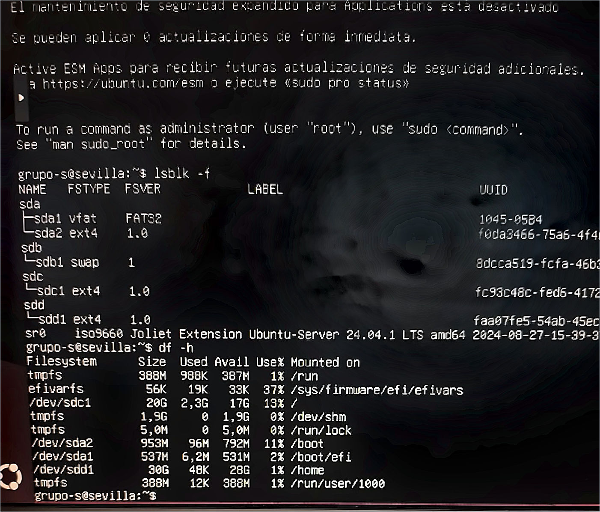</p>

> **Pendiente:** captura de `ls /sys/firmware/efi` para tener también la comprobación directa del directorio.

**2. Cada punto de montaje está en su disco.** Con `lsblk` vemos qué partición y qué disco físico corresponden a `/`, `/home`, `/boot`, `/boot/efi` y la swap. Con `df -h` vemos el tamaño y el espacio usado de cada punto de montaje:

```bash
lsblk -f
df -h
```

<p align="center">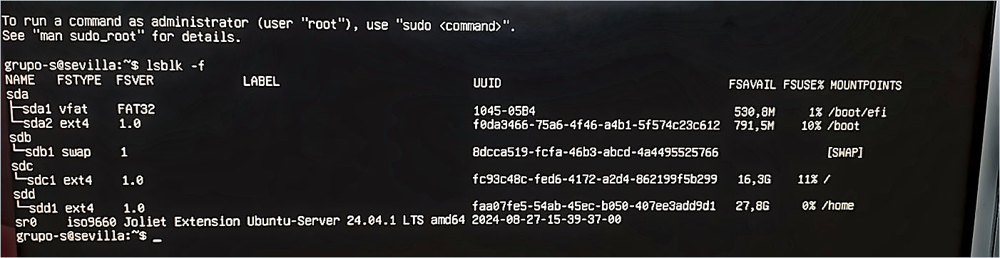</p>

La salida de `lsblk -f` confirma que cada punto de montaje está en su propio disco, tal como lo diseñamos en la Tarea 1:

| Disco | Partición | Sistema de ficheros | UUID | Punto de montaje | Tamaño (`df -h`) |
|---|---|---|---|---|---|
| `sda` | `sda1` | vfat (FAT32) | `1045-05B4` | `/boot/efi` | 537 MB |
| `sda` | `sda2` | ext4 | `f0da3466-75a6-4f46-a4b1-5f574c23c612` | `/boot` | 953 MB |
| `sdb` | `sdb1` | swap | `8dcca519-fcfa-46b3-abcd-4a4495525766` | `[SWAP]` | 10 GB |
| `sdc` | `sdc1` | ext4 | `fc93c48c-fed6-4172-a2d4-862199f5b299` | `/` | 20 GB |
| `sdd` | `sdd1` | ext4 | `faa07fe5-54ab-45ec-b050-407ee3add9d1` | `/home` | 30 GB |

También comprobamos que la swap del disco 2 está activa con `free -h` y `swapon --show`: el sistema dispone de 9 GiB de swap en la partición `/dev/sdb1`.

```bash
free -h
swapon --show
```

<p align="center">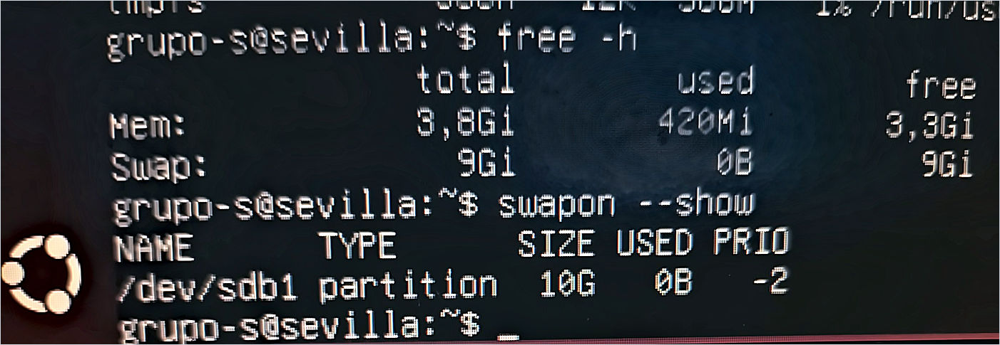</p>

> **Nota:** en `lsblk` aparece todavía `sr0` con la ISO de Ubuntu Server. Hay que quitarla de la máquina (**Hardware → CD/DVD Drive → Do not use any media**) para que no quede ningún medio de instalación conectado.

**3. Montaje automático por UUID.** El fichero `/etc/fstab` tiene que montar todos los puntos críticos al arrancar, identificando cada partición por su UUID:

```bash
cat /etc/fstab
sudo blkid
```

Con `blkid` podemos comparar los UUID de `/etc/fstab` con los de cada partición.

> **Pendiente:** captura del resultado.

## 6. Instalación de los clientes Linux Mint

### 6.1. Cliente virtualizado

1. Subimos la ISO de Linux Mint al almacenamiento `local` de Proxmox, igual que hicimos con la de Ubuntu Server (apartado 4.2). La imagen `linuxmint-22.3-cinnamon-64bit.iso` (3,09 GB) aparece en **ISO Images** junto a la de Ubuntu Server.

<p align="center">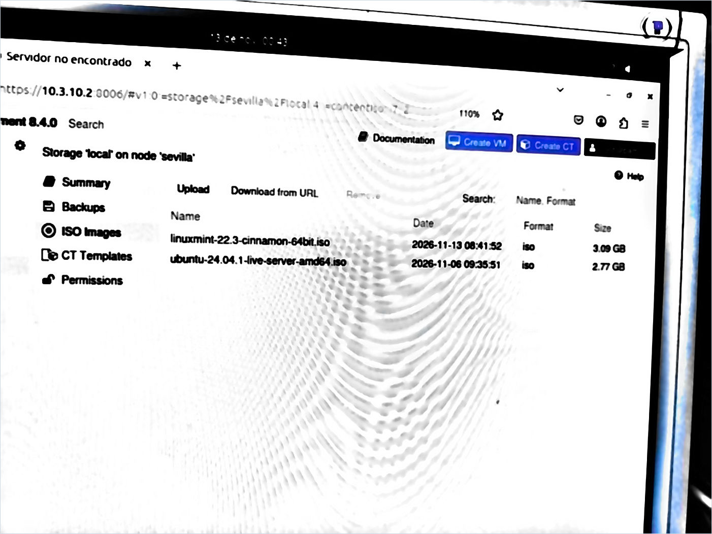</p>

2. Creamos una nueva máquina virtual con **Create VM** (VM 102). En la pestaña **OS** seleccionamos la ISO de Linux Mint y como sistema invitado **Linux 6.x – 2.6 Kernel**.

<p align="center">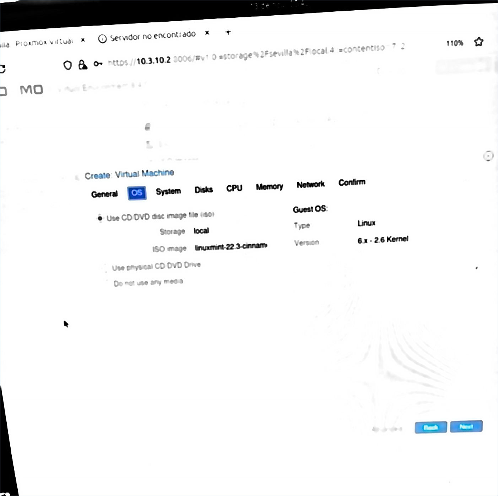</p>

3. En la pestaña **System** elegimos BIOS **OVMF (UEFI)** con disco EFI en `local-lvm` y el controlador **VirtIO SCSI single**. Después le asignamos un único disco y la tarjeta de red en el puente `vmbr0`.

<p align="center">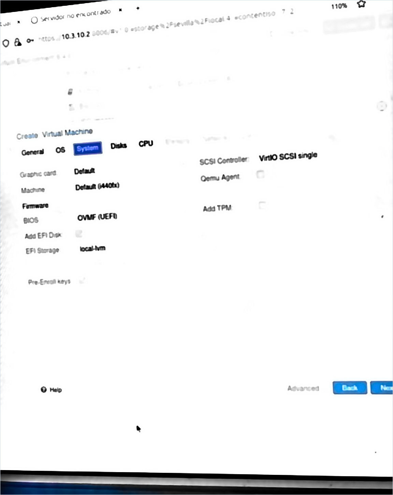</p>

4. Arrancamos la máquina desde la ISO. Se inicia la sesión en vivo de **Linux Mint 22.3 Cinnamon**, y desde el icono del escritorio lanzamos el instalador.

<p align="center">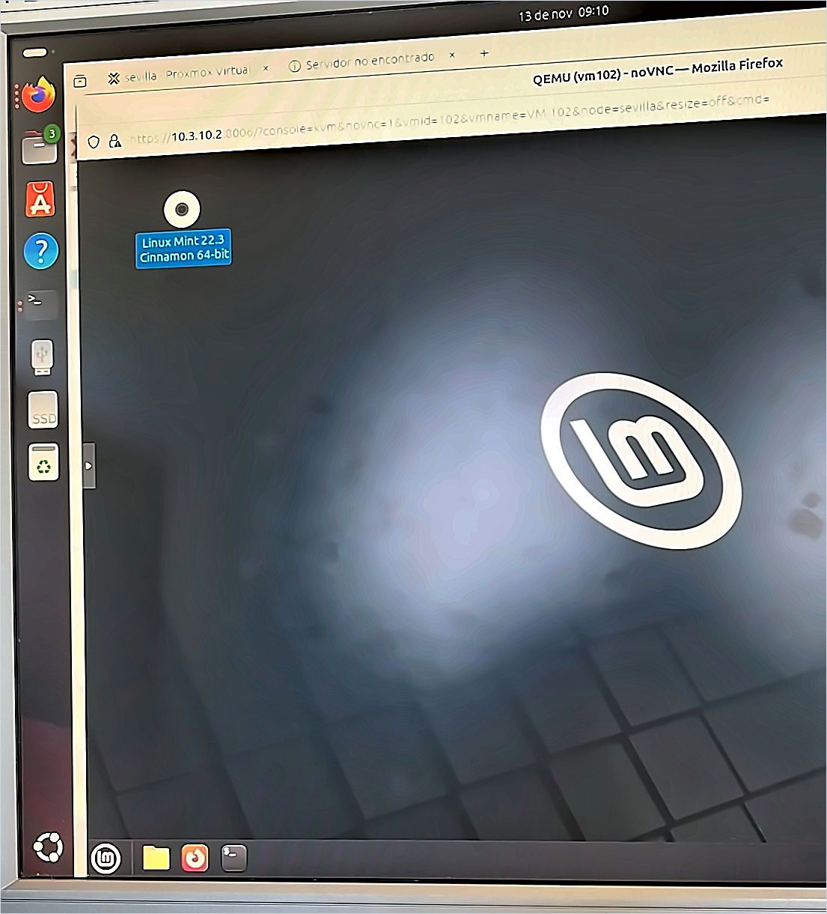</p>

5. Instalamos Linux Mint con la opción de particionado estándar del instalador (**Borrar disco e instalar Linux Mint**), que usa el único disco de la máquina.

<p align="center">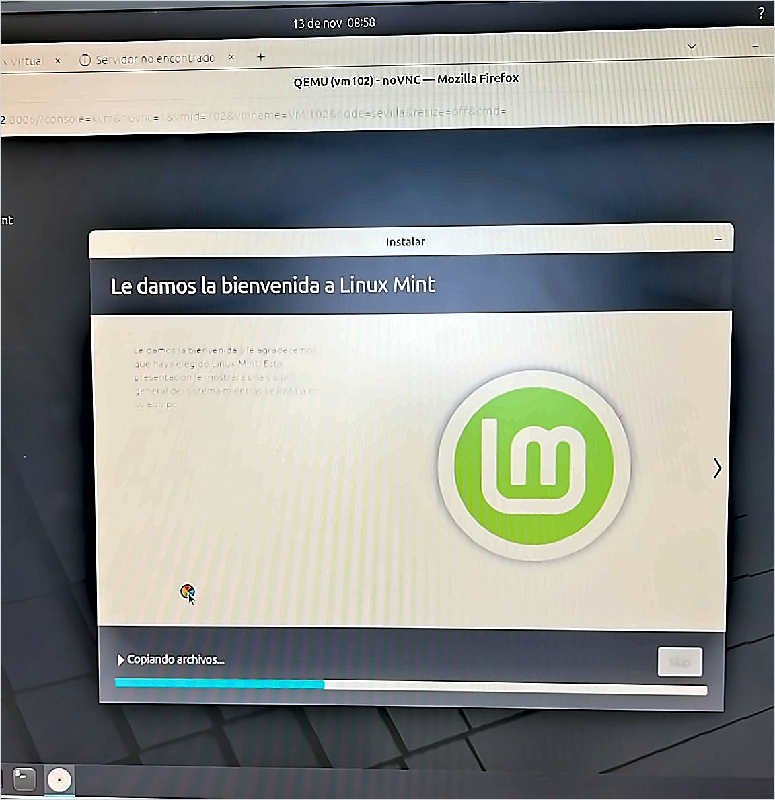</p>

6. Al terminar, quitamos la ISO y reiniciamos. La máquina arranca desde el disco y muestra la pantalla de inicio de sesión del usuario `sevilla`.

<p align="center">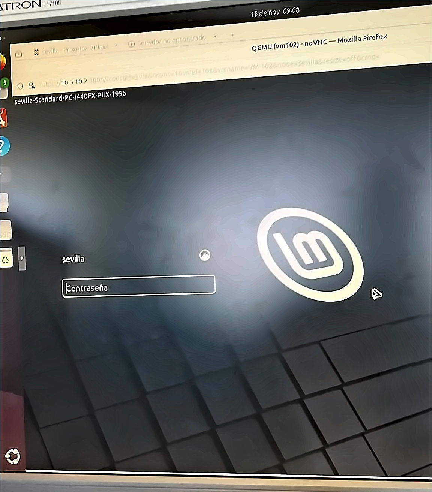</p>

> **Pendiente:** captura de los pasos del instalador donde se elige el particionado estándar.

### 6.2. Cliente físico

1. Arrancamos el equipo físico del grupo desde un USB con Linux Mint (igual que en la Práctica 2, apartado 1).
2. Instalamos Linux Mint en el único disco del equipo con el particionado estándar.
3. Conectamos el equipo a un puerto de la VLAN 310 del switch (por ejemplo, `0/23`, con la IP `10.3.10.3/24`) para que llegue al servidor y a la interfaz de Proxmox.

> **Pendiente:** capturas de la instalación y de la conectividad con el servidor.

---

# Práctica 4: Despliegue de servicios con Windows Server

Esta fase corresponde a la **Práctica 4: Despliegue de servicios con Windows Server**. La dirección de la empresa quiere centralizar la autenticación de los usuarios, la administración de los equipos, los recursos compartidos y las copias de seguridad. Para ello desplegamos un servidor **Windows Server 2025** en Proxmox que, además, asignará automáticamente la configuración IP a los clientes mediante **DHCP**. Para proteger la red frente a servidores DHCP no autorizados, activaremos **DHCP Snooping** en el switch Cisco 3560.

## 1. Tarea 1: Planificación de la infraestructura

### 1.1. Características de la máquina virtual

| Componente | Configuración requerida |
|---|---|
| Sistema operativo | Windows Server 2025 |
| Firmware | UEFI (OVMF) |
| Disco 0 | 60 GB (sistema operativo) |
| Disco 1 | 50 GB (datos) |
| Disco 2 | 50 GB (datos) |
| Disco 3 | 20 GB (copias de seguridad) |
| Memoria RAM | 8 GB mínimo |
| Procesadores | 2 vCPU |
| Adaptador de red | Puente `vmbr0` (red del laboratorio) |
| Nombre del servidor | `WS2025-ASIX333` (según el nombre que aparece en Proxmox) |

Antes de instalar comprobamos que la máquina utiliza UEFI y que tiene conectados los cuatro discos virtuales. En Proxmox seleccionamos **OVMF (UEFI)** y el almacenamiento `local-lvm` para el disco EFI.

<p align="center">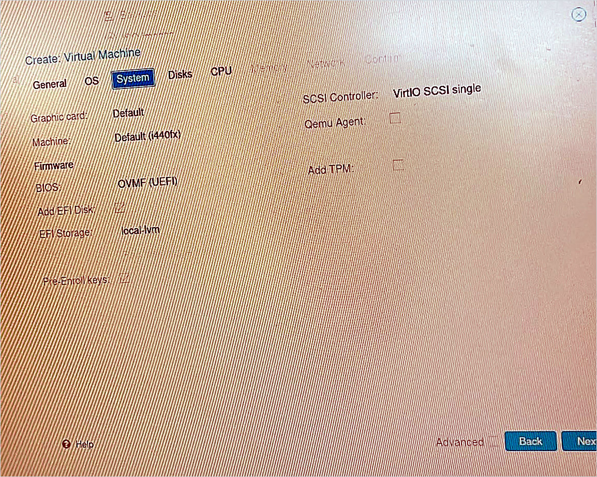</p>

**Aquí lo que hemos hecho es seleccionar OVMF (UEFI) como firmware de la máquina virtual y añadir el disco EFI en Proxmox.** De esta forma, la máquina queda preparada para iniciar Windows Server utilizando UEFI.

En la pestaña **Disks** añadimos los cuatro discos virtuales mediante el controlador **VirtIO SCSI single**. Los tamaños configurados son 60 GB, 50 GB, 50 GB y 20 GB.

<p align="center">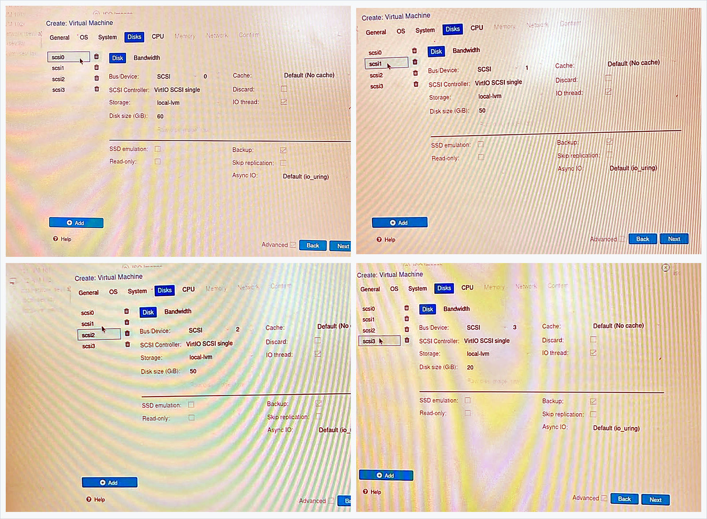</p>

**Aquí lo que hemos hecho es configurar los cuatro discos virtuales** (de izquierda a derecha y de arriba abajo):

- **`scsi0`**, de 60 GB, que se utilizará para instalar el sistema operativo.
- **`scsi1`**, de 50 GB, para almacenar datos.
- **`scsi2`**, de otros 50 GB, destinado a los datos departamentales.
- **`scsi3`**, de 20 GB, que utilizaremos para guardar las copias de seguridad.

Antes de crear la máquina revisamos el resumen. En él se ven los 8192 MB de memoria, los cuatro discos (60, 50, 50 y 20 GB), el disco EFI, la ISO de Windows Server y la red en `vmbr0`. La máquina tiene el identificador **103**.

<p align="center">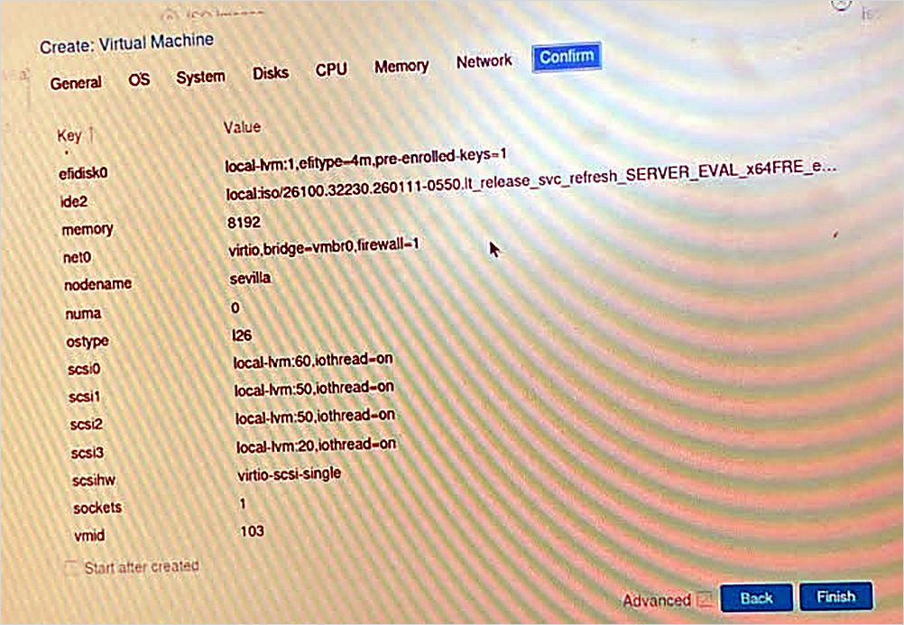</p>

### 1.2. Esquema de discos y volúmenes

| Disco | Tamaño | Volumen | Etiqueta | Finalidad |
|---|---|---|---|---|
| Disco 0 | 60 GB | `C:` | Sistema | Sistema operativo |
| Disco 1 | 50 GB | `E:` | datos_departamentales | Datos departamentales |
| Disco 2 | 50 GB | `D:` | Recursos_Compartidos | Recursos compartidos corporativos |
| Disco 3 | 20 GB | `F:` | copias_de_seguridad | Copias de seguridad |

Separamos el sistema, los datos y las copias en discos distintos para que un problema en uno no afecte a los demás y para que las copias de seguridad no estén en el mismo disco que los datos que protegen.

### 1.3. Esquema de red

El servidor se conecta a la VLAN 310 (Servidores, `10.3.10.0/24`), igual que el resto de equipos del laboratorio.

| Equipo | Dirección IP | Configuración |
|---|---|---|
| Switch Cisco 3560 (puerta de enlace) | `10.3.10.1` | Estática |
| Servidor Proxmox | `10.3.10.2/24` | Estática |
| Cliente físico | `10.3.10.3/24` | Dirección fija o reserva DHCP |
| Servidor Windows Server 2025 | `10.3.10.100/24` | Estática |
| Clientes | `10.3.10.100` – `10.3.10.200` | Ámbito DHCP configurado |

> **Atención:** la IP del servidor (`10.3.10.100`) está dentro del rango del ámbito DHCP. Hay que excluirla del ámbito (o empezar el rango en `10.3.10.101`) para que el servidor DHCP no la entregue a un cliente.

### 1.4. Nombre del servidor y del dominio

- **Servidor:** `WS2025-ASIX333`, que es el nombre que aparece en la consola de Proxmox.
- **Dominio:** `sevilla.local` (propuesta inicial). En el ámbito DHCP se configuró `sevilla.com`, así que hay que unificar el nombre del dominio.

## 2. Tarea 2: Instalación de Windows Server 2025

1. Creamos la máquina en Proxmox con BIOS **OVMF (UEFI)**, disco EFI y los cuatro discos de la tabla anterior.
2. Arrancamos desde la ISO y llegamos a la pantalla de selección del disco donde se instalará Windows Server 2025. En esa pantalla aparecen los cuatro discos virtuales con capacidades de 20 GB, 60 GB, 50 GB y 50 GB. Seleccionamos el disco de **60 GB** para instalar el sistema operativo.

<p align="center">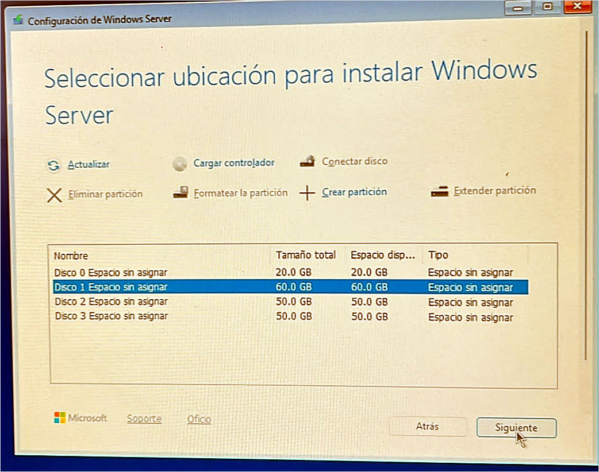</p>

**Aquí lo que hemos hecho es seleccionar el disco virtual de 60 GB para instalar Windows Server.** En la pantalla se ven también los otros tres discos, que se reservarán para los datos y las copias de seguridad.

3. Una vez finalizada la instalación, Windows solicita establecer la contraseña de la cuenta **Administrador**.

<p align="center">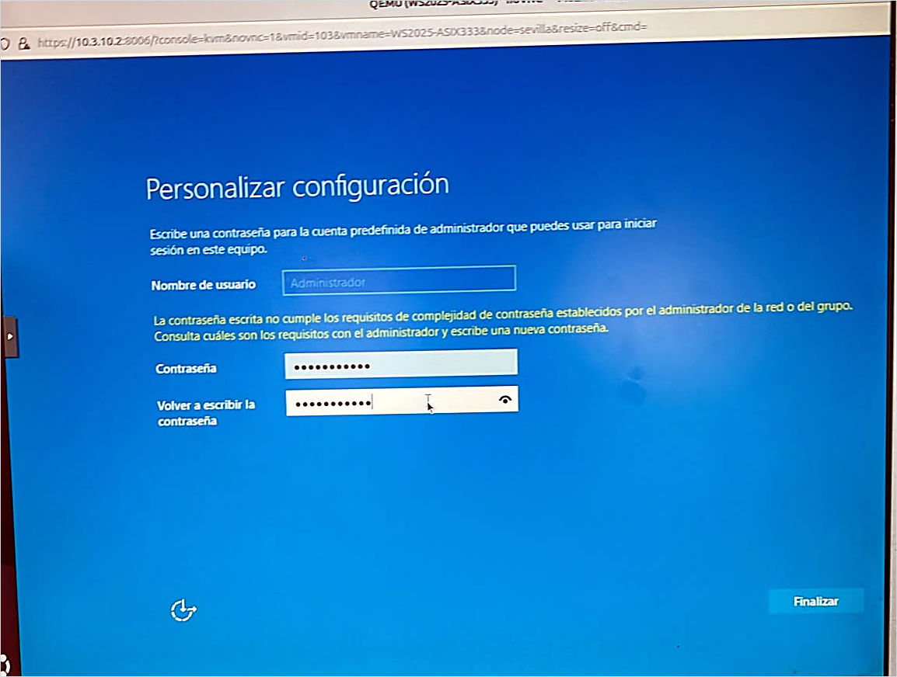</p>

**Aquí lo que hemos hecho es establecer la contraseña de la cuenta Administrador para poder iniciar sesión en Windows Server una vez terminada la instalación.**

## 3. Tarea 3: Configuración del almacenamiento

En **Administración de discos** (`diskmgmt.msc`) inicializamos los discos secundarios y creamos volúmenes simples. Los formateamos en **NTFS**, dejamos el tamaño de unidad de asignación predeterminado y asignamos las letras y etiquetas correspondientes.

<p align="center">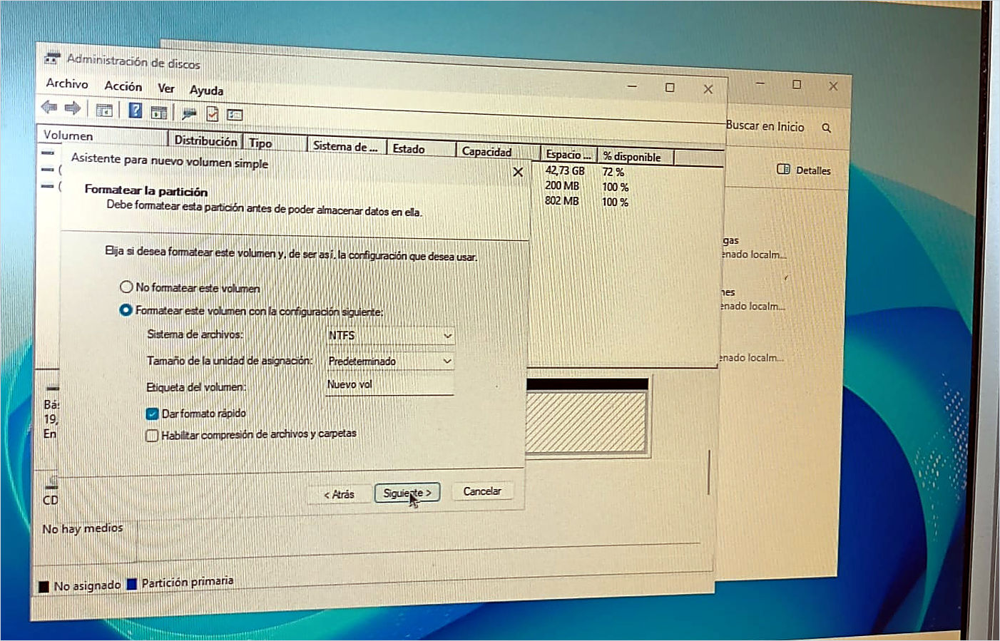</p>

**Aquí lo que hemos hecho es seleccionar el sistema de archivos NTFS para formatear el volumen y dejar el tamaño de unidad de asignación predeterminado.**

<p align="center">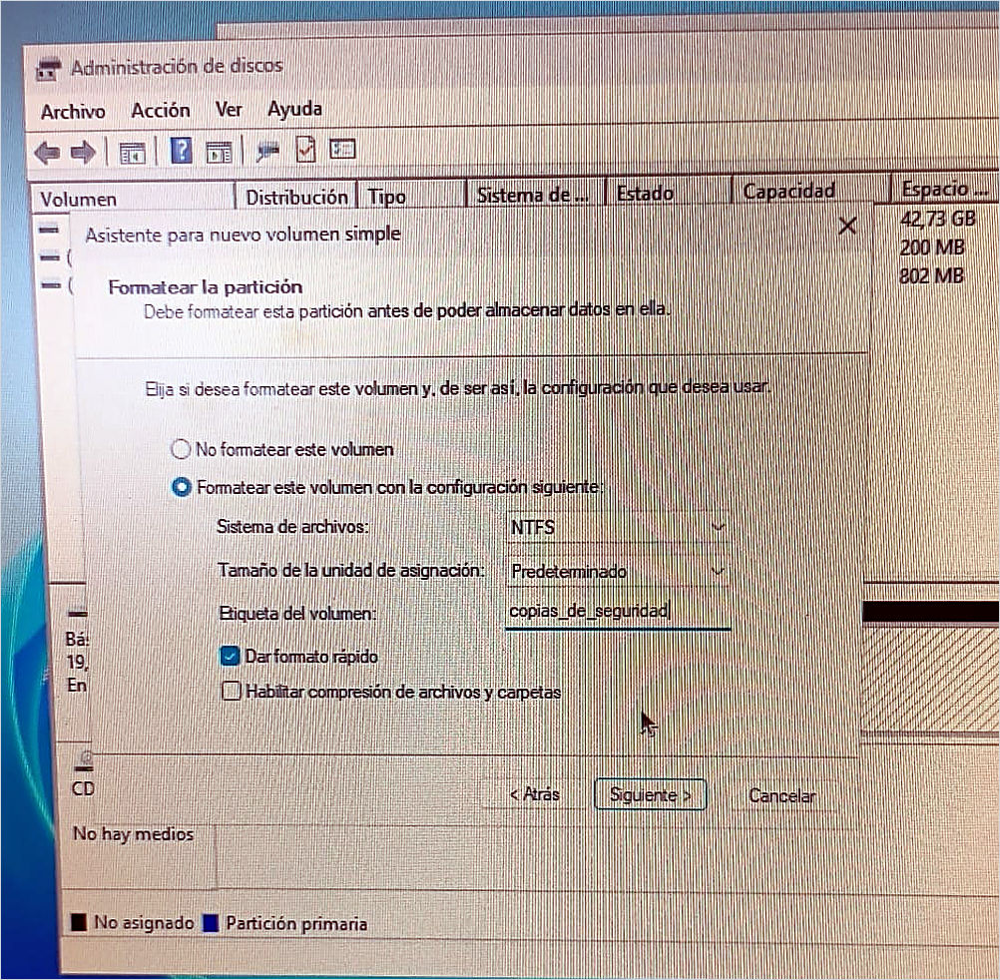</p>

**Aquí lo que hemos hecho es asignar la etiqueta `copias_de_seguridad` al volumen destinado a guardar las copias. También mantenemos el formato NTFS y el formato rápido.**

<p align="center"></p>

**Aquí lo que hemos hecho es asignar la etiqueta `Recursos_Compartidos` al volumen que utilizaremos para los recursos compartidos corporativos.**

Una vez creados y formateados los volúmenes, comprobamos su estado desde **Administración de discos**. En la captura se observan los tres discos secundarios en línea y con formato NTFS:

- `D:` — `Recursos_Compartidos`, aproximadamente 50 GB (Disco 2).
- `E:` — `datos_departamentales`, aproximadamente 50 GB (Disco 1).
- `F:` — `copias_de_seguridad`, aproximadamente 20 GB (Disco 3).

En el Disco 0 se ven la partición de sistema **EFI** (200 MB), `C:` (59 GB) y una partición de **recuperación** (802 MB). Esto demuestra que Windows se instaló en modo **UEFI** con tabla de particiones **GPT**.

<p align="center"></p>

**Aquí lo que hemos hecho es comprobar que los tres volúmenes están creados, aparecen en línea y utilizan NTFS. También podemos ver que cada uno tiene la letra y la etiqueta que le hemos asignado.**

## 4. Tarea 4: Configuración TCP/IP del servidor

Configuramos una dirección IP estática en el adaptador Ethernet de Windows Server. En la captura aparece la dirección `10.3.10.100` con máscara `255.255.255.0`.

<p align="center"></p>

**Aquí lo que hemos hecho es entrar en las propiedades IPv4 del adaptador Ethernet y seleccionar la configuración manual. En la captura se ve la dirección IP `10.3.10.100` y la máscara `255.255.255.0`. Los campos de puerta de enlace y DNS aparecen sin completar en esta imagen.**

Después comprobamos la configuración desde la consola de Windows y realizamos una prueba de conectividad con la dirección `10.3.10.1`.

<p align="center"></p>

**Aquí lo que hemos hecho es consultar la configuración de red desde la consola de Windows y ejecutar un `ping` hacia `10.3.10.1`. Se enviaron 4 paquetes y se recibieron los 4 (0 % de pérdida), así que hay conectividad con esa dirección de la red.**

En la misma sesión revisamos la red del servidor Proxmox en el fichero `/etc/network/interfaces`. El puente `vmbr0` tiene la IP `10.3.10.2/24` y la puerta de enlace `10.3.10.1`, y usa la tarjeta física `enp1s0f0`.

<p align="center"></p>

## 5. Tarea 5: Servicio DHCP en Windows Server

Una vez instalado el rol **Servidor DHCP**, abrimos la consola DHCP desde **Administrador del servidor → Herramientas → DHCP**.

<p align="center"></p>

**Aquí lo que hemos hecho es abrir la consola de administración DHCP para gestionar el servicio y crear el ámbito que utilizarán los equipos clientes.**

### 5.1. Creación del ámbito

En el asistente para crear un ámbito indicamos un nombre y un rango de direcciones IP. En la captura se ve el rango desde `10.3.10.100` hasta `10.3.10.200`.

<p align="center"></p>

**Aquí lo que hemos hecho es introducir el intervalo de direcciones que podrá entregar el servidor DHCP a los clientes.**

### 5.2. Configuración de DNS y dominio

En el asistente configuramos el nombre de dominio y el servidor DNS que recibirán los clientes. La captura muestra el dominio `sevilla.com` y el servidor DNS `10.3.10.100`.

<p align="center"></p>

**Aquí lo que hemos hecho es indicar el nombre de dominio que se entregará a los clientes y añadir la dirección IP del servidor DNS.**

### 5.3. Comprobación del ámbito

Después de completar el asistente, volvemos a la consola DHCP. En ella aparece el ámbito identificado como `10.3.10.0` y con el nombre `Sevilla`.

<p align="center"></p>

**Aquí lo que hemos hecho es comprobar que el ámbito `Sevilla` aparece creado dentro de IPv4 en la consola de administración DHCP.**

## 6. Tarea 6: DHCP no autorizado y DHCP Snooping

### 6.1. Conexión al switch Cisco 3560

Para administrar el switch Cisco 3560, conectamos el equipo del laboratorio mediante el cable de consola y abrimos una sesión con PuTTY. Durante la conexión aparecen mensajes del sistema que indican cambios en el estado de varias interfaces GigabitEthernet y de algunas interfaces VLAN.

<p align="center"></p>

**Aquí lo que hemos hecho es acceder al switch Cisco 3560 mediante PuTTY utilizando la conexión de consola. En la terminal aparecen mensajes que informan de cambios en el estado de diferentes puertos del switch mientras conectamos los equipos del laboratorio.**

### 6.2. Preparación del servidor Ubuntu

Para simular un servidor DHCP no autorizado utilizamos un equipo físico con Ubuntu Server. Durante la instalación configuramos el perfil del equipo y completamos la puesta en marcha del sistema.

<p align="center"></p>

**Aquí lo que hemos hecho es completar la configuración del perfil de Ubuntu Server, indicando el nombre del usuario y del equipo que utilizaremos para administrar el servidor.**

<p align="center"></p>

**Aquí lo que hemos hecho es comprobar que Ubuntu ha terminado de arrancar y que podemos acceder al sistema para continuar con la configuración del servicio DHCP.**

### 6.3. Instalación y comprobación del servicio DHCP en Ubuntu

Instalamos el servicio `isc-dhcp-server` y comprobamos su estado con:

```bash
sudo apt install isc-dhcp-server
sudo systemctl status isc-dhcp-server
```

<p align="center"></p>

**Aquí lo que hemos hecho es consultar el estado del servicio `isc-dhcp-server`. En la salida aparece como `active (running)`, por lo que el servicio está iniciado en Ubuntu.**

### 6.4. Configuración del ámbito DHCP no autorizado

Editamos el archivo de configuración del servicio:

```bash
sudo nano /etc/dhcp/dhcpd.conf
```

```conf
subnet 10.3.10.0 netmask 255.255.255.0 {
        range 10.3.10.201 10.3.10.230;
        option routers 10.3.10.254;
        option subnet-mask 255.255.255.0;
        option broadcast-address 10.3.10.255;
}
```

En la captura se observa un ámbito de pruebas para la red `10.3.10.0/24`, con un rango de direcciones diferente al que utiliza el servidor Windows y una puerta de enlace incorrecta para simular el servidor DHCP fraudulento.

<p align="center"></p>

**Aquí lo que hemos hecho es editar `dhcpd.conf` y definir el ámbito de pruebas para la red `10.3.10.0/24`. El servidor Ubuntu ofrece direcciones entre `10.3.10.201` y `10.3.10.230` y anuncia como puerta de enlace `10.3.10.254`, con el objetivo de simular una configuración DHCP incorrecta.**

### 6.5. Configuración del switch para la práctica

Antes de activar DHCP Snooping volvemos a configurar en el Cisco 3560 las interfaces VLAN y los puertos que intervienen en la práctica. Así nos aseguramos de que las respuestas del Windows Server entran por un único puerto y de que sabemos a qué puerto está conectado cada equipo.

**Esquema de los puertos del switch.** La última columna indica cómo quedará cada puerto cuando activemos DHCP Snooping (todavía no está aplicado, ver apartado 6.7):

| Puerto | Modo | VLAN | Equipo conectado | DHCP Snooping (previsto) |
|---|---|---|---|---|
| `Gi0/22` | Trunk 802.1Q (nativa 310) | 310, 320, 330, 399 | Servidor Proxmox (Windows Server 2025, VM 103) | **Trusted** |
| `Gi0/23` | Access | 310 | Cliente físico | Untrusted |
| `Gi0/25` – `Gi0/26` | Access | 320 | Equipos de RRHH | Untrusted |
| `Gi0/27` – `Gi0/28` | Access | 330 | Equipos de Dirección | Untrusted |
| `Gi0/29` – `Gi0/30` | Access | 399 | Equipos de Gestión | Untrusted |

**Interfaces VLAN (SVI).** Creamos una interfaz VLAN por cada red con su puerta de enlace `.1` y la activamos con `no shutdown`:

```text
interface vlan 310
 ip address 10.3.10.1 255.255.255.0
 no shutdown
exit
interface vlan 320
 ip address 10.3.20.1 255.255.255.0
 no shutdown
exit
interface vlan 330
 ip address 10.3.30.1 255.255.255.0
 no shutdown
interface vlan 399
 ip address 10.3.99.1 255.255.255.0
 no shutdown
```

<p align="center"></p>

**Aquí lo que hemos hecho es asignar a cada interfaz VLAN su dirección IP (`10.3.10.1`, `10.3.20.1`, `10.3.30.1` y `10.3.99.1`) y activarla con `no shutdown`. El primer intento con `interfaces vlan 310` da error porque el comando correcto es `interface`, en singular.**

**Puerto `Gi0/22` en modo trunk.** Es el puerto del servidor Proxmox, por donde entran las respuestas DHCP del Windows Server. En el 3560 hay que indicar primero la encapsulación `dot1q` antes de poner el puerto en modo trunk:

```text
interface gi0/22
 switchport trunk encapsulation dot1q
 switchport mode trunk
```

<p align="center"></p>

**Aquí lo que hemos hecho es configurar `Gi0/22` como trunk 802.1Q. Al aplicar el modo trunk, el puerto cae y vuelve a levantarse (`changed state to down` → `changed state to up`), lo que indica que ha renegociado el enlace. Los primeros intentos dan error porque escribimos `switchport` fuera de la interfaz y `gi/22` en lugar de `gi0/22`.**

Después indicamos la VLAN nativa y limitamos las VLAN que pueden pasar por el trunk:

```text
interface gi0/22
 switchport trunk native vlan 310
 switchport trunk allowed vlan 310,320,330,399
```

<p align="center"></p>

**Aquí lo que hemos hecho es poner la VLAN 310 como nativa, para que Proxmox y el Windows Server sigan en la red `10.3.10.0/24`, y permitir en el trunk solo las cuatro VLAN de la sede.**

**Puertos `Gi0/23` y `Gi0/25` en modo access.** Son puertos de equipos finales, así que los ponemos en modo access, cada uno en su VLAN, y activamos **PortFast** para que el equipo pueda pedir IP por DHCP nada más conectarse, sin esperar a Spanning Tree:

```text
interface gi0/23
 switchport mode access
 switchport access vlan 310
 spanning-tree portfast
exit
interface gi0/25
 switchport access vlan 320
 switchport mode access
 spanning-tree portfast
```

<p align="center"></p>

**Aquí lo que hemos hecho es configurar `Gi0/23` en modo access en la VLAN 310 y activar PortFast. El aviso `%Warning: portfast should only be enabled on ports connected to a single host` es informativo: PortFast solo se debe usar en puertos con un único equipo final, nunca con otro switch, porque podría provocar bucles temporales.**

<p align="center"></p>

**Aquí lo que hemos hecho es configurar `Gi0/25` en modo access en la VLAN 320 con PortFast. El mensaje `Portfast has been configured ... but will only have effect when the interface is in a non-trunking mode` confirma que PortFast funciona porque el puerto está en modo access.**

**Rangos de puertos para cada departamento.** Para no configurar los puertos uno a uno, usamos `interface range` y dejamos dos puertos access por VLAN: `Gi0/25`–`Gi0/26` para RRHH, `Gi0/27`–`Gi0/28` para Dirección y `Gi0/29`–`Gi0/30` para Gestión.

```text
interface range gi0/25 - 26
 switchport mode access
 switchport access vlan 320
 spanning-tree portfast
interface range gi0/27 - 28
 switchport mode access
 switchport access vlan 330
 spanning-tree portfast
interface range gi0/29 - 30
 switchport access vlan 399
 spanning-tree portfast
end
```

<p align="center"></p>

**Aquí lo que hemos hecho es poner `Gi0/25`–`Gi0/26` en la VLAN 320 y `Gi0/27`–`Gi0/28` en la VLAN 330, los dos rangos en modo access y con PortFast. El primer intento de PortFast da error porque escribimos `portsfast` en lugar de `portfast`. El mensaje `Portfast will be configured in 2 interfaces due to the range command` confirma que el comando se aplica a los dos puertos del rango.**

<p align="center"></p>

**Aquí lo que hemos hecho es asignar `Gi0/29`–`Gi0/30` a la VLAN 399 de Gestión con PortFast y salir con `end`. El mensaje `%SYS-5-CONFIG_I: Configured from console` indica que la configuración se ha aplicado desde la consola.**

> **Nota:** en el rango `Gi0/29`–`Gi0/30` no escribimos `switchport mode access`. Aunque los puertos ya aparecen en la VLAN 399, conviene añadirlo para que queden fijos en modo access, igual que los demás, y no negocien un trunk si se conecta otro switch.

### 6.6. Comprobación de la configuración del switch

Antes de activar DHCP Snooping comprobamos que las VLAN, el trunk y las interfaces VLAN han quedado bien.

**VLAN y puertos asignados.** Con `show vlan brief` vemos cada VLAN de la sede con sus puertos:

```text
show vlan brief
```

<p align="center"></p>

**Aquí lo que hemos hecho es comprobar que las cuatro VLAN de Sevilla están `active` y tienen sus puertos: la VLAN 310 tiene `Gi0/23`, la 320 tiene `Gi0/25` y `Gi0/26`, la 330 tiene `Gi0/27` y `Gi0/28`, y la 399 tiene `Gi0/29` y `Gi0/30`. `Gi0/22` no aparece en la lista porque es un trunk. También salen las VLAN de los otros grupos, porque el switch es compartido.**

**Trunk.** Con `show interfaces trunk` comprobamos el puerto del servidor Proxmox:

```text
show interfaces trunk
```

<p align="center"></p>

**Aquí lo que hemos hecho es comprobar que `Gi0/22` está en estado `trunking` con encapsulación `802.1q` y VLAN nativa 310, y que por él solo pasan las VLAN 310, 320, 330 y 399. Las cuatro aparecen activas y en estado *forwarding* de Spanning Tree.**

**Interfaces VLAN.** Con `show ip interface brief` vemos la IP y el estado de cada interfaz VLAN:

```text
show ip interface brief
```

<p align="center"></p>

**Aquí lo que hemos hecho es comprobar que `Vlan310` (`10.3.10.1`), `Vlan320` (`10.3.20.1`), `Vlan330` (`10.3.30.1`) y `Vlan399` (`10.3.99.1`) están en estado `up`/`up`. Una interfaz VLAN solo está `up` cuando su VLAN tiene algún puerto activo, así que esto también confirma que los puertos funcionan.**

> **Nota:** en `Vlan399` la columna *Method* pone `manual` en lugar de `NVRAM`. Esto quiere decir que la IP se ha cambiado y todavía no está guardada en la configuración de arranque. Hay que guardar con `copy running-config startup-config` para no perderla si se reinicia el switch.

### 6.7. Activación de DHCP Snooping en el Cisco 3560

La configuración prevista para proteger la red es la siguiente:

```text
conf t
ip dhcp snooping
ip dhcp snooping vlan 310
no ip dhcp snooping information option
interface gigabitEthernet 0/22
 ip dhcp snooping trust
end
show ip dhcp snooping
show ip dhcp snooping binding
```

El puerto `Gi0/22` es por donde entran las respuestas del Windows Server (a través de Proxmox), así que es el único **trusted**. Los puertos de acceso (`Gi0/23`, `Gi0/25` a `Gi0/30` y el puerto donde se conecte el Ubuntu Server fraudulento) quedan como **untrusted**, que es el valor por defecto al activar DHCP Snooping.

> **Pendiente:** aplicar esta configuración y añadir las capturas de `show ip dhcp snooping`, `show ip dhcp snooping binding` y las pruebas desde un cliente antes y después de activarlo.

---

# Incidencias y soluciones

| Incidencia | Causa | Solución |
|---|---|---|
| No podíamos entrar en Proxmox después de la primera instalación | Olvidamos la contraseña de `root` | Reinstalamos Proxmox |
| PuTTY no conectaba con el switch usando `/dev/ttyS0` | El cable de consola usa un adaptador USB–serie | Con `sudo dmesg \| grep tty` vimos que el puerto correcto es `/dev/ttyUSB0` |
| *PuTTY Fatal Error: Opening serial port '/dev/ttyUSB0': Permiso denegado* | El usuario no tiene permiso para usar el puerto serie | Abrimos PuTTY con `sudo putty` (también se puede añadir el usuario al grupo `dialout`) |
| `% Invalid input detected` en el switch | Errores al escribir los comandos (`interfaces vlan`, `gi/22`) o comandos fuera de `conf t` | Escribir bien los comandos (`interface vlan 310`, `interface gi0/22`) dentro de `conf t` |
| `% Invalid input detected` al activar PortFast | Escribimos `spanning-tree portsfast` | El comando correcto es `spanning-tree portfast` |
| `% Incomplete command` con `en` y `% Invalid input` con `conf t` | Escribimos `enable` y `conf t` estando ya en `(config)#` | Esos comandos no se usan dentro de `conf t`; ya estábamos en modo configuración |
| IP y puerta de enlace de Proxmox con la dirección de red `10.3.10.0` | Error en el instalador | Corregido en `/etc/network/interfaces` (`10.3.10.2/24`, puerta de enlace `10.3.10.1`) |

<p align="center"></p>

<div align="center">

**Grupo Sevilla · Proyecto intermodular · 2.º ASIX · Curso 2026–2027**

</div>
