# Proyecto intermodular — Grupo Sevilla


<div align="center">
  
</div>

<div align="center">

**Grupo Sevilla SL**

</div>

**Curso:** 2026–2027  
**Ciclo:** 2.º ASIX  
**Fecha del documento:** 25 de septiembre de 2026  
**Repositorio:** [Grupo-Sevilla](https://github.com/AliChan-ai/Grupo-Sevilla)

---

## Índice

1. [Fase 2: Instalación y configuración de Proxmox y VLANs](#fase-2-instalación-y-configuración-de-proxmox-y-vlans)
   1. [Instalar y poner en funcionamiento Proxmox](#1-instalar-y-poner-en-funcionamiento-proxmox)
   2. [Direcciones IP y redes VLAN](#2-direcciones-ip-y-redes-vlan)
   3. [Conexión al Cisco 3560 mediante consola](#3-conexión-al-cisco-3560-mediante-consola)
   4. [Configuración de VLANs en el Cisco 3560](#4-configuración-de-vlans-en-el-cisco-3560)
2. [Fase 3: Despliegue de los equipos del laboratorio](#fase-3-despliegue-de-los-equipos-del-laboratorio)
   1. [Esquema de conexión en la VLAN 310](#1-esquema-de-conexión-en-la-vlan-310)
   2. [Requisitos de los equipos](#2-requisitos-de-los-equipos)
   3. [Tarea 1: Diseño del particionado](#3-tarea-1-diseño-del-particionado)
   4. [Tarea 2: Instalación del servidor](#4-tarea-2-instalación-del-servidor)
   5. [Tarea 3: Verificación después de la instalación](#5-tarea-3-verificación-después-de-la-instalación)
   6. [Instalación de los clientes Linux Mint](#6-instalación-de-los-clientes-linux-mint)

---

# Fase 2: Instalación y configuración de Proxmox y VLANs

Tenemos que preparar el servidor de la sede para poder virtualizar varios servidores y clientes. Para ello, utilizaremos Proxmox.

## 1. Instalar y poner en funcionamiento Proxmox

Primero, vamos a instalar Proxmox VE en nuestro servidor para poder crear y gestionar máquinas virtuales.

### Pasos para arrancar desde un USB

1. Conectamos el USB que contiene el instalador de Proxmox al servidor.
2. Encendemos o reiniciamos el servidor y entramos en la BIOS/UEFI pulsando la tecla correspondiente (normalmente F2, F12, DEL o ESC).
3. Entramos en el menú **Boot** y seleccionamos el USB como dispositivo de arranque.
4. Guardamos los cambios y reiniciamos el servidor si es necesario.
5. Cuando arranque desde el USB, aparecerá el menú de instalación de Proxmox.
6. Seleccionamos **Install Proxmox VE** para comenzar con la instalación.

Una vez iniciado el instalador de Proxmox, aparecerá el acuerdo de licencia (EULA). Lo leeremos y aceptaremos para poder continuar con la instalación.

<p align="center">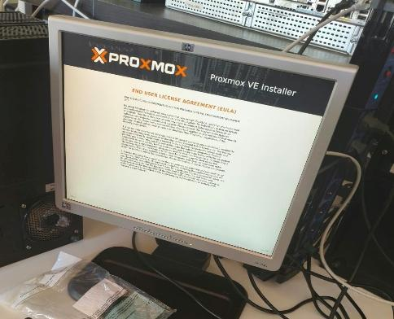</p>

A continuación, el instalador nos pedirá configurar la cuenta de administrador. Tendremos que introducir un correo electrónico y crear una contraseña segura que utilizaremos para acceder a Proxmox. Es importante guardar estos datos para poder iniciar sesión más adelante.

<p align="center">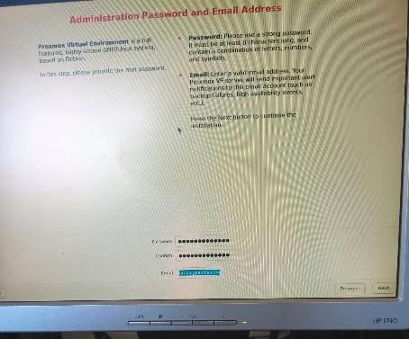</p>

Después, configuraremos la dirección IP del servidor para que tenga conectividad con los otros ordenadores de la red. También indicaremos la máscara de red, la puerta de enlace y el servidor DNS para asegurarnos de que la conexión funcione correctamente.

<p align="center">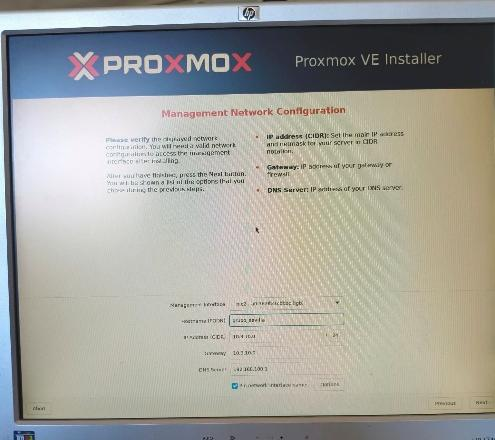</p>

Por último, revisaremos el resumen de la configuración para comprobar que todos los datos sean correctos. Si todo está bien, pulsaremos **Install** para comenzar la instalación de Proxmox. Esperaremos a que termine y, una vez finalizada, reiniciaremos el servidor para empezar a utilizarlo.

<p align="center">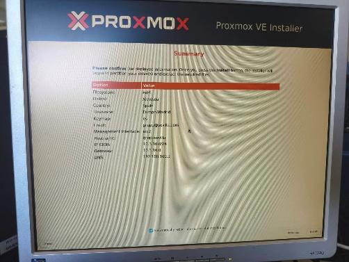</p>

## 2. Direcciones IP y redes VLAN

Según el diagrama, nuestra sede utiliza la red `10.3.0.0/16` y tiene las siguientes VLAN:

| VLAN | Departamento | Red |
|---:|---|---|
| 310 | Servidores | `10.3.10.0/24` |
| 320 | RRHH | `10.3.20.0/24` |
| 330 | Dirección | `10.3.30.0/24` |
| 399 | Gestión | `10.3.99.0/24` |

## 3. Conexión al Cisco 3560 mediante consola

Primero, tendremos que instalar PuTTY en nuestro ordenador cliente. Este programa nos permitirá conectarnos al switch Cisco 3560 mediante una conexión por consola y ejecutar los comandos necesarios para configurarlo.

<p align="center">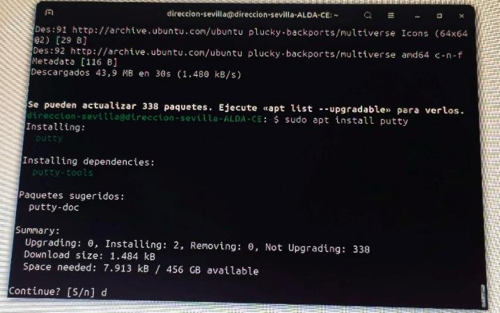</p>

Antes de conectar el switch Cisco 3560 al ordenador, identificaremos dónde se encuentra el puerto serial o de consola. Para ello, utilizaremos la imagen de referencia incluida en las capturas para localizar el puerto correcto y conectar el cable de consola.

<p align="center">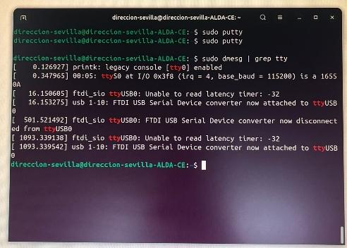</p>

Una vez instalado PuTTY, conectaremos el cable de consola entre el ordenador y el switch. Después, abriremos el programa, seleccionaremos el tipo de conexión **Serial** e indicaremos el puerto COM correspondiente.

<p align="center">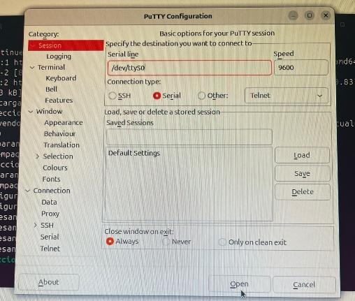</p>

Una vez conectado el cable y configurados los parámetros en PuTTY, pulsaremos **Open** para establecer la conexión. Si todo está correcto, podremos acceder a la consola del switch Cisco 3560 y empezar a introducir los comandos necesarios para su configuración.

<p align="center">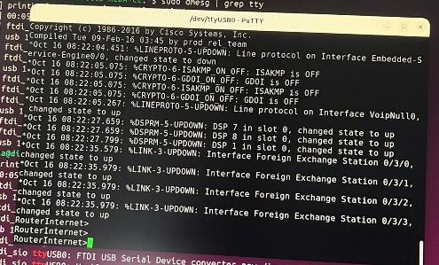</p>

## 4. Configuración de VLANs en el Cisco 3560

Primero, entraremos en el modo de configuración del switch utilizando el comando:

```text
conf t
```

Luego, crearemos las VLAN necesarias y asignaremos un nombre a cada una para identificar los diferentes departamentos de la sede de Sevilla.

<p align="center">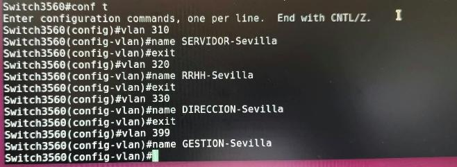</p>

A continuación, veremos las interfaces disponibles en el switch Cisco 3560. Esta información nos permitirá identificar los puertos que utilizaremos para conectar el servidor Proxmox y los futuros equipos, y así poder asignar cada puerto a la VLAN correspondiente.

<p align="center">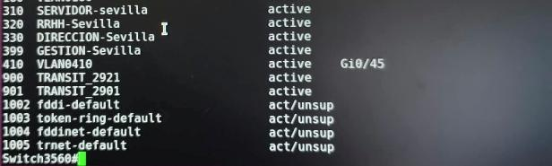</p>

En esta imagen podemos ver la configuración de PuTTY que utilizamos para conectarnos al switch Cisco 3560 mediante el puerto serial. Seleccionamos el tipo de conexión **Serial**, indicamos el puerto `/dev/ttyUSB0` y establecemos una velocidad de **9600 baudios**.

<p align="center">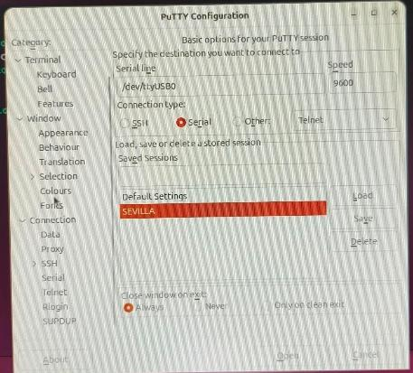</p>

Una vez configurados estos parámetros, pulsamos **Open** para acceder a la consola del switch. Desde allí, continuamos con la configuración de las VLAN que habíamos creado anteriormente y añadimos las que todavía faltaban.

<p align="center">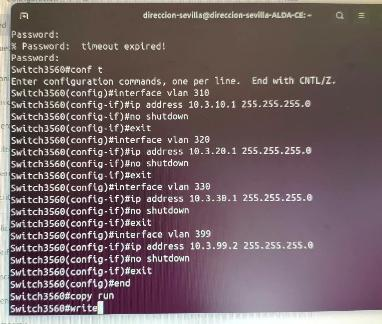</p>

Una vez conectados al switch Cisco 3560 mediante PuTTY, configuramos las VLAN necesarias para la sede de Sevilla. Para ello, entramos en el modo de configuración global con el comando `conf t` y creamos cada VLAN con su número, nombre y red IP correspondiente:

- **VLAN 310 — Servidores:** `10.3.10.0/24`
- **VLAN 320 — RRHH:** `10.3.20.0/24`
- **VLAN 330 — Dirección:** `10.3.30.0/24`
- **VLAN 399 — Gestión:** `10.3.99.0/24`

> **Nota:** las redes indicadas documentan el esquema IP de cada VLAN. La creación de una VLAN en el switch no configura por sí sola una dirección IP ni el enrutamiento de esa red.

---

# Fase 3: Despliegue de los equipos del laboratorio

Esta fase corresponde a la **Práctica 3: Despliegue de equipos del laboratorio**. Con Proxmox instalado y las VLAN configuradas en el switch, desplegamos los equipos del laboratorio del grupo:

1. Un **servidor virtualizado** con Ubuntu Server LTS, instalado en modo UEFI y con el sistema, el arranque, los datos de los usuarios y la swap en discos separados.
2. Un **cliente Linux virtualizado** con Linux Mint.
3. Un **cliente Linux físico** con Linux Mint, instalado en el equipo asignado al grupo.

### ¿Por qué separamos el sistema en varios discos?

Siguiendo las recomendaciones de LPIC-1 (objetivo 102.1), instalar Linux en un único disco o en una única partición raíz (`/`) es una mala práctica en un servidor de producción. Separar el árbol de directorios en discos y particiones independientes aporta:

- **Aislamiento de fallos:** si `/home` o `/var` se llenan, la raíz (`/`) sigue funcionando y el sistema no se bloquea por falta de espacio.
- **Rendimiento y tolerancia a fallos:** cada directorio puede estar en un disco de tecnología distinta o en RAID (por ejemplo, el sistema en SSD y los datos de usuarios en discos de mayor capacidad).
- **Seguridad:** cada partición se puede montar en `/etc/fstab` con opciones restrictivas como `noexec`, `nosuid` o `nodev`.
- **Actualizaciones independientes:** se puede reinstalar o migrar el sistema en `/` sin tocar los datos de los usuarios en `/home`.

## 1. Esquema de conexión en la VLAN 310

Antes de entrar en Proxmox, planificamos en la pizarra cómo se conectan los equipos dentro de la VLAN 310 (Servidores, red `10.3.10.0/24`):

| Equipo | Puerto del 3560 | Modo | Dirección IP |
|---|---|---|---|
| Switch Cisco 3560 (interfaz de la VLAN 310) | — | — | `10.3.10.1` |
| Servidor Proxmox | `0/22` | Access, VLAN 310 | `10.3.10.2/24` |
| Ordenador cliente (host PC) | `0/23` | Access, VLAN 310 | `10.3.10.3/24` |

Los dos puertos se configuran en modo **access** dentro de la VLAN 310, de modo que el servidor Proxmox y el ordenador cliente quedan en la misma red y pueden comunicarse. Dentro de Proxmox se alojarán las máquinas virtuales de los servidores (S1, S2…).

<p align="center">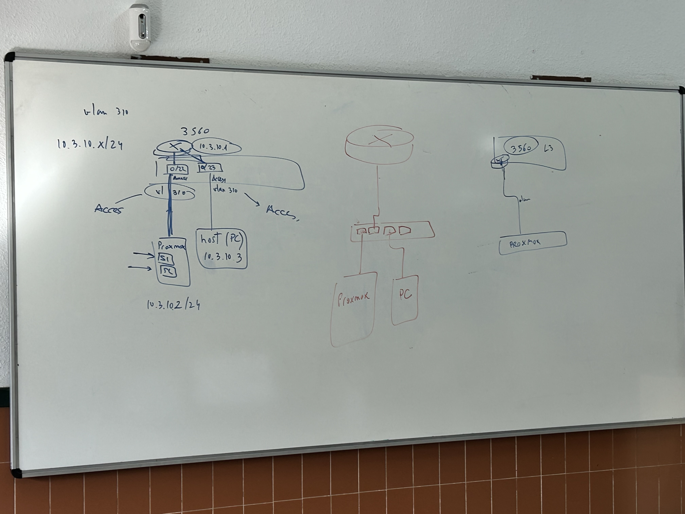</p>

## 2. Requisitos de los equipos

| Equipo | Sistema operativo | Firmware | Almacenamiento |
|---|---|---|---|
| Servidor (virtual, en Proxmox) | Ubuntu Server LTS (24.04.1) | UEFI obligatorio | 4 discos independientes |
| Cliente virtual (en Proxmox) | Linux Mint | UEFI o BIOS | 1 disco, particionado estándar |
| Cliente físico (equipo del grupo) | Linux Mint | UEFI o BIOS | 1 disco, particionado estándar |

## 3. Tarea 1: Diseño del particionado

Antes de iniciar el instalador, diseñamos el particionado del servidor. En Proxmox los discos de la máquina se conectan al controlador VirtIO SCSI, así que dentro de Ubuntu aparecen como `/dev/sda`, `/dev/sdb`, `/dev/sdc` y `/dev/sdd`.

| Disco | Disco en Proxmox | Dispositivo en Ubuntu | Tamaño del disco | Partición | Tamaño | Sistema de ficheros | Punto de montaje | Uso |
|---|---|---|---|---|---|---|---|---|
| Disco 1 | `scsi0` | `/dev/sda` | 1 GB | `/dev/sda1` | 512 MB | vfat (FAT32) | `/boot/efi` | Partición de sistema EFI, al principio del disco |
| Disco 1 | `scsi0` | `/dev/sda` | 1 GB | `/dev/sda2` | Resto (~500 MB) | ext4 | `/boot` | Núcleo Linux e initramfs |
| Disco 2 | `scsi1` | `/dev/sdb` | 20 GB | `/dev/sdb1` | 20 GB (todo el disco) | ext4 | `/` | Sistema base |
| Disco 3 | `scsi2` | `/dev/sdc` | 30 GB | `/dev/sdc1` | 30 GB (todo el disco) | ext4 | `/home` | Datos de los usuarios |
| Disco 4 | `scsi3` | `/dev/sdd` | 10 GB | `/dev/sdd1` | 10 GB (todo el disco) | swap | — | Memoria de intercambio |

**Justificación del diseño:**

- **`/boot/efi` en vfat:** el firmware UEFI solo sabe leer particiones FAT, por eso la partición EFI tiene que ser FAT32 y estar al principio del disco 1.
- **`/boot` en ext4:** solo guarda el núcleo y el initramfs, que son ficheros estáticos. Tenerlo aparte asegura que el sistema pueda arrancar aunque haya problemas en `/`.
- **`/` y `/home` en ext4:** ext4 es el sistema de ficheros por defecto de Ubuntu, es estable y tiene journaling. Cada uno ocupa su disco entero, así que los datos de los usuarios quedan aislados del sistema.
- **swap en un disco propio:** la memoria de intercambio no compite por espacio ni por accesos con el sistema ni con los datos.

> **Nota sobre el disco 1:** la práctica pide un disco de 1 GB con la partición EFI (mínimo recomendado de 512 MB) y `/boot` (1 GB). Las dos juntas no caben en 1 GB, así que hemos dejado 512 MB para EFI y el resto (~500 MB) para `/boot`, que es suficiente para el núcleo y el initramfs. Si se prefiere un `/boot` de 1 GB, el disco 1 tiene que ser de 2 GB.

Los clientes Linux Mint se instalan con el **particionado estándar** que propone el instalador, en un único disco.

## 4. Tarea 2: Instalación del servidor

### 4.1. Acceso a la interfaz web de Proxmox

Desde el ordenador cliente abrimos el navegador y accedemos a la interfaz web de Proxmox escribiendo la IP del servidor y el puerto `8006`:

```text
https://10.3.10.2:8006
```

El navegador mostrará un aviso de certificado, porque Proxmox utiliza un certificado autofirmado. Lo aceptamos para continuar. En la pantalla de inicio de sesión introducimos el usuario `root`, la contraseña que definimos durante la instalación y el dominio **Linux PAM standard authentication**, y pulsamos **Login**.

<p align="center">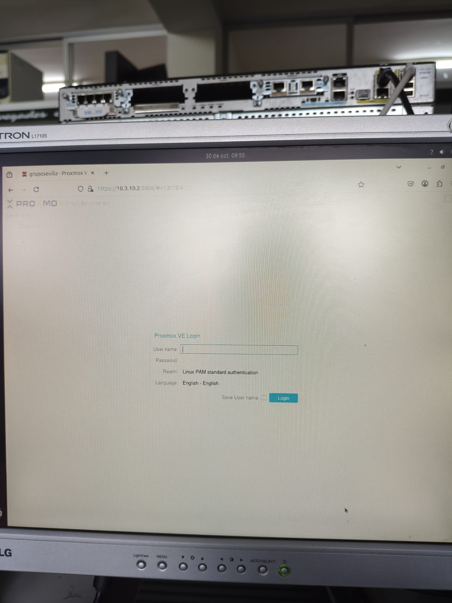</p>

Una vez dentro, vemos el panel **Datacenter** con nuestro nodo `gruposevilla` y sus almacenamientos: `local` (ISO, plantillas y copias de seguridad) y `local-lvm` (discos de las máquinas virtuales).

<p align="center">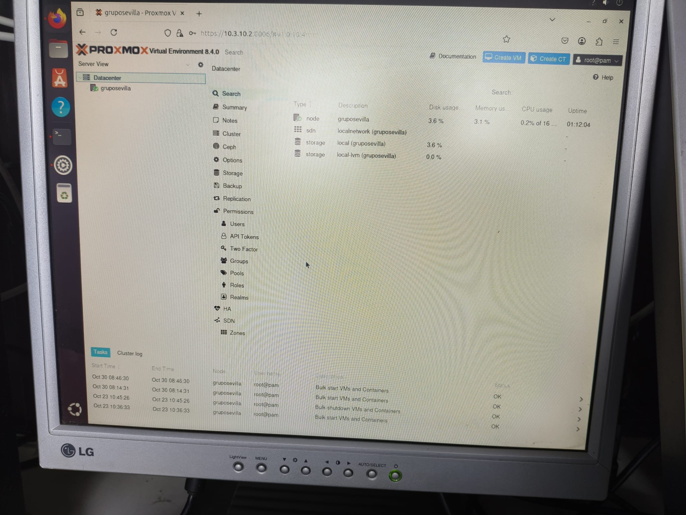</p>

### 4.2. Subir la imagen ISO de Ubuntu Server

Para instalar un sistema operativo en una máquina virtual necesitamos su imagen ISO dentro de Proxmox. Para ello, seleccionamos el almacenamiento **local (gruposevilla)**, entramos en **ISO Images** y pulsamos **Upload**. Elegimos el archivo `ubuntu-24.04.1-live-server-amd64.iso` desde el ordenador y pulsamos **Upload**.

<p align="center">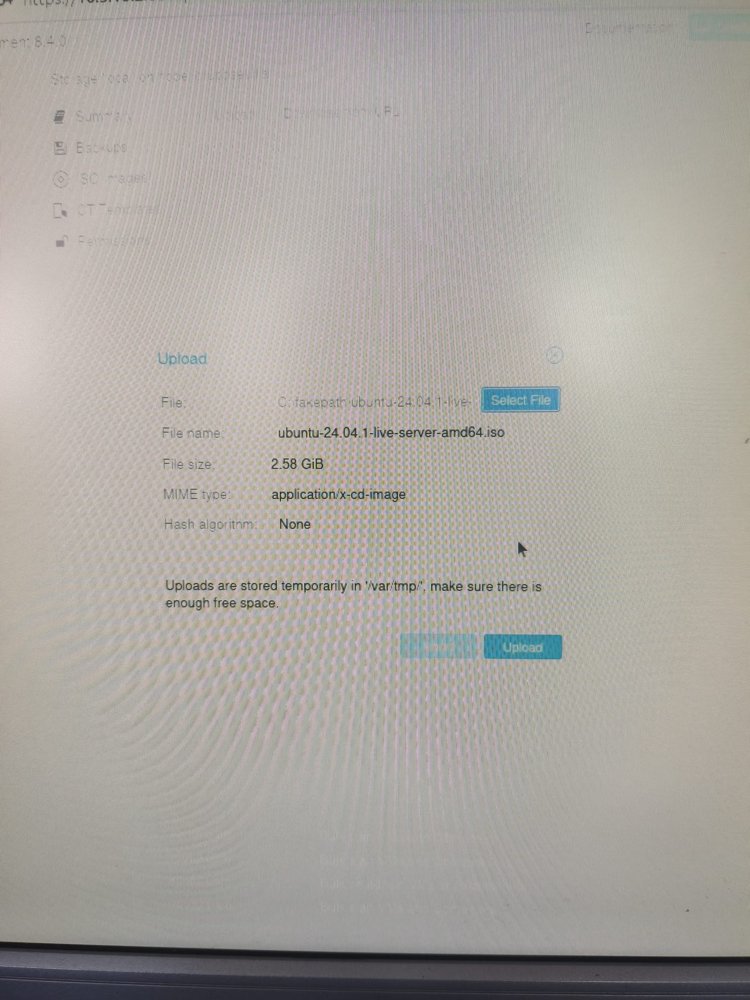</p>

Cuando termina la subida, la ISO aparece en la lista de **ISO Images** del almacenamiento `local`, con un tamaño de 2,77 GB.

<p align="center">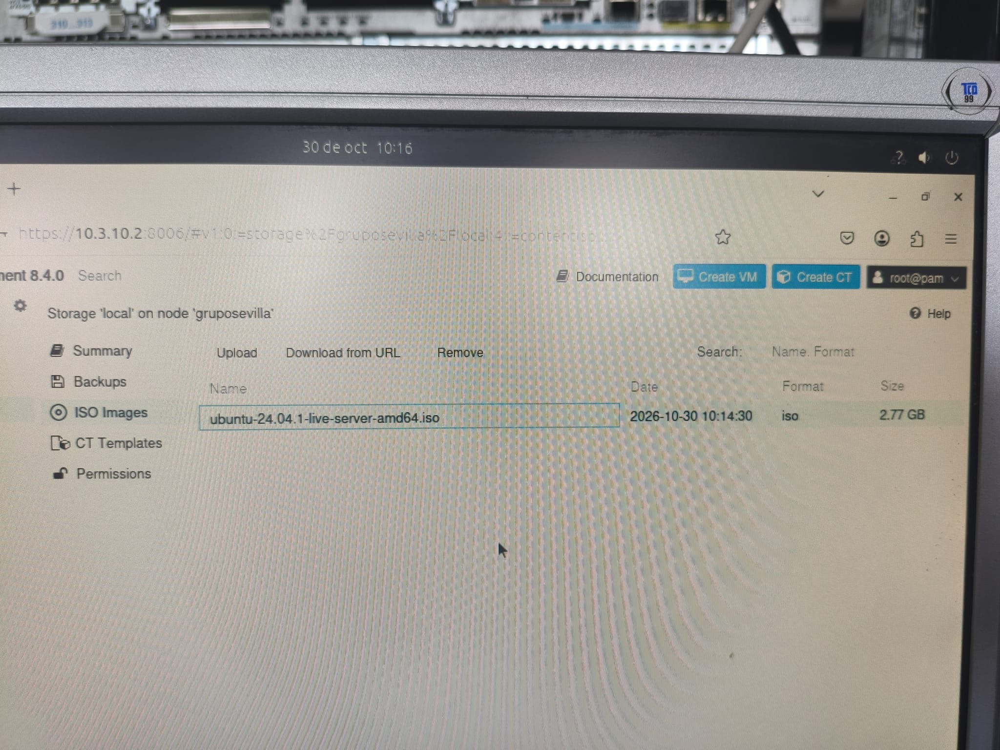</p>

### 4.3. Crear la máquina virtual

Pulsamos el botón **Create VM**, en la parte superior derecha, para abrir el asistente de creación de máquinas virtuales. Lo recorremos pestaña a pestaña.

**General.** Indicamos el nodo `gruposevilla`, el identificador de la máquina (**VM ID** `100`) y su nombre, `Ubuntuserver`.

<p align="center">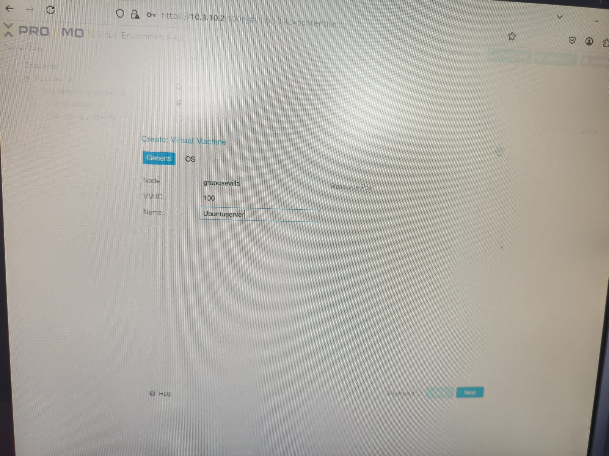</p>

**OS.** Marcamos **Use CD/DVD disc image file (iso)**, seleccionamos el almacenamiento `local` y la ISO `ubuntu-24.04.1-live-server-amd64.iso`. Como sistema invitado dejamos **Linux** con la versión **6.x – 2.6 Kernel**.

<p align="center">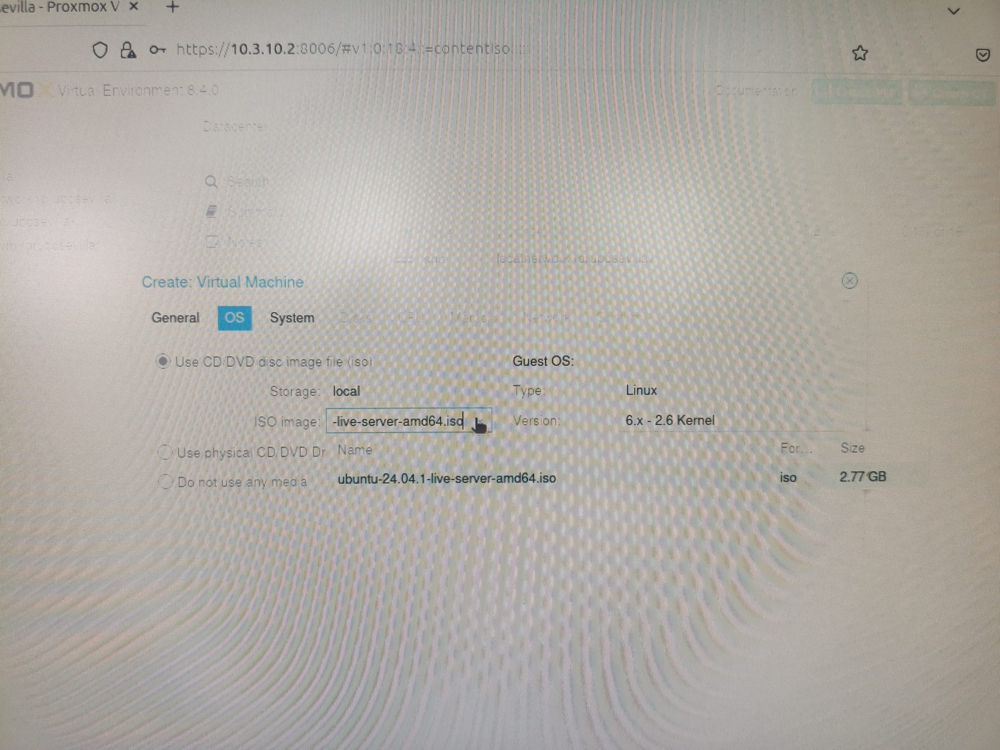</p>

**System.** Dejamos la tarjeta gráfica y el tipo de máquina por defecto y el controlador SCSI **VirtIO SCSI single**. Como BIOS elegimos **OVMF (UEFI)**, marcamos **Add EFI Disk** y guardamos el disco EFI en `local-lvm`. Con esto la máquina arranca en **modo UEFI**, como exige la práctica. El disco EFI de Proxmox solo guarda las variables del firmware y no es uno de los cuatro discos del diseño.

<p align="center">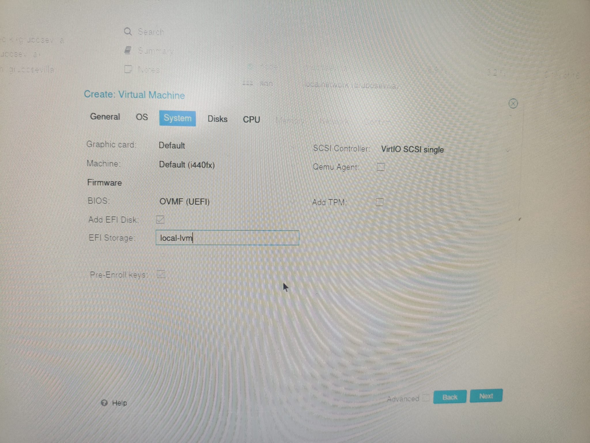</p>

**Disks.** En el asistente se creó un primer disco, `scsi0`, en el almacenamiento `local-lvm` con un tamaño de **32 GB** y sin caché. Este disco no cumple el diseño de la Tarea 1, así que después lo sustituimos por los cuatro discos de la práctica (apartado 4.5).

<p align="center">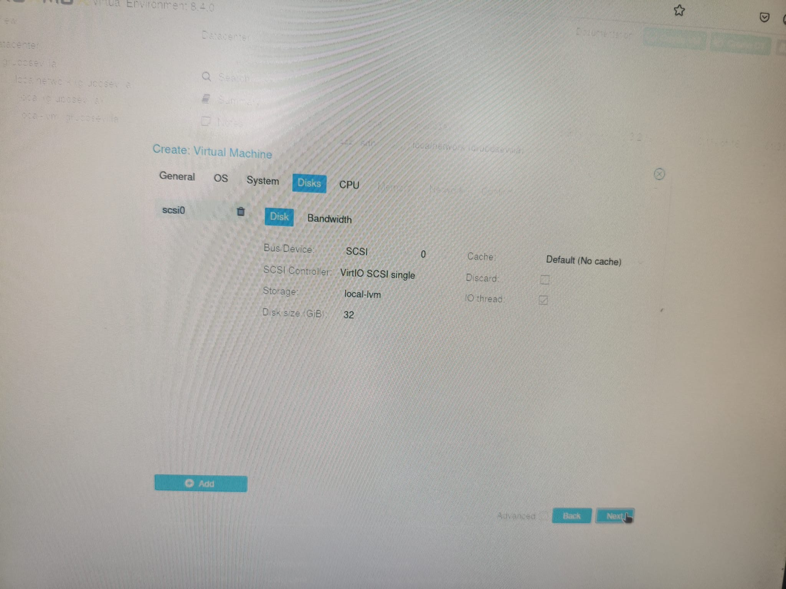</p>

**CPU y Memory.** Asignamos 1 socket con 1 núcleo (tipo de CPU `x86-64-v2-AES`) y **2048 MB** de memoria RAM. Estos valores se pueden ver en el resumen final.

**Network.** Conectamos la tarjeta de red al puente `vmbr0`, que es la interfaz de red del servidor Proxmox, con el modelo **VirtIO (paravirtualized)** y el cortafuegos activado. Así, la máquina virtual sale a la red por el mismo puerto que el servidor.

<p align="center">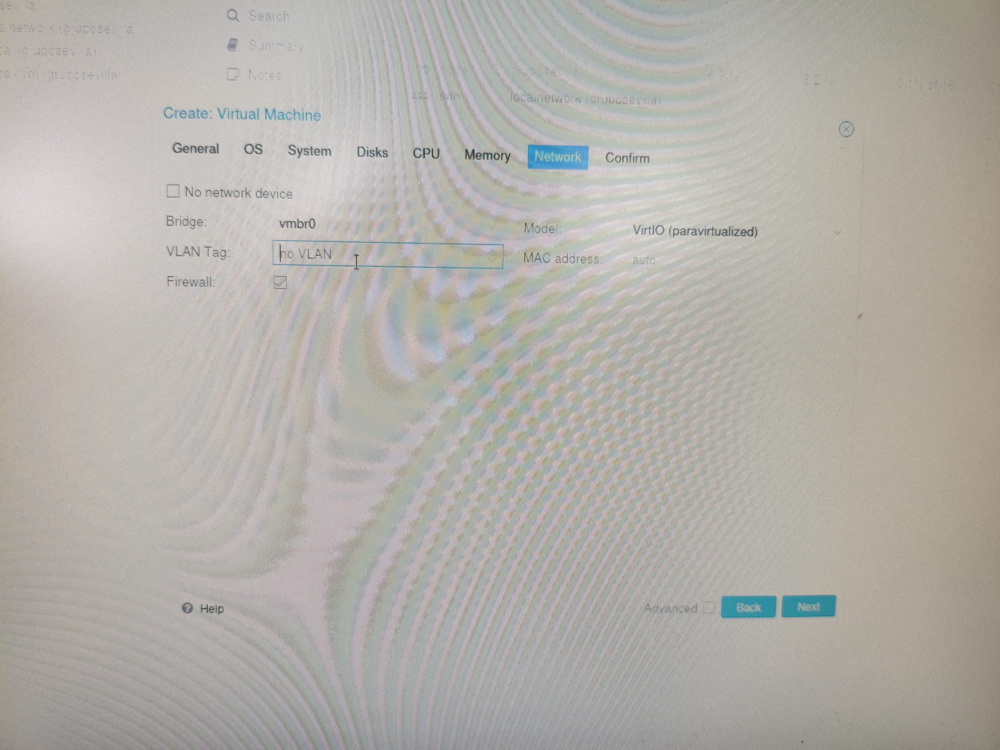</p>

**Confirm.** Revisamos el resumen de la configuración y pulsamos **Finish** para crear la máquina:

| Parámetro | Valor |
|---|---|
| `vmid` / `name` | `100` / `Ubuntuserver` |
| `nodename` | `gruposevilla` |
| `sockets` / `cores` / `cpu` | `1` / `1` / `x86-64-v2-AES` |
| `memory` | `2048` MB |
| `ostype` | `l26` (Linux) |
| `ide2` | `local:iso/ubuntu-24.04.1-live-server-amd64.iso,media=cdrom` |
| `scsi0` | `local-lvm:32,iothread=on` |
| `scsihw` | `virtio-scsi-single` |
| `efidisk0` | `local-lvm:1,efitype=4m,pre-enrolled-keys=1` |
| `net0` | `virtio,bridge=vmbr0,firewall=1` |

<p align="center">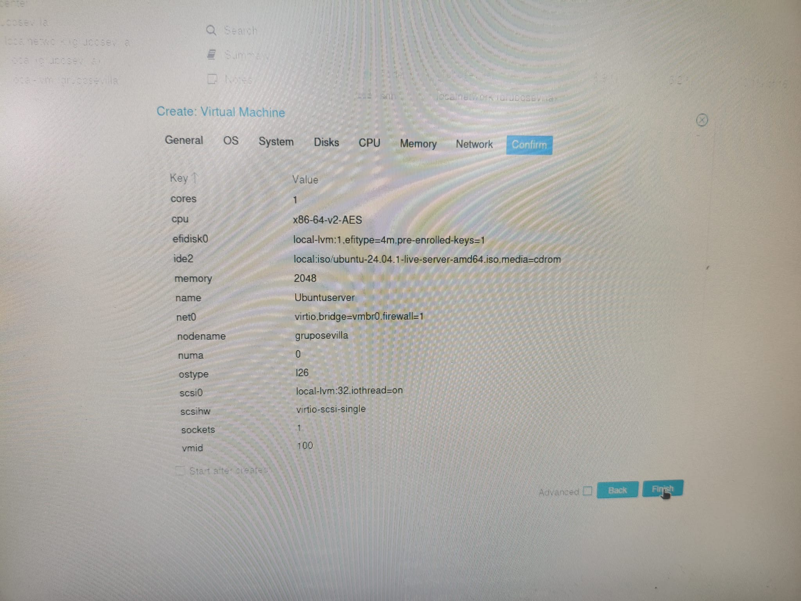</p>

### 4.4. Comprobación de la máquina virtual

Al volver al panel **Datacenter**, la nueva máquina virtual aparece en la lista de recursos como **100 (Ubuntuserver)**, dentro del nodo `gruposevilla`.

<p align="center">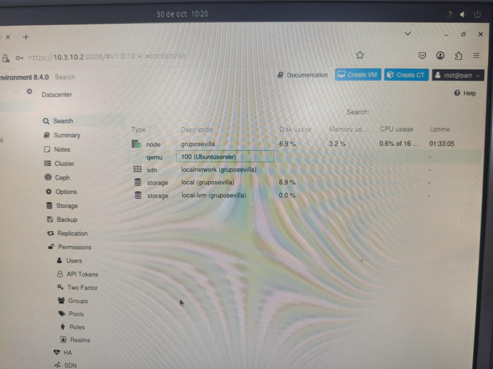</p>

### 4.5. Añadir los cuatro discos del diseño

Con la máquina apagada, seleccionamos **100 (Ubuntuserver) → Hardware** y ajustamos los discos al diseño de la Tarea 1:

1. Seleccionamos el disco de 32 GB (`scsi0`), pulsamos **Detach** y después **Remove** para eliminarlo.
2. Pulsamos **Add → Hard Disk** y creamos los cuatro discos en `local-lvm`, con el bus **SCSI**:

| Disco | Bus/Device | Tamaño |
|---|---|---|
| Disco 1 — arranque y EFI | `scsi0` | 1 GB |
| Disco 2 — sistema base | `scsi1` | 20 GB |
| Disco 3 — datos de usuarios | `scsi2` | 30 GB |
| Disco 4 — swap | `scsi3` | 10 GB |

3. En **Options → Boot Order** comprobamos que la máquina arranca primero desde el CD (`ide2`) para iniciar el instalador.

> **Pendiente:** añadir una captura de la pestaña **Hardware** con los cuatro discos.

### 4.6. Instalación de Ubuntu Server con particionado manual

1. Iniciamos la máquina (**Start**) y abrimos la **Console**. La máquina arranca en modo UEFI desde la ISO de Ubuntu Server.
2. Seguimos el instalador (idioma, teclado, red) hasta llegar a **Guided storage configuration**.
3. Elegimos **Custom storage layout**, que es el particionado manual. No usamos el particionado automático.
4. Creamos las particiones en cada disco tal como las diseñamos en la Tarea 1:
   - En `/dev/sda`: marcamos el disco como **Use as Boot Device**, lo que crea la partición EFI (`/boot/efi`, vfat), y en el espacio libre que queda añadimos una partición ext4 montada en `/boot`.
   - En `/dev/sdb`: una partición ext4 que ocupa todo el disco, montada en `/`.
   - En `/dev/sdc`: una partición ext4 que ocupa todo el disco, montada en `/home`.
   - En `/dev/sdd`: una partición que ocupa todo el disco, con formato **swap**.
5. Revisamos el resumen, confirmamos y completamos la instalación (usuario, nombre del equipo y servidor SSH).
6. Al terminar, quitamos la ISO de la máquina (**Hardware → CD/DVD Drive → Do not use any media**) y reiniciamos. El sistema tiene que arrancar solo desde el disco.

> **Pendiente:** añadir capturas del particionado manual (**Custom storage layout**) y del resumen final.

## 5. Tarea 3: Verificación después de la instalación

Una vez que el sistema arranca, entramos en la terminal y ejecutamos las siguientes comprobaciones.

**1. El sistema ha arrancado en modo UEFI.** Si existe el directorio `/sys/firmware/efi`, el sistema se ha iniciado en modo UEFI:

```bash
ls /sys/firmware/efi
[ -d /sys/firmware/efi ] && echo "Arranque en modo UEFI" || echo "Arranque en modo BIOS"
```

> **Pendiente:** captura del resultado.

**2. Cada punto de montaje está en su disco.** Con `lsblk` vemos qué partición y qué disco físico corresponden a `/`, `/home`, `/boot`, `/boot/efi` y la swap. Con `df -h` vemos el tamaño y el espacio usado de cada punto de montaje:

```bash
lsblk -f
df -h
```

> **Pendiente:** captura del resultado.

**3. Montaje automático por UUID.** El fichero `/etc/fstab` tiene que montar todos los puntos críticos al arrancar, identificando cada partición por su UUID:

```bash
cat /etc/fstab
sudo blkid
```

Con `blkid` podemos comparar los UUID de `/etc/fstab` con los de cada partición.

> **Pendiente:** captura del resultado.

## 6. Instalación de los clientes Linux Mint

### 6.1. Cliente virtualizado

1. Subimos la ISO de Linux Mint al almacenamiento `local` de Proxmox, igual que hicimos con la de Ubuntu Server (apartado 4.2).
2. Creamos una nueva máquina virtual con **Create VM**, con un único disco y la tarjeta de red en el puente `vmbr0`.
3. Instalamos Linux Mint con la opción de particionado estándar del instalador (**Erase disk and install Linux Mint**).

> **Pendiente:** capturas de la creación de la máquina y de la instalación.

### 6.2. Cliente físico

1. Arrancamos el equipo físico del grupo desde un USB con Linux Mint (igual que en la Fase 2, apartado 1).
2. Instalamos Linux Mint en el único disco del equipo con el particionado estándar.
3. Conectamos el equipo a un puerto de la VLAN 310 del switch (por ejemplo, `0/23`, con la IP `10.3.10.3/24`) para que llegue al servidor y a la interfaz de Proxmox.

> **Pendiente:** capturas de la instalación y de la conectividad con el servidor.

---

<div align="center">

**Grupo Sevilla · Proyecto intermodular · 2.º ASIX · Curso 2026–2027**

</div>
