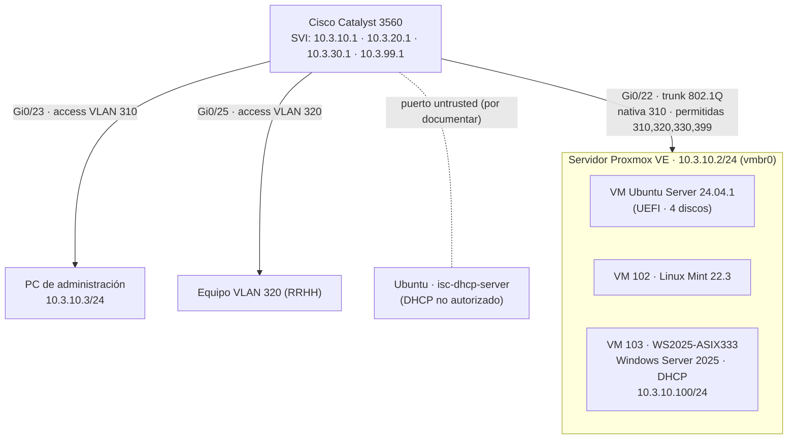

<div align="center">


# Documento del proyecto · Grupo Sevilla SL

**Proyecto intermodular · Sistema informático empresarial**<br />
2.º ASIX · Curso 2026–2027

[⬅ Volver al repositorio](../README.md) · [Recursos](../Recursos/) · [Bitácora](../Bitacora/) · [Tablero Trello](https://trello.com/b/ZamItCqc/grupo-sevilla)

</div>

---

## Índice

- [Resumen del proyecto](#resumen-del-proyecto)
- [Objetivos](#objetivos)
- [Tecnologías y requisitos](#tecnologías-y-requisitos)
- [Topología y direccionamiento](#topología-y-direccionamiento)
- [Práctica 1 · Organización del grupo de trabajo](#práctica-1--organización-del-grupo-de-trabajo)
  - [1.1 Roles y responsables](#11-roles-y-responsables)
  - [1.2 Herramientas y técnicas](#12-herramientas-y-técnicas)
  - [1.3 Repositorio de documentación](#13-repositorio-de-documentación)
  - [1.4 Bitácora](#14-bitácora)
  - [1.5 Normas de colaboración y metodología](#15-normas-de-colaboración-y-metodología)
- [Práctica 2 · Proxmox VE y VLANs en el Cisco 3560](#práctica-2--proxmox-ve-y-vlans-en-el-cisco-3560)
  - [2.1 Instalación de Proxmox VE](#21-instalación-de-proxmox-ve)
  - [2.2 Acceso al switch por consola serie](#22-acceso-al-switch-por-consola-serie)
  - [2.3 Creación de las VLANs](#23-creación-de-las-vlans)
  - [2.4 Interfaces VLAN (SVI)](#24-interfaces-vlan-svi)
  - [2.5 Configuración de los puertos](#25-configuración-de-los-puertos)
- [Práctica 3 · Despliegue de los equipos del laboratorio](#práctica-3--despliegue-de-los-equipos-del-laboratorio)
  - [3.1 Esquema de conexión en la VLAN 310](#31-esquema-de-conexión-en-la-vlan-310)
  - [3.2 Requisitos de los equipos](#32-requisitos-de-los-equipos)
  - [3.3 Diseño del particionado del servidor](#33-diseño-del-particionado-del-servidor)
  - [3.4 Creación de la VM en Proxmox](#34-creación-de-la-vm-en-proxmox)
  - [3.5 Instalación de Ubuntu Server con particionado manual](#35-instalación-de-ubuntu-server-con-particionado-manual)
  - [3.6 Verificación posterior a la instalación](#36-verificación-posterior-a-la-instalación)
  - [3.7 Clientes Linux Mint](#37-clientes-linux-mint)
- [Práctica 4 · Windows Server 2025, DHCP y DHCP Snooping](#práctica-4--windows-server-2025-dhcp-y-dhcp-snooping)
  - [4.1 Planificación de la infraestructura](#41-planificación-de-la-infraestructura)
  - [4.2 Creación de la VM e instalación](#42-creación-de-la-vm-e-instalación)
  - [4.3 Configuración del almacenamiento](#43-configuración-del-almacenamiento)
  - [4.4 Configuración TCP/IP](#44-configuración-tcpip)
  - [4.5 Servicio DHCP en Windows Server](#45-servicio-dhcp-en-windows-server)
  - [4.6 Servidor DHCP no autorizado en Ubuntu](#46-servidor-dhcp-no-autorizado-en-ubuntu)
  - [4.7 DHCP Snooping en el Cisco 3560](#47-dhcp-snooping-en-el-cisco-3560)
- [Incidencias y soluciones](#incidencias-y-soluciones)
- [Estado del proyecto y tareas pendientes](#estado-del-proyecto-y-tareas-pendientes)
- [Conclusiones](#conclusiones)

---

## Resumen del proyecto

**Grupo Sevilla SL** es la sede ficticia que el grupo diseña y despliega en el laboratorio del ciclo de **Administración de Sistemas Informáticos en Red (ASIX)**. El proyecto se divide en prácticas, tal como las plantean los enunciados del módulo:

| Práctica | Bloque del enunciado | Contenido | Resultado |
|---|---|---|---|
| [**1**](#práctica-1--organización-del-grupo-de-trabajo) | Fase 1 · Presentación y organización iniciales | Roles, herramientas, repositorio y bitácora | Equipo organizado, repositorio con documentación, recursos, bitácora y tablero Trello |
| [**2**](#práctica-2--proxmox-ve-y-vlans-en-el-cisco-3560) | Fase 1 · Presentación y organización iniciales | Instalación de Proxmox VE y VLANs en un Cisco Catalyst 3560 | Hipervisor operativo y cuatro VLANs con su interfaz SVI |
| [**3**](#práctica-3--despliegue-de-los-equipos-del-laboratorio) | Unidad 1 | Ubuntu Server virtualizado (UEFI, cuatro discos) y clientes Linux Mint | Servidor con `/boot/efi`, `/boot`, `/`, `/home` y swap en discos separados |
| [**4**](#práctica-4--windows-server-2025-dhcp-y-dhcp-snooping) | Unidad 1 | Windows Server 2025 con almacenamiento separado, IP estática y DHCP; DHCP fraudulento y DHCP Snooping | Ámbito DHCP `10.3.10.0/24` creado y servidor fraudulento preparado para la prueba |

## Objetivos

- Preparar un servidor físico como **hipervisor Proxmox VE** para alojar servidores y clientes virtualizados.
- **Segmentar la red** de la sede en VLANs por departamento (Servidores, RRHH, Dirección y Gestión).
- Desplegar un **servidor Linux** siguiendo buenas prácticas de particionado (LPIC-1, objetivo 102.1) y arranque **UEFI**.
- Desplegar un **servidor Windows Server 2025** con almacenamiento organizado por función y servicio **DHCP**.
- Proteger la red frente a **servidores DHCP no autorizados** mediante **DHCP Snooping**.
- Documentar todo el proceso con evidencias reales.

## Tecnologías y requisitos

| Elemento | Detalle |
|---|---|
| Hipervisor | Proxmox VE 8.4 en servidor físico (nodo `gruposevilla` / `sevilla`) |
| Conmutación | Cisco Catalyst 3560 (consola serie a 9600 baudios mediante adaptador USB–serie FTDI) |
| Servidor Linux | Ubuntu Server 24.04.1 LTS (`ubuntu-24.04.1-live-server-amd64.iso`) |
| Clientes | Linux Mint 22.3 Cinnamon (`linuxmint-22.3-cinnamon-64bit.iso`) |
| Servidor Windows | Windows Server 2025, edición de evaluación (compilación 26100) |
| DHCP fraudulento | Equipo físico con Ubuntu 24.04.5 LTS e `isc-dhcp-server` |
| Equipo de administración | PC con Ubuntu y PuTTY para la consola del switch |
| Acceso a Proxmox | Interfaz web en `https://10.3.10.2:8006` |
| Gestión del proyecto | GitHub (repositorio y Markdown) y Trello |

---

## Topología y direccionamiento

La sede utiliza el bloque **`10.3.0.0/16`**, dividido en una subred `/24` por VLAN:

| VLAN | Nombre en el switch | Departamento | Red | Puerta de enlace (SVI) |
|---:|---|---|---|---|
| 310 | `SERVIDOR-Sevilla` | Servidores | `10.3.10.0/24` | `10.3.10.1` |
| 320 | `RRHH-Sevilla` | RRHH | `10.3.20.0/24` | `10.3.20.1` |
| 330 | `DIRECCION-Sevilla` | Dirección | `10.3.30.0/24` | `10.3.30.1` |
| 399 | `GESTION-Sevilla` | Gestión | `10.3.99.0/24` | `10.3.99.1` |



| Equipo | Puerto del 3560 | Modo | Dirección IP |
|---|---|---|---|
| Switch Cisco 3560 (SVI VLAN 310) | — | — | `10.3.10.1/24` |
| Servidor Proxmox VE | `Gi0/22` | Trunk 802.1Q, VLAN nativa 310 | `10.3.10.2/24` |
| PC de administración / cliente | `Gi0/23` | Access, VLAN 310 | `10.3.10.3/24` |
| Equipo de RRHH | `Gi0/25` | Access, VLAN 320 | — |
| Windows Server 2025 (VM 103) | vía `Gi0/22` | — | `10.3.10.100/24` (estática) |
| Clientes DHCP | — | — | `10.3.10.100` – `10.3.10.200` (ámbito configurado) |

> [!NOTE]
> En la planificación inicial (pizarra) el puerto del servidor Proxmox figuraba en modo *access*. En la configuración final del switch, `Gi0/22` quedó como **trunk** con VLAN nativa 310: el tráfico sin etiquetar de Proxmox sigue perteneciendo a la VLAN 310, y además el enlace puede transportar las VLANs 320, 330 y 399 hacia las máquinas virtuales.

---

# Práctica 1 · Organización del grupo de trabajo

> **Fase 1 · Presentación y organización iniciales.** Antes de empezar el proyecto, el grupo debe repartir los roles (con un suplente para cada uno), elegir las herramientas de trabajo, crear el repositorio de documentación con su bitácora y publicar el enlace de acceso.

### Tareas del enunciado y cumplimiento

| Tarea | Dónde se documenta | Estado |
|---|---|---|
| 1. Asignación de roles y justificación | [1.1](#11-roles-y-responsables) | ✅ |
| 2. Herramientas y técnicas (comunicación, documentación y repositorio, diagramas, gestión de proyectos) | [1.2](#12-herramientas-y-técnicas) | ⚠️ Faltan por documentar las herramientas de comunicación y de diagramas |
| 3. Repositorio: documento del proyecto, carpeta de recursos, panel de gestión y bitácora | [1.3](#13-repositorio-de-documentación) | ✅ |
| 4. Enlace de acceso al repositorio | [github.com/AliChan-ai/Grupo-Sevilla](https://github.com/AliChan-ai/Grupo-Sevilla) | ✅ |

## 1.1 Roles y responsables

El equipo tiene **seis integrantes** organizados en **tres áreas**. Cada área está a cargo de **dos personas**: así se cumple el requisito del enunciado de que cada rol tenga un suplente que lo sustituya si el titular no está en clase, y además se garantiza el apoyo mutuo y la continuidad del trabajo. El reparto se cerró en la primera sesión por acuerdo de todo el equipo (bitácoras de la semana 1).

| Rol (enunciado) | Área | Integrantes | Responsabilidades |
|---|---|---|---|
| **Jefe de proyecto** | Coordinación | [Yeray Mico](https://github.com/Yekiyey) · [Sharaf El Mahfoudi](https://github.com/Sh4raf-05) | Coordinar el grupo y la sede, planificar y asignar tareas, controlar plazos, coordinar las exposiciones y justificar las decisiones del grupo |
| **Secretario** | Documentación | [Hamza Souiad](https://github.com/hamzasouiad) · [Ali Slatna](https://github.com/AliChan-ai) | Redactar las actas, coordinar la documentación que aporta cada integrante, mantener la bitácora semanal y hacer las entregas (commit con el nombre de la práctica y enlace en Aules) |
| **Responsable técnico** | Técnica | [Jhoel Fuentes](https://github.com/Jhoel52) · [Raul Llorca](https://github.com/raulllorcagomez) | Gestionar las herramientas de trabajo, llevar el inventario del hardware y software cedido por el centro, y diseñar, implementar y probar la solución técnica |

## 1.2 Herramientas y técnicas

| Necesidad (enunciado) | Herramienta | Uso |
|---|---|---|
| Repositorio de documentación (obligatorio) | **GitHub** | Repositorio común con la documentación, los recursos y la bitácora |
| Documentación | **Markdown** | Documento del proyecto, bitácoras y README |
| Gestión del proyecto (obligatoria) | **Trello** | [Tablero del grupo](https://trello.com/b/ZamItCqc/grupo-sevilla) con las columnas *Pendiente → En curso → En revisión → Hecho* |
| Diagramas | Mermaid (en GitHub) | Diagrama de topología de este documento |
| Comunicación del grupo | *Pendiente de documentar* | — |
| Administración del laboratorio | PuTTY, interfaz web de Proxmox VE | Consola del switch y gestión de máquinas virtuales |

> [!NOTE]
> El inventario de hardware cedido por el centro aún no está documentado. En la revisión inicial se detectó que **tres equipos cliente no tenían memoria RAM** (bitácora semanal, semana 2).

## 1.3 Repositorio de documentación

Enlace de acceso: **https://github.com/AliChan-ai/Grupo-Sevilla**

| Elemento exigido | Ubicación |
|---|---|
| Documento del proyecto | [`Documentacion/Proyecto.md`](Proyecto.md) (este documento) |
| Carpeta de recursos a entregar | [`Recursos/`](../Recursos/): imágenes, configuraciones de switch, router y servidores, y scripts |
| Panel de gestión del proyecto | [Tablero Trello](https://trello.com/b/ZamItCqc/grupo-sevilla) |
| Bitácora | [`Bitacora/`](../Bitacora/): registro semanal del grupo y registro diario de cada integrante |

Cada entrega la hace el secretario con un **commit que lleva el nombre de la práctica** (por ejemplo, `Fase 1 Práctica 2`) y el enlace a ese commit en Aules.

## 1.4 Bitácora

Se llevan dos registros en Markdown, en **orden cronológico inverso** (primero la entrada más reciente):

| Registro | Responsable | Contenido de cada entrada |
|---|---|---|
| [Diario](../Bitacora/Diario/), un fichero por integrante | Cada integrante, al terminar cada sesión | Objetivo · Qué ha hecho · Qué ha conseguido · Qué no ha conseguido y por qué |
| [Semanal](../Bitacora/Semanal.md), un único fichero | Secretario, al terminar cada semana | Objetivo del grupo · Qué se ha conseguido · Qué no se ha conseguido y por qué |

## 1.5 Normas de colaboración y metodología

El grupo trabaja en un ciclo continuo **Planificar → Organizar → Desarrollar → Documentar**, y sigue estas normas:

| Norma | Detalle | Ejemplo |
|---|---|---|
| Commits claros | En español, en imperativo y con el formato `tipo: descripción` | `docs: añadir justificación de roles` |
| Prefijos normalizados | `docs` documentación · `feat` nueva funcionalidad · `fix` corrección · `chore` mantenimiento | `feat: crear script de copia de seguridad` |
| Bitácora al día | Cada sesión en `Bitacora/Diario/` y resumen semanal en `Bitacora/Semanal.md` | — |
| Nomenclatura de archivos | Sin espacios ni tildes, con el formato `Nombre_Documento.md` | ✅ `Justificacion_Roles.md` · ❌ `Justificación roles.md` |
| Revisión cruzada | Al menos otro integrante revisa cada cambio relevante antes de validarlo | Autor → Revisor → Validado |


---

# Práctica 2 · Proxmox VE y VLANs en el Cisco 3560

> **Fase 1 · Instalación de los servidores de trabajo y conexión a la red del laboratorio.** Hay que preparar el servidor de la sede para virtualizar servidores y clientes con Proxmox: instalarlo, estudiar el diagrama de red para asignar IPs y redes, conectar por consola al switch 3560 y configurar sus VLANs para el servidor y los futuros equipos.


### Tareas del enunciado y cumplimiento

| Tarea | Dónde se documenta | Estado |
|---|---|---|
| 1. Conectar, instalar y ejecutar Proxmox en el servidor de la sede | [2.1](#21-instalación-de-proxmox-ve) | ✅ |
| 2. Estudiar el diagrama de red: IPs y redes a utilizar | [Topología y direccionamiento](#topología-y-direccionamiento) | ✅ |
| 3. Investigar cómo conectar al switch 3560 por consola | [2.2](#22-acceso-al-switch-por-consola-serie) | ✅ |
| 4. Configurar el switching del 3560 (VLANs) para Proxmox y futuros equipos | [2.3](#23-creación-de-las-vlans) – [2.5](#25-configuración-de-los-puertos) | ✅ |

## 2.1 Instalación de Proxmox VE

**1. Arranque desde USB.** Conectamos el USB con el instalador, entramos en el menú de arranque del firmware y elegimos la entrada **`UEFI: Acer USB Flash Drive`** para que la instalación se haga en modo UEFI.

<p align="center">
  
  <br /><sub><i>Menú de arranque del firmware con la entrada UEFI del USB.</i></sub>
</p>

**2. Licencia.** En el instalador seleccionamos **Install Proxmox VE** y aceptamos el acuerdo de licencia (EULA).

<p align="center">
  
</p>

**3. Cuenta de administración.** Definimos la contraseña de `root` (mínimo 8 caracteres) y un correo para las notificaciones del sistema.

<p align="center">
  
  <br /><sub><i>El correo electrónico se ha ocultado en la captura.</i></sub>
</p>

**4. Red de gestión.** Indicamos la interfaz de gestión, el nombre de host, la dirección IP en notación CIDR, la puerta de enlace y el servidor DNS.

<p align="center">
  
</p>

**5. Resumen e instalación.** Revisamos el resumen y pulsamos **Install**.

<p align="center">
  
</p>

| Parámetro (resumen del instalador) | Valor |
|---|---|
| Sistema de ficheros / disco | `ext4` en `/dev/sda` |
| País / zona horaria / teclado | Spain / `Europe/Madrid` / `es` |
| Interfaz de gestión | `nic2` |
| Hostname | `gruposevilla` |
| IP (CIDR) / puerta de enlace | `10.3.10.0/24` / `10.3.10.0` |
| DNS | `192.168.100.1` |

> [!WARNING]
> En el instalador se introdujeron como IP y como puerta de enlace la **dirección de red** (`10.3.10.0`), que no es una dirección de host válida. La configuración se corrigió después en `/etc/network/interfaces`, donde el puente `vmbr0` tiene `address 10.3.10.2/24` y `gateway 10.3.10.1` (ver [4.4](#44-configuración-tcpip)). Con ella se accede a la interfaz web en `https://10.3.10.2:8006`.

## 2.2 Acceso al switch por consola serie

**1. Instalación de PuTTY** en el equipo de administración (Ubuntu):

```bash
sudo apt install putty
```

<p align="center">
  
</p>

**2. Primer intento con `/dev/ttyS0`.** Configuramos PuTTY con conexión **Serial** a **9600 baudios** sobre el puerto serie integrado `/dev/ttyS0`.

<p align="center">
  
</p>

**3. Identificación del puerto correcto.** El cable de consola se conecta mediante un adaptador **USB–serie**, así que buscamos en los mensajes del kernel qué dispositivo le ha asignado el sistema:

```bash
sudo dmesg | grep tty
```

La salida muestra que el conversor **FTDI USB Serial Device** se ha registrado como **`ttyUSB0`**.

<p align="center">
  
</p>

**4. Sesión definitiva.** Cambiamos la línea serie a **`/dev/ttyUSB0`** (9600 baudios) y guardamos la sesión como **`SEVILLA`** para reutilizarla.

<p align="center">
  
</p>

| Parámetro de PuTTY | Valor |
|---|---|
| Connection type | Serial |
| Serial line | `/dev/ttyUSB0` |
| Speed | `9600` |
| Sesión guardada | `SEVILLA` |

## 2.3 Creación de las VLANs

Desde el modo de configuración global creamos cada VLAN y le asignamos un nombre:

```text
Switch3560# configure terminal
Switch3560(config)# vlan 310
Switch3560(config-vlan)# name SERVIDOR-Sevilla
Switch3560(config-vlan)# exit
Switch3560(config)# vlan 320
Switch3560(config-vlan)# name RRHH-Sevilla
Switch3560(config-vlan)# exit
Switch3560(config)# vlan 330
Switch3560(config-vlan)# name DIRECCION-Sevilla
Switch3560(config-vlan)# exit
Switch3560(config)# vlan 399
Switch3560(config-vlan)# name GESTION-Sevilla
```

<p align="center">
  
</p>

Con `show vlan brief` comprobamos que las cuatro VLANs aparecen en estado **active**. El switch es compartido en el laboratorio, por eso la lista incluye también VLANs de otros grupos.

<p align="center">
  
</p>

## 2.4 Interfaces VLAN (SVI)

Crear una VLAN no le asigna ninguna dirección IP. Para que el switch tenga presencia en cada red, y sirva de puerta de enlace, configuramos una **interfaz VLAN (SVI)** por departamento:

```text
SW-BIL-3560(config)# interface vlan 310
SW-BIL-3560(config-if)# ip address 10.3.10.1 255.255.255.0
SW-BIL-3560(config-if)# no shutdown
SW-BIL-3560(config-if)# exit
SW-BIL-3560(config)# interface vlan 320
SW-BIL-3560(config-if)# ip address 10.3.20.1 255.255.255.0
SW-BIL-3560(config-if)# no shutdown
SW-BIL-3560(config-if)# exit
SW-BIL-3560(config)# interface vlan 330
SW-BIL-3560(config-if)# ip address 10.3.30.1 255.255.255.0
SW-BIL-3560(config-if)# no shutdown
SW-BIL-3560(config-if)# interface vlan 399
SW-BIL-3560(config-if)# ip address 10.3.99.1 255.255.255.0
SW-BIL-3560(config-if)# no shutdown
```

<p align="center">
  
</p>

> [!NOTE]
> En una primera sesión se asignó `10.3.99.2` a la VLAN 399. En la configuración posterior se dejó `10.3.99.1`, que sigue el mismo criterio que el resto de VLANs (`.1` como puerta de enlace). Para que el 3560 enrute entre VLANs se necesita además `ip routing`, que no aparece en las capturas.

## 2.5 Configuración de los puertos

**Gi0/22 → servidor Proxmox (trunk 802.1Q).**

```text
SW-BIL-3560(config)# interface gi0/22
SW-BIL-3560(config-if)# switchport trunk encapsulation dot1q
SW-BIL-3560(config-if)# switchport mode trunk
SW-BIL-3560(config-if)# switchport trunk native vlan 310
SW-BIL-3560(config-if)# switchport trunk allowed vlan 310,320,330,399
```

<p align="center">
  
  <br />
  
</p>

En el 3560 la encapsulación (`dot1q`) debe fijarse **antes** de poner el puerto en modo trunk. El registro `LINEPROTO-5-UPDOWN` confirma que el enlace se renegocia y vuelve a estado **up**.

**Gi0/23 → PC de la VLAN 310 · Gi0/25 → equipo de la VLAN 320 (access + PortFast).**

```text
SW-BIL-3560(config)# interface gi0/23
SW-BIL-3560(config-if)# switchport mode access
SW-BIL-3560(config-if)# switchport access vlan 310
SW-BIL-3560(config-if)# spanning-tree portfast
SW-BIL-3560(config-if)# exit
SW-BIL-3560(config)# interface gi0/25
SW-BIL-3560(config-if)# switchport access vlan 320
SW-BIL-3560(config-if)# switchport mode access
SW-BIL-3560(config-if)# spanning-tree portfast
```

<p align="center">
  
  <br />
  
</p>

**PortFast** lleva directamente a *forwarding* los puertos que conectan con un único equipo final, sin esperar a los estados de escucha y aprendizaje de STP. El aviso del IOS recuerda que no debe activarse en puertos conectados a otros switches.

> El listado completo de comandos está en [`configs/cisco-3560/vlans-svi-puertos.txt`](../Recursos/Configuraciones/cisco-3560/vlans-svi-puertos.txt).

---

# Práctica 3 · Despliegue de los equipos del laboratorio

Con Proxmox instalado y las VLANs configuradas, desplegamos:

1. Un **servidor virtualizado** con Ubuntu Server LTS en modo **UEFI**, con el arranque, el sistema, los datos de usuario y la swap en **discos separados**.
2. Un **cliente Linux virtualizado** con Linux Mint.
3. Un **cliente Linux físico** con Linux Mint.

### ¿Por qué separamos el sistema en varios discos?

Siguiendo LPIC-1 (objetivo 102.1), instalar todo en una única partición raíz es una mala práctica en un servidor de producción. Separar el árbol de directorios aporta:

- **Aislamiento de fallos:** si `/home` se llena, la raíz sigue funcionando.
- **Rendimiento y tolerancia a fallos:** cada punto de montaje puede ir en un disco o RAID distinto.
- **Seguridad:** cada partición se puede montar en `/etc/fstab` con opciones como `noexec`, `nosuid` o `nodev`.
- **Mantenimiento independiente:** se puede reinstalar el sistema sin tocar los datos de `/home`.


### Requisitos del enunciado y cumplimiento

| Requisito | Implementado | Estado |
|---|---|---|
| Ubuntu Server 24.04 LTS | Ubuntu Server 24.04.1 LTS | ✅ |
| Firmware EFI obligatorio | OVMF (UEFI) + `efidisk0`; `efivarfs` montado | ✅ |
| Disco 1 (1 GB): arranque + EFI | `scsi0` de **1,5 GB** (ESP 538 MB + `/boot` 986 MB, ver nota en 3.3) | ✅ con ajuste justificado |
| Disco 2 (20 GB): sistema base | `scsi2` 20 GB → `/` ext4 | ✅ |
| Disco 3 (30 GB): datos de usuarios | `scsi3` 30 GB → `/home` ext4 | ✅ |
| Disco 4 (10 GB): swap | `scsi1` 10 GB → swap | ✅ (el orden de los discos en Proxmox es distinto al del enunciado) |
| Particionado manual (no automático) | *Custom storage layout* | ✅ |
| Retirar el medio de instalación | Retirado en el arranque, pero `sr0` sigue apareciendo en `lsblk` | ⚠️ |
| Evidencia UEFI en `/sys` | `efivarfs` en `df -h`; falta la captura de `ls /sys/firmware/efi` | ⚠️ |
| Evidencia `lsblk` / `df -h` | Capturas incluidas | ✅ |
| `/etc/fstab` con UUID | Captura pendiente | ⏳ |
| Cliente Linux Mint virtualizado | VM 102 | ✅ |
| Cliente Linux Mint en equipo físico | Capturas pendientes | ⏳ |

## 3.1 Esquema de conexión en la VLAN 310

Antes de empezar planificamos en la pizarra la conexión del switch, el servidor Proxmox y el PC dentro de la VLAN 310 (`10.3.10.0/24`).

<p align="center">
  
  <br /><sub><i>Planificación inicial: switch 3560 (10.3.10.1), Proxmox (10.3.10.2/24) y PC (10.3.10.3).</i></sub>
</p>

## 3.2 Requisitos de los equipos

| Equipo | Sistema operativo | Firmware | Almacenamiento |
|---|---|---|---|
| Servidor (VM en Proxmox) | Ubuntu Server 24.04.1 LTS | UEFI obligatorio | 4 discos independientes |
| Cliente virtual (VM 102) | Linux Mint 22.3 Cinnamon | UEFI (OVMF) | 1 disco, particionado estándar |
| Cliente físico | Linux Mint | UEFI o BIOS | 1 disco, particionado estándar |

## 3.3 Diseño del particionado del servidor

Los discos se conectan al controlador **VirtIO SCSI single**, por lo que Ubuntu los ve como `/dev/sda` … `/dev/sdd`.

| Disco | Proxmox | Ubuntu | Tamaño | Partición | Tamaño | FS | Montaje | Uso |
|---|---|---|---|---|---|---|---|---|
| 1 | `scsi0` | `/dev/sda` | 1,5 GB | `sda1` | 538 MB | vfat (FAT32) | `/boot/efi` | Partición de sistema EFI |
| 1 | `scsi0` | `/dev/sda` | 1,5 GB | `sda2` | 986 MB | ext4 | `/boot` | Núcleo e initramfs |
| 2 | `scsi1` | `/dev/sdb` | 10 GB | `sdb1` | 10 GB | swap | — | Memoria de intercambio |
| 3 | `scsi2` | `/dev/sdc` | 20 GB | `sdc1` | 20 GB | ext4 | `/` | Sistema base |
| 4 | `scsi3` | `/dev/sdd` | 30 GB | `sdd1` | 30 GB | ext4 | `/home` | Datos de usuarios |

**Justificación:**

- **`/boot/efi` en FAT32:** el firmware UEFI solo lee particiones FAT, así que la ESP debe ser FAT32.
- **`/boot` en ext4 y separado:** contiene ficheros estáticos (núcleo e initramfs) y permite arrancar aunque `/` tenga problemas.
- **`/` y `/home` en ext4:** es el sistema por defecto de Ubuntu, con *journaling*. Cada uno ocupa su propio disco.
- **swap en disco propio:** no compite en espacio ni en E/S con el sistema ni con los datos.

> [!NOTE]
> La práctica pedía un disco 1 de 1 GB para la ESP (mínimo recomendado 512 MB) y `/boot` (1 GB). Ambas no caben en 1 GB, por lo que el disco 1 se creó de **1,5 GB**: 538 MB para la ESP y 986 MB para `/boot`.

## 3.4 Creación de la VM en Proxmox

**1. Acceso a la interfaz web.** Desde el PC abrimos `https://10.3.10.2:8006`, aceptamos el certificado autofirmado e iniciamos sesión como `root` con el dominio **Linux PAM standard authentication**.

<p align="center">
  
</p>

En el panel **Datacenter** aparece el nodo `gruposevilla` con sus almacenamientos `local` (ISO, plantillas y copias) y `local-lvm` (discos de las VMs).

<p align="center">
  
</p>

**2. Subida de la ISO.** En **local → ISO Images → Upload** subimos `ubuntu-24.04.1-live-server-amd64.iso`.

<p align="center">
  
  
</p>

**3. Asistente Create VM.**

| Pestaña | Configuración |
|---|---|
| **General** | Nodo `gruposevilla`, VM ID `100`, nombre `Ubuntuserver` |
| **OS** | ISO `ubuntu-24.04.1-live-server-amd64.iso`, tipo Linux 6.x – 2.6 Kernel |
| **System** | BIOS **OVMF (UEFI)**, *Add EFI Disk* en `local-lvm`, controlador **VirtIO SCSI single** |
| **Disks** | Disco inicial `scsi0` de 32 GB (se sustituye después por los cuatro discos del diseño) |
| **CPU / Memory** | 1 socket, 1 núcleo (`x86-64-v2-AES`), 2048 MB |
| **Network** | Puente `vmbr0`, modelo VirtIO (paravirtualized), cortafuegos activado |

<table>
  <tr>
    <td align="center"><br /><sub>General</sub></td>
    <td align="center"><br /><sub>OS</sub></td>
  </tr>
  <tr>
    <td align="center"><br /><sub>System · OVMF (UEFI)</sub></td>
    <td align="center"><br /><sub>Disks (inicial)</sub></td>
  </tr>
  <tr>
    <td align="center"><br /><sub>Network · vmbr0</sub></td>
    <td align="center"><br /><sub>Confirm</sub></td>
  </tr>
</table>

El disco EFI de Proxmox (`efidisk0`) solo almacena las variables del firmware: no es uno de los cuatro discos del diseño.

<p align="center">
  
</p>

**4. Sustitución del disco por los cuatro del diseño.** Con la VM apagada, en **Hardware** desconectamos y eliminamos el disco de 32 GB (**Detach → Remove**). Después añadimos los cuatro discos en `local-lvm` con bus SCSI y caché por defecto (*No cache*):

| Disco | Bus/Device | Tamaño |
|---|---|---|
| Arranque y EFI | `scsi0` | 1,5 GB |
| swap | `scsi1` | 10 GB |
| Sistema base | `scsi2` | 20 GB |
| Datos de usuarios | `scsi3` | 30 GB |

<p align="center">
  
</p>

Por último, en **Options → Boot Order** comprobamos que la VM arranca primero desde el CD (`ide2`).

## 3.5 Instalación de Ubuntu Server con particionado manual

1. Iniciamos la VM y abrimos la consola. En **Guided storage configuration** elegimos **Custom storage layout**.

<p align="center">
  
</p>

2. Creamos las particiones según el diseño:
   - **`scsi0`**: *Use as Boot Device* (crea la ESP en FAT32 montada en `/boot/efi`) y, en el espacio libre, una partición **ext4** en `/boot`.
   - **`scsi1`**: una partición de todo el disco con formato **swap**.
   - **`scsi2`**: ext4 en `/`.
   - **`scsi3`**: ext4 en `/home`.

<table>
  <tr>
    <td align="center"><br /><sub>/boot (ext4) en scsi0</sub></td>
    <td align="center"><br /><sub>swap en scsi1</sub></td>
  </tr>
</table>

3. Revisamos el resumen: cada punto de montaje está en su disco.

<p align="center">
  
</p>

4. En **Profile configuration** indicamos el nombre `Sevilla`, el hostname `sevilla` y el usuario `grupo-s`.

<p align="center">
  
</p>

5. Al terminar retiramos la ISO (**Hardware → CD/DVD Drive → Do not use any media**) y reiniciamos. El sistema arranca desde disco con el núcleo `6.8.0-41-generic` y el mensaje de bienvenida ya muestra el espacio propio de `/home` (29,36 GB).

<p align="center">
  
</p>

> [!NOTE]
> El asistente de Proxmox creó la VM con ID 100, mientras que la consola noVNC de la instalación muestra `vm101`. Conviene unificar el identificador en la documentación.

## 3.6 Verificación posterior a la instalación

**1. Arranque en modo UEFI.**

```bash
ls /sys/firmware/efi
[ -d /sys/firmware/efi ] && echo "Arranque en modo UEFI" || echo "Arranque en modo BIOS"
```

La salida de `df -h` muestra montado **`efivarfs`** en `/sys/firmware/efi/efivars`. Este sistema de ficheros solo existe cuando el equipo ha arrancado en UEFI.

**2. Cada punto de montaje en su disco.**

```bash
lsblk -f
df -h
```

<p align="center">
  
  <br />
  
</p>

| Disco | Partición | FS | UUID | Montaje | Tamaño (`df -h`) |
|---|---|---|---|---|---|
| `sda` | `sda1` | vfat | `1045-05B4` | `/boot/efi` | 537 MB |
| `sda` | `sda2` | ext4 | `f0da3466-75a6-4f46-a4b1-5f574c23c612` | `/boot` | 953 MB |
| `sdb` | `sdb1` | swap | `8dcca519-fcfa-46b3-abcd-4a4495525766` | `[SWAP]` | 10 GB |
| `sdc` | `sdc1` | ext4 | `fc93c48c-fed6-4172-a2d4-862199f5b299` | `/` | 20 GB |
| `sdd` | `sdd1` | ext4 | `faa07fe5-54ab-45ec-b050-407ee3add9d1` | `/home` | 30 GB |

**3. Swap activa.**

```bash
free -h
swapon --show
```

<p align="center">
  
</p>

El sistema dispone de **9 GiB de swap** en `/dev/sdb1` (partición de 10 GB).

**4. Montaje automático por UUID.** `/etc/fstab` debe identificar cada partición por su UUID; se comprueba comparándolo con `blkid`:

```bash
cat /etc/fstab
sudo blkid
```

> [!IMPORTANT]
> En `lsblk` aparece todavía `sr0` con la ISO de instalación: hay que retirarla de la VM. Las capturas de `ls /sys/firmware/efi` y de `/etc/fstab` + `blkid` están pendientes.

## 3.7 Clientes Linux Mint

### Cliente virtualizado (VM 102)

1. Subimos `linuxmint-22.3-cinnamon-64bit.iso` (3,09 GB) al almacenamiento `local`.
2. Creamos la VM con tipo Linux 6.x – 2.6 Kernel, BIOS **OVMF (UEFI)** con disco EFI en `local-lvm`, controlador VirtIO SCSI single, un único disco y red en `vmbr0`.

<table>
  <tr>
    <td align="center"><br /><sub>ISO en <code>local</code></sub></td>
    <td align="center"><br /><sub>OS</sub></td>
    <td align="center"><br /><sub>System · UEFI</sub></td>
  </tr>
</table>

3. Arrancamos la sesión *live* de Linux Mint 22.3 Cinnamon e instalamos con el particionado estándar (**Borrar disco e instalar Linux Mint**).
4. Retiramos la ISO y reiniciamos. La VM arranca desde disco y muestra el inicio de sesión del usuario `sevilla`.

<table>
  <tr>
    <td align="center"><br /><sub>Sesión live</sub></td>
    <td align="center"><br /><sub>Instalación</sub></td>
    <td align="center"><br /><sub>Sistema instalado</sub></td>
  </tr>
</table>

### Cliente físico

1. Arrancar el equipo desde un USB con Linux Mint (como en [2.1](#21-instalación-de-proxmox-ve)).
2. Instalar en el único disco con el particionado estándar.
3. Conectarlo a un puerto de la VLAN 310 (`Gi0/23`, IP `10.3.10.3/24`) para que llegue al servidor y a la interfaz de Proxmox.

El equipo de administración del laboratorio se instaló con Ubuntu usando también la opción **Borrar disco e instalar**:

<p align="center">
  
</p>

> [!IMPORTANT]
> Pendiente: capturas de la instalación de Linux Mint en el equipo físico y de su conectividad con el servidor.

---

# Práctica 4 · Windows Server 2025, DHCP y DHCP Snooping

La dirección de la empresa quiere centralizar la autenticación, la administración de equipos, los recursos compartidos y las copias de seguridad. Para ello desplegamos un **Windows Server 2025** en Proxmox que, además, asigna automáticamente la configuración IP mediante **DHCP**. Para proteger la red frente a servidores DHCP no autorizados se activa **DHCP Snooping** en el Cisco 3560.


### Tareas del enunciado y cumplimiento

| Tarea | Evidencias incluidas | Estado |
|---|---|---|
| 1. Planificación de la infraestructura | Tablas de VM, discos/volúmenes, red y nombres ([4.1](#41-planificación-de-la-infraestructura)) | ✅ |
| 2. Instalación en UEFI/GPT | Configuración OVMF, selección de disco, particiones EFI/recuperación, contraseña de Administrador ([4.2](#42-creación-de-la-vm-e-instalación), [4.3](#43-configuración-del-almacenamiento)) | ⚠️ Faltan la pantalla de inicio de sesión y la información del sistema |
| 3. Configuración del almacenamiento | Volúmenes D:, E:, F: en NTFS con etiquetas ([4.3](#43-configuración-del-almacenamiento)) | ✅ |
| 4. Configuración TCP/IP | IP estática, `ipconfig /all`, `ping` ([4.4](#44-configuración-tcpip)) | ⚠️ Faltan puerta de enlace y DNS |
| 5. Servicio DHCP en Windows Server | Rol instalado, ámbito, intervalo, dominio y DNS ([4.5](#45-servicio-dhcp-en-windows-server)) | ⚠️ Faltan opción de enrutador, exclusión, activación, reserva y pruebas con clientes |
| 6. DHCP no autorizado y DHCP Snooping | Ubuntu con `isc-dhcp-server` y ámbito fraudulento ([4.6](#46-servidor-dhcp-no-autorizado-en-ubuntu)); configuración prevista ([4.7](#47-dhcp-snooping-en-el-cisco-3560)) | ⏳ Falta aplicar y verificar DHCP Snooping y las pruebas antes/después |

## 4.1 Planificación de la infraestructura

### Máquina virtual

| Componente | Requisito | Configurado (resumen de Proxmox) |
|---|---|---|
| Sistema operativo | Windows Server 2025 | ISO de evaluación, compilación 26100 |
| Firmware | UEFI | OVMF + `efidisk0` (`pre-enrolled-keys=1`) |
| Disco 0 | 60 GB (sistema) | `scsi0: local-lvm:60` |
| Disco 1 | 50 GB (datos) | `scsi1: local-lvm:50` |
| Disco 2 | 50 GB (datos) | `scsi2: local-lvm:50` |
| Disco 3 | 20 GB (copias) | `scsi3: local-lvm:20` |
| Memoria RAM | ≥ 8 GB | `8192` MB |
| Procesadores | 2 vCPU | 1 socket (núcleos no visibles en la captura) |
| Red | Puente del laboratorio | `virtio,bridge=vmbr0,firewall=1` |
| Identificador / nombre | — | VM `103`, `WS2025-ASIX333`, nodo `sevilla` |

### Discos y volúmenes

| Disco | Tamaño | Volumen | Etiqueta | Finalidad |
|---|---|---|---|---|
| Disco 0 | 60 GB | `C:` | — | Sistema operativo (+ ESP 200 MB y recuperación 802 MB) |
| Disco 1 | 50 GB | `E:` | `datos_departamentales` | Datos departamentales |
| Disco 2 | 50 GB | `D:` | `Recursos_Compartidos` | Recursos compartidos corporativos |
| Disco 3 | 20 GB | `F:` | `copias_de_seguridad` | Copias de seguridad |

Separamos sistema, datos y copias en discos distintos: un fallo en uno no afecta a los demás, y las copias nunca comparten disco con los datos que protegen.

### Red

| Equipo | IP | Tipo |
|---|---|---|
| Switch 3560 (puerta de enlace) | `10.3.10.1` | Estática |
| Servidor Proxmox | `10.3.10.2/24` | Estática |
| Cliente físico | `10.3.10.3/24` | Fija o reserva DHCP |
| Windows Server 2025 | `10.3.10.100/24` | Estática (configurada) |
| Clientes | `10.3.10.100` – `10.3.10.200` | Ámbito DHCP (configurado) |

### Nombres

- **Servidor:** `WS2025-ASIX333` (nombre de la VM en Proxmox).
- **Dominio:** `sevilla.local` como propuesta inicial; en el ámbito DHCP se configuró `sevilla.com` (ver [pendientes](#estado-del-proyecto-y-tareas-pendientes)).

## 4.2 Creación de la VM e instalación

**1. Firmware UEFI y discos.** En **System** seleccionamos **OVMF (UEFI)**, añadimos el disco EFI en `local-lvm` y usamos el controlador **VirtIO SCSI single**. En **Disks** creamos los cuatro discos.

<p align="center">
  
</p>

<p align="center">
  
  <br /><sub><i>scsi0 60 GB · scsi1 50 GB · scsi2 50 GB · scsi3 20 GB.</i></sub>
</p>

**2. Confirmación.** El resumen recoge la memoria de 8192 MB, los cuatro discos, el disco EFI, la ISO de Windows Server y la red en `vmbr0`.

<p align="center">
  
</p>

**3. Disco de instalación.** El instalador lista los cuatro discos (20, 60, 50 y 50 GB; el orden de enumeración no coincide con el de Proxmox) y seleccionamos el de **60 GB**.

<p align="center">
  
</p>

**4. Contraseña del Administrador.** Al finalizar, Windows pide la contraseña de la cuenta **Administrador**, que debe cumplir los requisitos de complejidad.

<p align="center">
  
</p>

## 4.3 Configuración del almacenamiento

En **Administración de discos** (`diskmgmt.msc`) inicializamos los discos secundarios y creamos **volúmenes simples** en **NTFS**, con tamaño de unidad de asignación predeterminado, formato rápido, letra y etiqueta.

<table>
  <tr>
    <td align="center"><br /><sub>Etiqueta <code>copias_de_seguridad</code></sub></td>
    <td align="center"><br /><sub>Etiqueta <code>Recursos_Compartidos</code></sub></td>
  </tr>
</table>

Resultado final:

<p align="center">
  
</p>

| Disco | Contenido |
|---|---|
| Disco 0 (59,98 GB) | Partición de sistema **EFI** (200 MB) · `C:` NTFS 59 GB · partición de **recuperación** (802 MB) |
| Disco 1 (49,98 GB) | `E:` `datos_departamentales`, NTFS |
| Disco 2 (49,98 GB) | `D:` `Recursos_Compartidos`, NTFS |
| Disco 3 (19,98 GB) | `F:` `copias_de_seguridad`, NTFS |

La presencia de una partición EFI y una de recuperación en el Disco 0 confirma que Windows se instaló en modo **UEFI** sobre una tabla de particiones **GPT**.

## 4.4 Configuración TCP/IP

Asignamos una IP estática en las propiedades IPv4 del adaptador Ethernet: **`10.3.10.100`** con máscara **`255.255.255.0`**.

<p align="center">
  
</p>

`ipconfig /all` confirma la configuración (DHCP deshabilitado, IPv4 `10.3.10.100`). El `ping` a la puerta de enlace `10.3.10.1` devuelve **4/4 respuestas, 0 % de pérdida**.

<p align="center">
  
</p>

En el mismo puesto se revisó la red del host Proxmox (`/etc/network/interfaces`): el puente `vmbr0` tiene la IP `10.3.10.2/24`, la puerta de enlace `10.3.10.1` y la interfaz física `enp1s0f0` como puerto del puente.

<p align="center">
  
</p>

> [!WARNING]
> En la captura de IPv4 los campos **puerta de enlace** y **DNS** están vacíos, y `ipconfig /all` no muestra puerta de enlace. Hay que configurar `10.3.10.1` como puerta de enlace y el DNS correspondiente (ver [pendientes](#estado-del-proyecto-y-tareas-pendientes)).

## 4.5 Servicio DHCP en Windows Server

Instalado el rol **Servidor DHCP** (el Administrador del servidor muestra 2 roles: DHCP y Servicios de archivos y almacenamiento), abrimos la consola desde **Herramientas → DHCP**.

<p align="center">
  
</p>

### Creación del ámbito

En el asistente **Ámbito nuevo** definimos el intervalo de direcciones:

| Parámetro | Valor |
|---|---|
| Nombre del ámbito | `Sevilla` |
| IP inicial – final | `10.3.10.100` – `10.3.10.200` |
| Máscara | `/24` (`255.255.255.0`) |
| Nombre de dominio | `sevilla.com` |
| Servidor DNS | `sevilla` → `10.3.10.100` |

<table>
  <tr>
    <td align="center"><br /><sub>Intervalo de direcciones</sub></td>
    <td align="center"><br /><sub>Dominio y DNS</sub></td>
  </tr>
</table>

> [!NOTE]
> En la captura del intervalo, la máscara aparece a medio editar (`255.252.255.0`, longitud 8). El ámbito resultante se identifica como `10.3.10.0`, coherente con una máscara `/24`.

### Comprobación

El ámbito **`[10.3.10.0] Sevilla`** aparece bajo IPv4 en la consola DHCP.

<p align="center">
  
</p>

> [!WARNING]
> La IP estática del servidor (`10.3.10.100`) está **dentro** del intervalo del ámbito (`.100`–`.200`). Debe añadirse una **exclusión** para `10.3.10.100` (o mover el inicio del rango a `.101`) para evitar conflictos de direcciones.

## 4.6 Servidor DHCP no autorizado en Ubuntu

Para simular un servidor DHCP fraudulento (*rogue DHCP*) usamos un **equipo físico con Ubuntu 24.04.5 LTS**. En el instalador se configuraron el nombre, el servidor y el usuario `grupo_sevilla`.

<p align="center">
  
</p>

### Instalación del servicio

```bash
sudo apt install isc-dhcp-server
sudo systemctl status isc-dhcp-server
```

El servicio queda **`active (running)`** y escuchando en la interfaz `eno1`.

<p align="center">
  
  <br /><sub><i>Las direcciones MAC se han ocultado.</i></sub>
</p>

### Ámbito fraudulento

```bash
sudo nano /etc/dhcp/dhcpd.conf
```

```conf
subnet 10.3.10.0 netmask 255.255.255.0 {
        range 10.3.10.201 10.3.10.230;
        option routers 10.3.10.254;
        option subnet-mask 255.255.255.0;
        option broadcast-address 10.3.10.255;
}
```

<p align="center">
  
</p>

El servidor ofrece direcciones de un rango distinto (`.201`–`.230`) y anuncia una **puerta de enlace falsa** (`10.3.10.254`). Así se reproduce de forma controlada lo que haría un DHCP malicioso: redirigir o cortar el tráfico de los clientes.

## 4.7 DHCP Snooping en el Cisco 3560

### Acceso al switch

Accedemos de nuevo por consola con PuTTY. Durante la conexión aparecen mensajes `LINK-3-UPDOWN` y `LINEPROTO-5-UPDOWN` por cambios de estado en interfaces GigabitEthernet y VLAN mientras se conectan los equipos del laboratorio.

<p align="center">
  
</p>

### Configuración prevista

```text
configure terminal
 ip dhcp snooping
 ip dhcp snooping vlan 310
 no ip dhcp snooping information option
 interface gigabitEthernet 0/22
  ip dhcp snooping trust
end
show ip dhcp snooping
show ip dhcp snooping binding
```

| Elemento | Función |
|---|---|
| `ip dhcp snooping` | Activa la función de forma global |
| `ip dhcp snooping vlan 310` | La aplica a la VLAN de servidores, donde está el ámbito |
| `no ip dhcp snooping information option` | Evita que el switch inserte la opción 82, que el servidor Windows podría rechazar |
| `ip dhcp snooping trust` en `Gi0/22` | Único puerto **trusted**: por él llegan las respuestas legítimas del Windows Server (VM en Proxmox) |
| Resto de puertos | **Untrusted** por defecto: se descartan los `DHCPOFFER`/`DHCPACK` que entren por ellos, incluidos los del servidor Ubuntu |

> [!IMPORTANT]
> Esta configuración aún no está verificada en las capturas. Faltan la salida de `show ip dhcp snooping`, la tabla de *bindings* y las pruebas de un cliente **antes** (recibe la oferta fraudulenta) y **después** (solo recibe la de Windows Server). Fichero: [`configs/cisco-3560/dhcp-snooping.txt`](../Recursos/Configuraciones/cisco-3560/dhcp-snooping.txt).

---

## Incidencias y soluciones

| # | Incidencia | Causa | Solución |
|---|---|---|---|
| 1 | PuTTY no conectaba con el switch usando `/dev/ttyS0` | El cable de consola usa un adaptador USB–serie, no el puerto serie integrado | `dmesg \| grep tty` identificó el conversor FTDI en **`/dev/ttyUSB0`** |
| 2 | *PuTTY Fatal Error: Opening serial port '/dev/ttyUSB0': Permiso denegado* | El usuario no tiene permisos sobre el dispositivo serie | Se ejecutó PuTTY con `sudo putty`. Alternativa recomendada: añadir el usuario al grupo `dialout` (`sudo usermod -aG dialout $USER`) |
| 3 | `% Invalid input detected` al configurar el switch | Errores de sintaxis (`interfaces vlan`, `gi/22`) o comandos de interfaz en modo EXEC privilegiado | Uso de la sintaxis correcta (`interface vlan 310`, `interface gi0/22`) dentro de `configure terminal` |
| 4 | IP y puerta de enlace de Proxmox con la dirección de red `10.3.10.0` | Error en el instalador | Corregido en `/etc/network/interfaces` (`10.3.10.2/24`, gw `10.3.10.1`) |
| 5 | No se podía acceder al panel de Proxmox tras la primera instalación | Se olvidó la contraseña de `root` definida en el instalador | Reinstalación de Proxmox con otra versión (bitácoras, semanas 2 y 4) |
| 6 | Tres equipos cliente sin memoria RAM | Hardware cedido incompleto | Detectado en la revisión inicial de los equipos (bitácora semanal, semana 2) |
| 7 | Fallos de conectividad Ethernet entre equipos | Origen no identificado durante varias sesiones | Resuelto en la semana 5 junto con la conexión entre Proxmox y el servidor (bitácora semanal) |

<p align="center">
  
</p>

---

## Estado del proyecto y tareas pendientes

| Práctica | Tarea | Estado |
|---|---|---|
| 1 | Roles asignados, repositorio, Trello y bitácoras creadas | ✅ |
| 1 | Documentar las herramientas de comunicación y de diagramas, y el inventario de hardware | ⏳ |
| 1 | Completar las bitácoras diarias pendientes (Sharaf y Raul) y la semana 6 de la bitácora semanal | ⏳ |
| 2 | Proxmox VE instalado y accesible por web | ✅ |
| 2 | VLANs 310/320/330/399 y SVIs configuradas | ✅ |
| 2 | Puertos Gi0/22 (trunk), Gi0/23 y Gi0/25 (access) | ✅ |
| 2 | Guardar la configuración del switch (`copy running-config startup-config`) en la última sesión | ⏳ Sin evidencia |
| 3 | Ubuntu Server en UEFI con cuatro discos | ✅ |
| 3 | Captura de `ls /sys/firmware/efi`, `/etc/fstab` y `blkid` | ⏳ |
| 3 | Retirar la ISO (`sr0`) de la VM | ⏳ |
| 3 | Cliente Linux Mint virtual | ✅ |
| 3 | Cliente Linux Mint físico y prueba de conectividad | ⏳ |
| 4 | Windows Server 2025 en UEFI/GPT con volúmenes D:, E:, F: | ✅ |
| 4 | IP estática `10.3.10.100` y ping a la puerta de enlace | ✅ |
| 4 | Completar puerta de enlace y DNS en el adaptador | ⏳ |
| 4 | Cambiar el nombre de host interno (aparece como `WIN-…`) a `WS2025-ASIX333` | ⏳ |
| 4 | Ámbito DHCP `10.3.10.0/24` creado | ✅ |
| 4 | Exclusión de `10.3.10.100`, opción de enrutador (003) y activación del ámbito | ⏳ |
| 4 | Unificar el dominio (`sevilla.local` planificado / `sevilla.com` en DHCP) | ⏳ |
| 4 | Reserva DHCP para el cliente físico y `ipconfig /all` en los clientes | ⏳ |
| 4 | DHCP fraudulento en Ubuntu (`isc-dhcp-server`) | ✅ |
| 4 | DHCP Snooping aplicado, verificado y probado antes/después | ⏳ |

## Conclusiones

- Organizarse desde el principio con **roles definidos, un repositorio común, un tablero Trello y bitácoras** ha permitido repartir el trabajo y dejar trazabilidad de cada sesión.
- **Proxmox VE** permite consolidar en un solo servidor físico los servidores Linux y Windows y los clientes del laboratorio, con firmware UEFI (OVMF) y discos VirtIO SCSI.
- La segmentación en **VLANs con SVIs** organiza la red por departamentos. El **trunk 802.1Q** hacia Proxmox deja que las máquinas virtuales se conecten a cualquiera de las VLANs.
- Separar **arranque, sistema, datos y swap** en discos distintos (Linux) y **sistema, datos y copias** en volúmenes distintos (Windows) aísla los fallos y facilita el mantenimiento.
- Documentar con evidencias permitió detectar errores reales: el puerto serie equivocado, los permisos del dispositivo y el direccionamiento de Proxmox ya están corregidos; el solapamiento entre la IP del servidor y el ámbito DHCP queda pendiente.
- La simulación del **DHCP fraudulento** muestra lo fácil que es desviar el tráfico de los clientes en una red sin protección. Por eso **DHCP Snooping**, con un único puerto *trusted*, es una medida imprescindible en el acceso.

---

<div align="center">

**Grupo Sevilla** · Proyecto intermodular · 2.º ASIX · Curso 2026–2027

</div>
