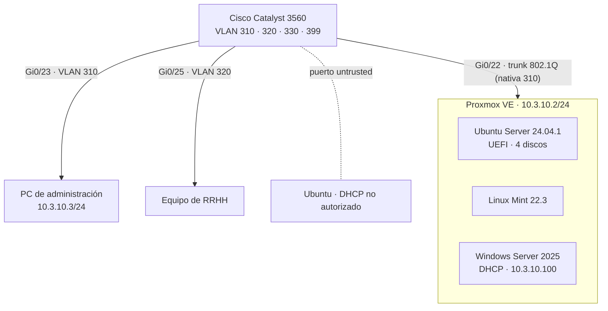

<div align="center">


# Grupo Sevilla · Proyecto intermodular

**Sistema informático empresarial para la sede de Grupo Sevilla SL**<br />
Ciclo Formativo de Grado Superior en Administración de Sistemas Informáticos en Red (ASIX) · Curso 2026–2027


<br />

<a href="Documentacion/Proyecto.md"></a>
<a href="Recursos/"></a>
<a href="https://trello.com/b/ZamItCqc/grupo-sevilla"></a>
<a href="Bitacora/"></a>

</div>

---

## Presentación

**Grupo Sevilla** es un equipo de seis estudiantes de 2.º de ASIX que diseña, despliega y documenta la infraestructura informática de una sede empresarial: **virtualización** con Proxmox VE, **segmentación de la red** con VLANs en un switch Cisco Catalyst 3560, **servidores Linux y Windows**, **DHCP** y **protección frente a servidores DHCP no autorizados**.

Este repositorio es el espacio de trabajo del grupo. Contiene la documentación técnica, los recursos (capturas y configuraciones) y la bitácora del proyecto.

## Integrantes

<table>
<tr>
<th align="center" width="33%">Coordinación<br /><sub>Jefe de proyecto</sub></th>
<th align="center" width="33%">Documentación<br /><sub>Secretario</sub></th>
<th align="center" width="33%">Área técnica<br /><sub>Responsable técnico</sub></th>
</tr>
<tr>
<td align="center"><a href="https://github.com/Yekiyey"><br /><b>Yeray Mico</b></a><br /><sub>@Yekiyey</sub></td>
<td align="center"><a href="https://github.com/hamzasouiad"><br /><b>Hamza Souiad</b></a><br /><sub>@hamzasouiad</sub></td>
<td align="center"><a href="https://github.com/Jhoel52"><br /><b>Jhoel Fuentes</b></a><br /><sub>@Jhoel52</sub></td>
</tr>
<tr>
<td align="center"><a href="https://github.com/Sh4raf-05"><br /><b>Sharaf El Mahfoudi</b></a><br /><sub>@Sh4raf-05</sub></td>
<td align="center"><a href="https://github.com/AliChan-ai"><br /><b>Ali Slatna</b></a><br /><sub>@AliChan-ai</sub></td>
<td align="center"><a href="https://github.com/raulllorcagomez"><br /><b>Raul Llorca</b></a><br /><sub>@raulllorcagomez</sub></td>
</tr>
</table>

Cada rol lo comparten dos integrantes, de modo que siempre hay un suplente si el titular no está. Las funciones de cada rol están en el [documento del proyecto](Documentacion/Proyecto.md#11-roles-y-responsables).

## Enlaces del proyecto

| Elemento | Enlace | Contenido |
|---|---|---|
| 📘 **Documento del proyecto** | [`Documentacion/Proyecto.md`](Documentacion/Proyecto.md) | Documentación técnica de todas las prácticas, con capturas y configuraciones |
| 🗂️ **Recursos a entregar** | [`Recursos/`](Recursos/) | Imágenes, configuraciones del switch y de los servidores, y scripts |
| 📋 **Gestión del proyecto** | [Tablero Trello](https://trello.com/b/ZamItCqc/grupo-sevilla) | Tareas: *Pendiente → En curso → En revisión → Hecho* |
| 📓 **Bitácora** | [Semanal](Bitacora/Semanal.md) · [Diaria](Bitacora/Diario/) | Registro del trabajo del grupo y de cada integrante |

## Prácticas

| Práctica | Bloque | Contenido | Estado |
|---|---|---|:---:|
| [1 · Organización del grupo de trabajo](Documentacion/Proyecto.md#práctica-1--organización-del-grupo-de-trabajo) | Fase 1 | Roles, herramientas, repositorio y bitácora | 🟡 Detalles pendientes |
| [2 · Proxmox VE y VLANs](Documentacion/Proyecto.md#práctica-2--proxmox-ve-y-vlans-en-el-cisco-3560) | Fase 1 | Hipervisor Proxmox, consola serie del 3560, VLANs, SVIs, trunk 802.1Q | ✅ |
| [3 · Despliegue de los equipos del laboratorio](Documentacion/Proyecto.md#práctica-3--despliegue-de-los-equipos-del-laboratorio) | Unidad 1 | Ubuntu Server en UEFI con cuatro discos; clientes Linux Mint | 🟡 Evidencias pendientes |
| [4 · Windows Server 2025, DHCP y DHCP Snooping](Documentacion/Proyecto.md#práctica-4--windows-server-2025-dhcp-y-dhcp-snooping) | Unidad 1 | Almacenamiento, TCP/IP, ámbito DHCP, DHCP fraudulento | 🟡 En curso |

## Infraestructura desplegada



| VLAN | Departamento | Red | Puerta de enlace |
|---:|---|---|---|
| 310 | Servidores | `10.3.10.0/24` | `10.3.10.1` |
| 320 | RRHH | `10.3.20.0/24` | `10.3.20.1` |
| 330 | Dirección | `10.3.30.0/24` | `10.3.30.1` |
| 399 | Gestión | `10.3.99.0/24` | `10.3.99.1` |

## Estructura del repositorio

```text
.
├── README.md                          # Portada: grupo, integrantes y enlaces
├── Documentacion/
│   └── Proyecto.md                    # Documento del proyecto (Prácticas 1–4)
├── Recursos/
│   ├── README.md
│   ├── Imagenes/
│   │   ├── logo/
│   │   ├── practica-2/                # Proxmox, PuTTY y Cisco 3560
│   │   ├── practica-3/                # Ubuntu Server y Linux Mint
│   │   └── practica-4/                # Windows Server 2025 y DHCP
│   ├── Configuraciones/
│   │   ├── cisco-3560/                # VLANs, SVIs, puertos y DHCP Snooping
│   │   ├── proxmox/                   # /etc/network/interfaces
│   │   └── ubuntu-dhcp-fraudulento/   # dhcpd.conf
│   └── Scripts/
└── Bitacora/
    ├── README.md                      # Normas y plantilla de la bitácora
    ├── Semanal.md                     # Registro semanal del grupo
    └── Diario/                        # Registro diario de cada integrante
```

## Normas de colaboración

- **Commits** en español, en imperativo y con prefijo: `docs:`, `feat:`, `fix:` o `chore:`. Ejemplo: `docs: añadir justificación de roles`.
- **Entregas:** el secretario hace un commit con el nombre de la práctica (por ejemplo, `Fase 1 Práctica 2`) y sube a Aules el enlace a ese commit.
- **Bitácora** actualizada al final de cada sesión (diaria) y de cada semana (semanal), en orden cronológico inverso.
- **Nombres de archivo** sin espacios ni tildes.
- **Revisión cruzada:** otro integrante revisa cada cambio relevante antes de validarlo.

<div align="center">

---

**Grupo Sevilla** · Proyecto intermodular · 2.º ASIX · Curso 2026–2027

</div>
