# Proyecto intermodular — Grupo Sevilla


**Curso:** 2026–2027  
**Ciclo:** 2.º ASIX  
**Fecha del documento:** 25 de septiembre de 2026  
**Repositorio:** [Grupo-Sevilla](https://github.com/AliChan-ai/Grupo-Sevilla)

---

## Índice

1. [Fase 2: Instalación y configuración de Proxmox y VLANs](#fase-2-instalación-y-configuración-de-proxmox-y-vlans)
   1. [Instalar y poner en funcionamiento Proxmox](#1-instalar-y-poner-en-funcionamiento-proxmox)
   2. [Direcciones IP y redes VLAN](#2-direcciones-ip-y-redes-vlan)
   3. [Conexión al Cisco 3560 mediante consola](#3-conexión-al-cisco-3560-mediante-consola)
   4. [Configuración de VLANs en el Cisco 3560](#4-configuración-de-vlans-en-el-cisco-3560)

---

# Fase 2: Instalación y configuración de Proxmox y VLANs

Tenemos que preparar el servidor de la sede para poder virtualizar varios servidores y clientes. Para ello, utilizaremos Proxmox.

## 1. Instalar y poner en funcionamiento Proxmox

Primero, vamos a instalar Proxmox VE en nuestro servidor para poder crear y gestionar máquinas virtuales.

### Pasos para arrancar desde un USB

1. Conectamos el USB que contiene el instalador de Proxmox al servidor.
2. Encendemos o reiniciamos el servidor y entramos en la BIOS/UEFI pulsando la tecla correspondiente (normalmente F2, F12, DEL o ESC).
3. Entramos en el menú **Boot** y seleccionamos el USB como dispositivo de arranque.
4. Guardamos los cambios y reiniciamos el servidor si es necesario.
5. Cuando arranque desde el USB, aparecerá el menú de instalación de Proxmox.
6. Seleccionamos **Install Proxmox VE** para comenzar con la instalación.

Una vez iniciado el instalador de Proxmox, aparecerá el acuerdo de licencia (EULA). Lo leeremos y aceptaremos para poder continuar con la instalación.

A continuación, el instalador nos pedirá configurar la cuenta de administrador. Tendremos que introducir un correo electrónico y crear una contraseña segura que utilizaremos para acceder a Proxmox. Es importante guardar estos datos para poder iniciar sesión más adelante.

Después, configuraremos la dirección IP del servidor para que tenga conectividad con los otros ordenadores de la red. También indicaremos la máscara de red, la puerta de enlace y el servidor DNS para asegurarnos de que la conexión funcione correctamente.

Por último, revisaremos el resumen de la configuración para comprobar que todos los datos sean correctos. Si todo está bien, pulsaremos **Install** para comenzar la instalación de Proxmox. Esperaremos a que termine y, una vez finalizada, reiniciaremos el servidor para empezar a utilizarlo.

### Capturas de la instalación

Las imágenes extraídas del PDF se guardan en `imagenes/`. Consulta esa carpeta para ver las capturas originales que se pudieron extraer del documento.

## 2. Direcciones IP y redes VLAN

Según el diagrama, nuestra sede utiliza la red `10.3.0.0/16` y tiene las siguientes VLAN:

| VLAN | Departamento | Red |
|---:|---|---|
| 310 | Servidores | `10.3.10.0/24` |
| 320 | RRHH | `10.3.20.0/24` |
| 330 | Dirección | `10.3.30.0/24` |
| 399 | Gestión | `10.3.99.0/24` |

## 3. Conexión al Cisco 3560 mediante consola

Primero, tendremos que instalar PuTTY en nuestro ordenador cliente. Este programa nos permitirá conectarnos al switch Cisco 3560 mediante una conexión por consola y ejecutar los comandos necesarios para configurarlo.

Antes de conectar el switch Cisco 3560 al ordenador, identificaremos dónde se encuentra el puerto serial o de consola. Para ello, utilizaremos la imagen de referencia incluida en las capturas para localizar el puerto correcto y conectar el cable de consola.

Una vez instalado PuTTY, conectaremos el cable de consola entre el ordenador y el switch. Después, abriremos el programa, seleccionaremos el tipo de conexión **Serial** e indicaremos el puerto COM correspondiente.

Una vez conectado el cable y configurados los parámetros en PuTTY, pulsaremos **Open** para establecer la conexión. Si todo está correcto, podremos acceder a la consola del switch Cisco 3560 y empezar a introducir los comandos necesarios para su configuración.

### Parámetros de conexión de PuTTY

En la configuración utilizada en el documento, seleccionamos el tipo de conexión **Serial**, indicamos el puerto `/dev/ttyUSB0` y establecemos una velocidad de **9600 baudios**. Después, pulsamos **Open** para acceder a la consola.

## 4. Configuración de VLANs en el Cisco 3560

Primero, entraremos en el modo de configuración del switch utilizando el comando:

```text
conf t
```

Luego, crearemos las VLAN necesarias y asignaremos un nombre a cada una para identificar los diferentes departamentos de la sede de Sevilla.

A continuación, veremos las interfaces disponibles en el switch Cisco 3560. Esta información nos permitirá identificar los puertos que utilizaremos para conectar el servidor Proxmox y los futuros equipos, y así poder asignar cada puerto a la VLAN correspondiente.

Una vez conectados al switch Cisco 3560 mediante PuTTY, configuramos las VLAN necesarias para la sede de Sevilla. Para ello, entramos en el modo de configuración global con el comando `conf t` y creamos cada VLAN con su número, nombre y red IP correspondiente:

- **VLAN 310 — Servidores:** `10.3.10.0/24`
- **VLAN 320 — RRHH:** `10.3.20.0/24`
- **VLAN 330 — Dirección:** `10.3.30.0/24`
- **VLAN 399 — Gestión:** `10.3.99.0/24`

> **Nota:** las redes indicadas documentan el esquema IP de cada VLAN. La creación de una VLAN en el switch no configura por sí sola una dirección IP ni el enrutamiento de esa red.

---

**Grupo Sevilla · Proyecto intermodular · 2.º ASIX · Curso 2026–2027**


## Imágenes extraídas del PDF


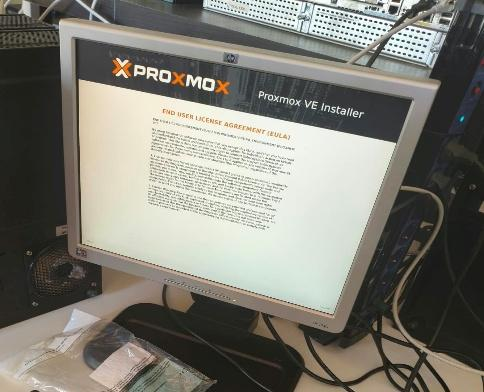

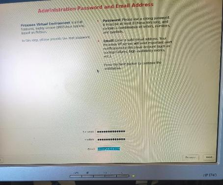

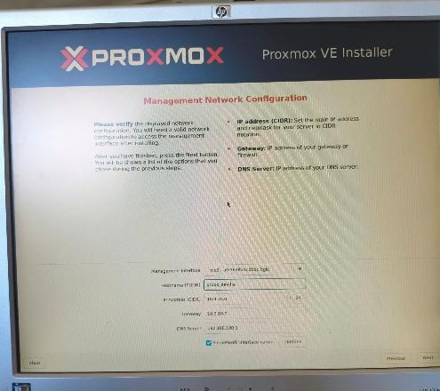

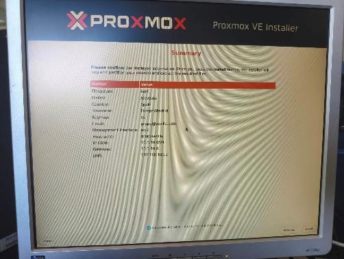

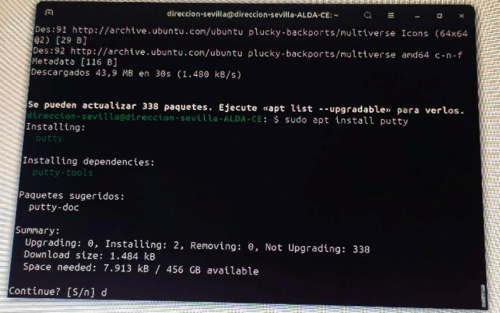

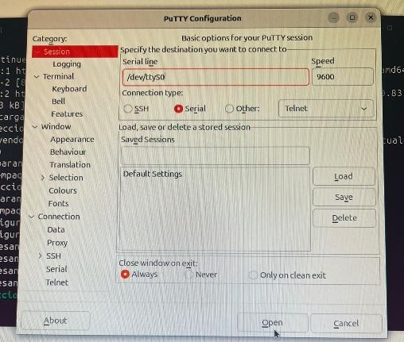

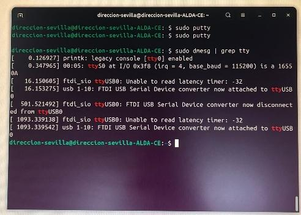

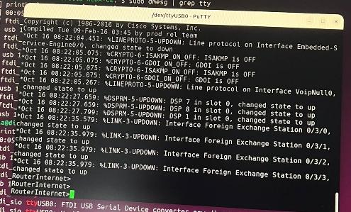

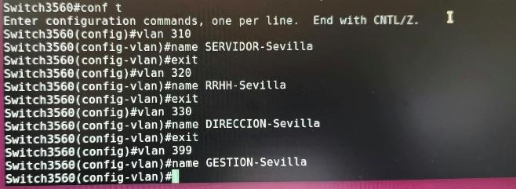

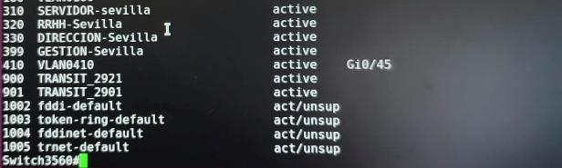

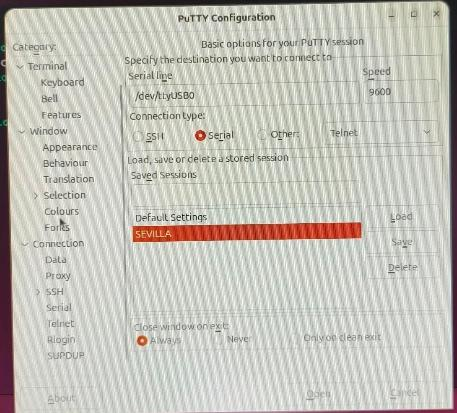

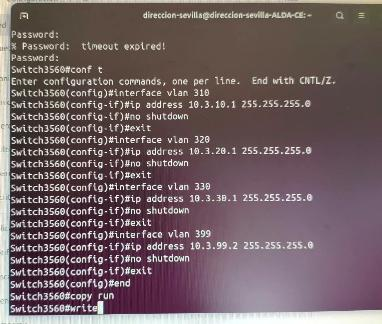

