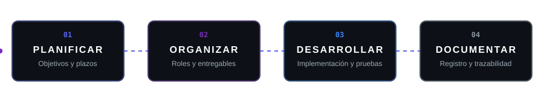

<picture>
  <source media="(prefers-color-scheme: dark)" srcset="./Documentacion/imagenes/cabecera_oscuro_2.svg"/>
  <source media="(prefers-color-scheme: light)" srcset="./Documentacion/imagenes/cabecera_claro_2.svg"/>
  
</picture>

 

 

[Presentación](#1-presentación) ·
[Equipo](#2-organización-del-equipo) ·
[Estructura](#3-estructura-del-repositorio) ·
[Metodología](#4-metodología-de-trabajo) ·
[Normas](#5-normas-de-colaboración) ·
[Trello](#6-gestión-de-tareas-trello)

## 1. Presentación

Somos **Grupo Sevilla**, seis alumnos de **2.º de ASIX** haciendo juntos el **Proyecto Intermodular** del curso 2026–2027.

En este repo guardamos todo lo del proyecto: la documentación que vamos entregando, los scripts y recursos que usamos y la bitácora con lo que vamos haciendo cada día.

## 2. Organización del equipo

Nos hemos repartido en **tres áreas** con **dos personas en cada una**. Así, si un día falta alguien, siempre hay otro que sabe cómo va su parte.

<table>
<tr>
<th align="center" width="33%"></th>
<th align="center" width="33%"></th>
<th align="center" width="33%"></th>
</tr>
<tr>
<td align="center" width="33%">
 
 
<b><a href="https://github.com/Yekiyey">Yeray Mico</a></b> 
 

  
</td>
<td align="center" width="33%">
 
 
<b><a href="https://github.com/hamzasouiad">Hamza Souiad</a></b> 
 

  
</td>
<td align="center" width="33%">
 
 
<b><a href="https://github.com/Jhoel52">Jhoel Fuentes</a></b> 
 

  
</td>
</tr>
<tr>
<td align="center" width="33%">
 
 
<b><a href="https://github.com/Sh4raf-05">Sharaf El Mahfoudi</a></b> 
 

  
</td>
<td align="center" width="33%">
 
 
<b><a href="https://github.com/AliChan-ai">Ali Slarna</a></b> 
 

  
</td>
<td align="center" width="33%">
 
 
<b><a href="https://github.com/raulllorcagomez">Raul Llorca</a></b> 
 

  
</td>
</tr>
</table>

<b>¿Qué hace cada área?</b>

 

| Área | Qué hace |
|:---|:---|
| **Coordinación** | Reparte las tareas, controla que lleguemos a los plazos y habla con los profes. |
| **Documentación** | Escribe y revisa los documentos, hace las actas y lleva la bitácora al día. |
| **Área técnica** | Monta y prueba la parte técnica del proyecto, y explica por qué usamos cada herramienta. |

## 3. Estructura del repositorio

 

&nbsp;

&nbsp;

 

| Carpeta / archivo | Qué hay dentro | Enlace |
|:---|:---|:---|
| 📓 **`Bitacora/`** | Lo que vamos haciendo, día a día y resumido por semanas. | [Semanal](./Bitacora/Semanal.md) · [Diario](./Bitacora/Diario/) |
| 📚 **`Documentacion/`** | Las entregas, cómo nos organizamos, por qué cada uno tiene su rol y qué herramientas usamos. | [Ver →](./Documentacion/) |
| 🛠️ **`Recursos/`** | Scripts, diagramas, imágenes y todo lo que vamos usando. | [Ver →](./Recursos/) |
| 📄 **`Como hacer bitacora`** | Cómo hay que rellenar la bitácora. Mírala antes de escribir la primera entrada. | En la raíz |
| 📘 **`README.md`** | Esto que estás leyendo. | — |

## 4. Metodología de trabajo

Trabajamos siempre igual: primero planificamos qué hay que hacer, nos lo repartimos, cada uno hace su parte y al final lo documentamos. Todo lo que se hace queda apuntado en la bitácora.

## 5. Normas de colaboración

Para que el repo no se convierta en un caos, seguimos estas normas:

<table width="100%">
<tr>
<th align="center" width="12%">N.º</th>
<th align="left" width="53%">Norma</th>
<th align="left" width="35%">Ejemplo</th>
</tr>
<tr>
<td align="center"></td>
<td align="left"><b>✍️ Commits claros</b> En <b>español</b>, en <b>imperativo</b> y con el formato <code>tipo: descripción</code>. Que se entienda qué has cambiado sin abrir el commit.</td>
<td align="left"><code>docs: añadir justificación de roles</code></td>
</tr>
<tr>
<td align="center"></td>
<td align="left"><b>🏷️ Prefijos</b> Cada commit empieza por uno de estos:  documentación &nbsp; algo nuevo  arreglo &nbsp; mantenimiento</td>
<td align="left"><code>feat: crear script de copia de seguridad</code></td>
</tr>
<tr>
<td align="center"></td>
<td align="left"><b>📓 Bitácora al día</b> Cada sesión se apunta en <code>Bitacora/Diario/</code> y luego se resume en <code>Bitacora/Semanal.md</code>.</td>
<td align="left"><code>Diario/</code> → <code>Semanal.md</code></td>
</tr>
<tr>
<td align="center"></td>
<td align="left"><b>🗂️ Nombres de archivo</b> <b>Sin espacios ni tildes</b>. Mejor con el formato <code>Nombre_Documento.md</code>.</td>
<td align="left">✅ <code>Justificacion_Roles.md</code> ❌ <code>Justificación roles.md</code></td>
</tr>
<tr>
<td align="center"></td>
<td align="left"><b>🔍 Revisión</b> Nada importante se da por bueno hasta que lo ha mirado <b>otro compañero</b>.</td>
<td align="left">Autor → Revisor → <b>Validado</b></td>
</tr>
</table>

## 6. Gestión de tareas (Trello)

Las tareas las llevamos en un tablero de **Trello** que compartimos todos. Cada tarjeta tiene quién se encarga, para cuándo es y en qué punto está.

 

 

2.º ASIX · Proyecto Intermodular · Curso 2026–2027

