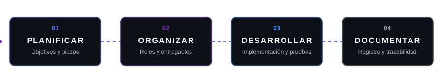

 

 

[Presentación](#1-presentación) ·
[Equipo](#2-organización-del-equipo) ·
[Estructura](#3-estructura-del-repositorio) ·
[Metodología](#4-metodología-de-trabajo) ·
[Normas](#5-normas-de-colaboración)

## 1. Presentación

**Grupo Sevilla** es un equipo formado por seis estudiantes de **2.º curso del ciclo formativo de Administración de Sistemas Informáticos en Red (ASIX)**, que desarrolla de manera conjunta el **Proyecto Intermodular** correspondiente al curso académico 2026–2027.

El presente repositorio constituye el espacio central de trabajo del grupo. En él se recogen la documentación oficial, los recursos técnicos empleados y el seguimiento continuo de la evolución del proyecto.

## 2. Organización del equipo

El equipo se estructura en **tres áreas de responsabilidad**, cada una a cargo de dos integrantes, con el fin de garantizar el apoyo mutuo y la continuidad del trabajo.

<table>
<tr>
<th align="center" width="33%"></th>
<th align="center" width="33%"></th>
<th align="center" width="33%"></th>
</tr>
<tr>
<td align="center" width="33%">
 
 
<b><a href="https://github.com/Yekiyey">Yeray Mico</a></b> 
 

  
</td>
<td align="center" width="33%">
 
 
<b><a href="https://github.com/hamzasouiad">Hamza Souiad</a></b> 
 

  
</td>
<td align="center" width="33%">
 
 
<b><a href="https://github.com/Jhoel52">Jhoel Fuentes</a></b> 
 

  
</td>
</tr>
<tr>
<td align="center" width="33%">
 
 
<b><a href="https://github.com/Sh4raf-05">Sharaf El Mahfoudi</a></b> 
 

  
</td>
<td align="center" width="33%">
 
 
<b><a href="https://github.com/AliChan-ai">Ali Slarna</a></b> 
 

  
</td>
<td align="center" width="33%">
 
 
<b><a href="https://github.com/raulllorcagomez">Raul Llorca</a></b> 
 

  
</td>
</tr>
</table>

<b>Funciones de cada área</b>

 

| Área | Funciones principales |
|:---|:---|
| **Coordinación** | Planificación general, asignación de tareas, control de plazos y comunicación con el equipo docente. |
| **Documentación** | Redacción y revisión de documentos, elaboración de actas, mantenimiento de la bitácora y control de calidad documental. |
| **Área técnica** | Diseño, implementación y pruebas de la solución técnica, así como la selección y justificación de las herramientas. |

## 3. Estructura del repositorio

 

&nbsp;

&nbsp;

 

| Elemento | Contenido | Acceso |
|:---|:---|:---|
| 📓 **`Bitacora/`** | Historial del trabajo realizado y seguimiento de la evolución del proyecto. | [Semanal](./Bitacora/Semanal.md) · [Diario](./Bitacora/Diario/) |
| 📚 **`Documentacion/`** | Documentos principales, organización del equipo, justificación de roles y herramientas seleccionadas. | [Consultar →](./Documentacion/) |
| 🛠️ **`Recursos/`** | Scripts, diagramas, imágenes y materiales utilizados durante el proyecto. | [Consultar →](./Recursos/) |
| 📄 **`Como hacer bitacora`** | Guía de referencia para el correcto registro de la bitácora. | En la raíz del repositorio |
| 📘 **`README.md`** | Presentación general del proyecto y del equipo. | Este documento |

## 4. Metodología de trabajo

El grupo trabaja siguiendo un ciclo continuo de cuatro fases. Cada integrante contribuye desde su área de responsabilidad y todas las actuaciones quedan registradas en la bitácora.

## 5. Normas de colaboración

Con objeto de mantener el repositorio ordenado y coherente, se establecen las siguientes pautas:

<table width="100%">
<tr>
<th align="center" width="12%">N.º</th>
<th align="left" width="53%">Norma</th>
<th align="left" width="35%">Ejemplo</th>
</tr>
<tr>
<td align="center"></td>
<td align="left"><b>✍️ Commits claros</b> Mensajes descriptivos, redactados en <b>español</b> y en <b>modo imperativo</b>, con el formato <code>tipo: descripción</code>.</td>
<td align="left"><code>docs: añadir justificación de roles</code></td>
</tr>
<tr>
<td align="center"></td>
<td align="left"><b>🏷️ Prefijos normalizados</b> Todo commit comienza con un prefijo que indica su naturaleza:  documentación &nbsp; nueva funcionalidad  corrección &nbsp; mantenimiento</td>
<td align="left"><code>feat: crear script de copia de seguridad</code></td>
</tr>
<tr>
<td align="center"></td>
<td align="left"><b>📓 Bitácora al día</b> Cada sesión de trabajo se registra en <code>Bitacora/Diario/</code> y se resume semanalmente en <code>Bitacora/Semanal.md</code>.</td>
<td align="left"><code>Diario/</code> → <code>Semanal.md</code></td>
</tr>
<tr>
<td align="center"></td>
<td align="left"><b>🗂️ Nomenclatura de archivos</b> Nombres <b>sin espacios ni tildes</b>, preferiblemente con el formato <code>Nombre_Documento.md</code>.</td>
<td align="left">✅ <code>Justificacion_Roles.md</code> ❌ <code>Justificación roles.md</code></td>
</tr>
<tr>
<td align="center"></td>
<td align="left"><b>🔍 Revisión cruzada</b> Los cambios relevantes son revisados por, <b>al menos, otro integrante</b> antes de darse por validados.</td>
<td align="left">Autor → Revisor → <b>Validado</b></td>
</tr>
</table>

 

2.º ASIX · Proyecto Intermodular · Curso 2026–2027

